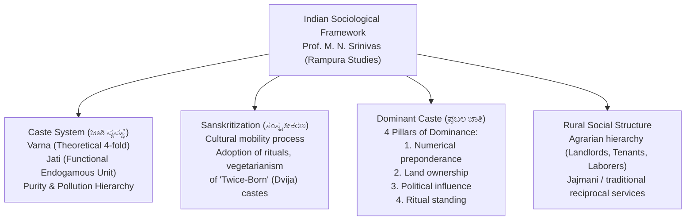

# Indian Social System: Caste, Sanskritization, Dominant Caste and Rural Structure (ಭಾರತೀಯ ಸಾಮಾಜಿಕ ವ್ಯವಸ್ಥೆ: ಜಾತಿ, ಸಂಸ್ಕೃತೀಕರಣ, ಪ್ರಬಲ ಜಾತಿ ಮತ್ತು ಗ್ರಾಮೀಣ ರಚನೆ)

> [!exam-focus]
> **Exam Weightage & Testing Patterns**: Integral component of Mains GS-1 Section 2 (Social and Political Perspective, 15-mark questions) and Prelims Paper 1 (Humanities: Social Sector & Demographics).
> - **Prelims Traps**: Confusing M. N. Srinivas's concepts of *Sanskritization* (cultural/ritual mobility) with *Dominant Caste* (structural/political power); confusing Jati (endogamous occupational group, thousands in number) with Varna (fourfold scriptural division).
> - **Mains Dimensions**: Dynamics of agrarian social stratification in rural Karnataka; how democratic franchise and land reforms transformed the status of intermediate castes into dominant castes; changing role of the joint family under urbanization.

---

## 1. Sociological Concepts & Theoretical Framework

The diagram above details the seminal sociological models pioneered by world-renowned Indian sociologist Prof. M. N. Srinivas (based on his field work in Rampura village, Mandya district, Karnataka), explaining the dual axes of ritual hierarchy and secular power in rural society.

---

## 2. The Caste System: Structure, Functions and Mobility

### 2.1 Varna versus Jati
- **Varna (ವರ್ಣ)**: A pan-Indian, scriptural, fourfold theoretical division (*Brahmana, Kshatriya, Vaishya, Shudra*), alongside the excluded Untouchables / Dalits (*Avarna / Panchama*). Static and rigid in textual tradition.
- **Jati (ಜಾತಿ)**: The local, practical, endogamous operational social unit. Over 3,000 distinct Jatis exist across India, each associated with traditional hereditary occupations, regional food taboos, and marriage boundaries.

### 2.2 Prof. M. N. Srinivas's Core Sociological Breakthroughs
Prof. **M. N. Srinivas (ಎಂ. ಎನ್. ಶ್ರೀನಿವಾಸ್: 1916–1999)** conducted extensive ethnographic fieldwork in **Rampura village (ಮಂಡ್ಯ ಜಿಲ್ಲೆಯ ರಾಂಪುರ)**, producing the classic text *The Remembered Village* (1976) and revolutionizing Indian sociology:

#### 1. Sanskritization (ಸಂಸ್ಕೃತೀಕರಣ)
- **Definition**: *"A process by which a 'low' Hindu caste, or tribal or other group, changes its customs, ritual, ideology, and way of life in the direction of a high, and frequently, 'twice-born' (Dvija) caste."*
- **Mechanism**: Lower or intermediate castes adopt vegetarianism, teetotalism, wear the sacred thread (*Yajnopavita*), emulate Vedic rituals, and change caste nomenclature to claim higher status in the local hierarchy.
- **Limitation**: Leads only to **positional mobility** of a particular caste within the existing hierarchy; it does **not** alter the structural hierarchy of the caste system itself.

#### 2. The Concept of Dominant Caste (ಪ್ರಬಲ ಜಾತಿ ಸಿದ್ಧಾಂತ)
- Srinivas demonstrated that secular power often matters more than ritual purity in village life.
- **Four Defining Criteria of a Dominant Caste**:
  1. **Numerical Strength**: Constituting a sizable demographic proportion of the local population.
  2. **Economic Power**: Owning a preponderant share of the arable agricultural land in the village or region.
  3. **Political Power**: Holding elected offices (Panchayat leadership, MLAs) and exercising decisive clout in dispute settlement.
  4. **High/Intermediate Ritual Status**: Positioned reasonably high in the local hierarchy (not at the bottom).
- **Dominant Castes in Karnataka**: **Lingayats (ಲಿಂಗಾಯತರು)** in Northern and Central Karnataka and **Vokkaligas (ಒಕ್ಕಲಿಗರು)** in Southern Karnataka, who emerged as decisive political and economic forces following post-1956 state integration and the 1974 land reforms.

---

## 3. Rural Social Structure and Agrarian Relations

### 3.1 Agrarian Social Stratification
1. **Landed Gentry / Rich Peasants**: Own substantial landholdings, employ wage laborers, control cooperative banks and Agricultural Produce Market Committees (APMCs).
2. **Small & Marginal Farmers**: Own small plots (below 2 hectares); rely on family labor; vulnerable to monsoon failures and institutional debt.
3. **Agricultural Laborers (ಕೃಷಿ ಕೂಲಿ ಕಾರ್ಮಿಕರು)**: Landless families dependent entirely on daily wage labor; historically from SC, ST, and Most Backward communities.

### 3.2 The Joint Family & Marriage Dynamics
- **Joint Family (ಅವಿಭಕ್ತ ಕುಟುಂಬ)**: Three or more generations residing under one roof, sharing a common hearth, common property, common worship, and reciprocal obligations.
- **Contemporary Transformation**: Industrialization, urban migration, and nuclearization of households are replacing joint families with **Nuclear Families (ವಿಭಕ್ತ ಕುಟುಂಬ)**, leading to emerging challenges such as care for the elderly (*geriatric care*) and erosion of kinship safety nets.
- **Marriage Rules**: Endogamy (marrying within one's Jati) remains resilient, while exogamy (*Gotra, Pravara, and Sapinda* restrictions) governs sub-clan boundaries. Consanguineous marriages (maternal uncle-niece and cross-cousin marriages) historically prevalent in southern Karnataka are witnessing gradual decline with higher female education.

---

## 4. Related Vault Notes
- [[Karnataka_Unification_and_Social_Movements]] — Dalit, backward class, and farmer mobilizations.
- [[Social_Welfare_and_Justice_Karnataka]] — State constitutional and institutional protections.
- [[Panchayati_Raj_and_Decentralization_Karnataka]] — Power dynamics in Grama Panchayats.

---

## 5. Likely Questions & Verbatim PYQs

### Prelims Multiple-Choice Questions
- **PYQ (KPSC KAS 2017 Prelims P1)**: The famous sociological concept of "Sanskritization" explaining cultural mobility in the Indian caste system was formulated by which scholar?
  - (A) G. S. Ghurye
  - (B) M. N. Srinivas [Correct]
  - (C) S. C. Dube
  - (D) Andre Beteille
- **PYQ (KPSC KAS 2020 Prelims P1)**: Which of the following is NOT one of the defining criteria of a "Dominant Caste" as outlined by Prof. M. N. Srinivas?
  - (A) Numerical strength in the local population
  - (B) Ownership of a major share of agricultural land
  - (C) Hereditary monopoly over religious priesthood [Correct - Priesthood is not a requirement]
  - (D) Political dominance and dispute adjudication clout
- **Expected Question (Prelims 2026)**: In which classic sociological work did Prof. M. N. Srinivas document the village life and social dynamics of Rampura in Karnataka?
  - *Answer*: *The Remembered Village* (1976).

### Mains Analytical Question & Answer Outline
- **Mains GS-1 Question**: *"Examine the concept of 'Dominant Caste' propounded by M. N. Srinivas and discuss its role in shaping contemporary political dynamics in Karnataka." (15 Marks / 250 Words)*
  - **Introduction**: Introduce Prof. M. N. Srinivas as Karnataka's preeminent sociologist; define the concept of Dominant Caste as an intermediate caste group combining numerical preponderance, landed wealth, and political leverage to dominate local village affairs.
  - **The Four Determinants**: Numerical weight; control over agricultural land; political influence; respectable ritual standing.
  - **Application to Karnataka Politics**:
    - *Bipolar Hegemony*: Lingayats in the north/central districts and Vokkaligas in the southern districts emerged as classic dominant castes post-unification (1956).
    - *Economic Muscle via Land Reforms*: While Devaraj Urs' 1974 land reforms broke feudal Brahmin and absentee landlordism, it empowered tenant cultivators from intermediate dominant groups who became proprietary landholders.
    - *Control over Rural Institutions*: Dominant caste networks command Village Panchayats, APMC yards, Taluk marketing federations, and sugar cooperatives, acting as gatekeepers of rural vote banks.
  - **Counter-Mobilizations & Recent Shifts**: Rise of the AHINDA coalition (Alpasankhyataru, Hindulidavaru, Dalitaru - Minorities, Backward Classes, Dalits) under Devaraj Urs and Siddaramaiah, challenging dominant caste hegemony and asserting proportional socio-political power.
  - **Conclusion**: Conclude that while Sanskritization was cultural emulation, the Dominant Caste phenomenon demonstrates the triumph of secular democratic and economic power over classical ritual orthodoxy.

---

> [!summary] Quick Revision Box (10 Non-Negotiable Facts)
> 1. **M. N. Srinivas**: Formulated Sanskritization, Dominant Caste, and Westernization.
> 2. **Rampura Village**: Fieldwork site in Mandya district immortalized in *The Remembered Village*.
> 3. **Sanskritization**: Positional cultural mobility adopting rituals of Twice-Born castes.
> 4. **Dominant Caste 4 Pillars**: Numerical weight, landed wealth, political power, respectable ritual status.
> 5. **Karnataka Dominant Castes**: Lingayats (North/Central) and Vokkaligas (South).
> 6. **Jati vs Varna**: Jati is local endogamous functional unit; Varna is 4-fold textual division.
> 7. **Joint Family Transition**: Nuclearization driven by industrialization and urban labor mobility.
> 8. **AHINDA Movement**: Counter-coalition of Minorities, Backwards, and Dalits challenging dominant castes.
> 9. **Agrarian Stratification**: Landed gentry -> Small/marginal farmers -> Landless agricultural laborers.
> 10. **Positional vs Structural Mobility**: Sanskritization alters group position, not systemic hierarchy.
