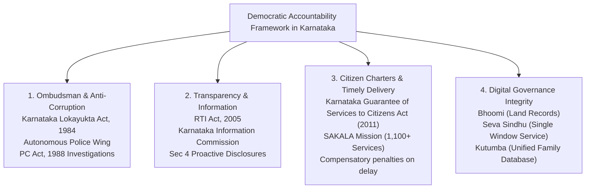
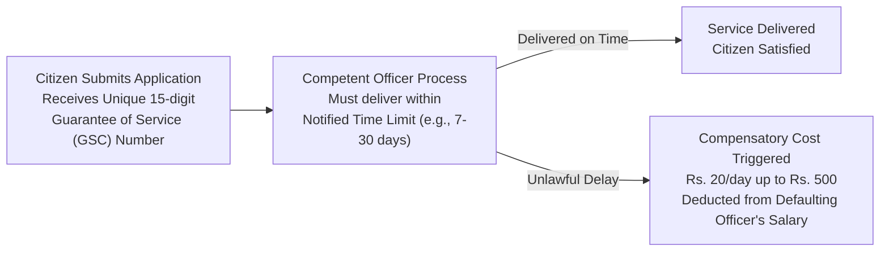

# Institutional Accountability, Karnataka Lokayukta, RTI and SAKALA (ಸಾಂಸ್ಥಿಕ ಹೊಣೆಗಾರಿಕೆ, ಕರ್ನಾಟಕ ಲೋಕಾಯುಕ್ತ, ಮಾಹಿತಿ ಹಕ್ಕು ಮತ್ತು ಸಕಾಲ)

> [!exam-focus]
> **Exam Weightage & Testing Patterns**: High-frequency topic in Mains GS-2 Section 3 (Public Administration & Accountability) and GS-4 Section 3 (Probity in Governance), generating 10 to 15-mark questions consistently. Also yields 2-3 MCQs in Prelims Paper 1.
> - **Prelims Traps**: Confusing the appointment committee of Karnataka Lokayukta with the national Lokpal committee; mixing up the RTI time limits (normal 30 days vs 48 hours for life and liberty vs 35 days when APIO is involved); confusing Sakala compensatory penalties (awarded to citizen from defaulting officer's salary) with disciplinary action.
> - **Mains Dimensions**: The historic 2022 Karnataka High Court verdict quashing the executive Anti-Corruption Bureau (ACB) and restoring investigative powers to the Lokayukta; assessing SAKALA's impact on reducing petty bureaucratic corruption; e-governance platforms (Bhoomi, Seva Sindhu, Kutumba) as transparency tools.

---

## 1. Accountability Framework Overview

The diagram above illustrates Karnataka's integrated accountability ecosystem: the punitive anti-corruption machinery of the Lokayukta, the citizen-empowerment transparency of the RTI Act, statutory time-bound service delivery via SAKALA, and algorithmic transparency through statewide e-governance portals.

---

## 2. The Karnataka Lokayukta (ಕರ್ನಾಟಕ ಲೋಕಾಯುಕ್ತ)

### 2.1 Statutory Genesis & Composition
- **Legislation**: Enacted under the **Karnataka Lokayukta Act, 1984** during the tenure of Chief Minister Ramakrishna Hegde; hailed as the strongest state ombudsman legislation in India.
- **Composition**: Consists of the **Lokayukta** (must be a retired Judge of the Supreme Court of India or a retired Chief Justice of a High Court) and one or more **Upa-Lokayuktas** (retired High Court Judges).
- **Appointment Committee (ನೇಮಕಾತಿ ಸಮಿತಿ)**: The Governor appoints the Lokayukta on the binding unanimous or majority advice of a six-member committee:
  1. Chief Minister (Presides)
  2. Chief Justice of the Karnataka High Court
  3. Chairman of the Karnataka Legislative Council
  4. Speaker of the Karnataka Legislative Assembly
  5. Leader of the Opposition in the Legislative Council
  6. Leader of the Opposition in the Legislative Assembly
- **Tenure**: Fixed term of **5 years**; ineligible for reappointment or any other government employment thereafter.
- **Removal**: Removed by the Governor only on the ground of proven misbehavior or incapacity following an address passed by a two-thirds majority of both houses of the State Legislature.

### 2.2 Powers, Jurisdiction & Operational Wings
- **Jurisdiction**: Covers the Chief Minister, all State Cabinet Ministers, Members of the State Legislature (MLAs/MLCs), and all public servants/officials across state corporations, boards, and local bodies.
- **Twin Statutory Mandate**:
  1. *Grievances (ಕುಂದುಕೊರತೆಗಳು)*: Inquiring into administrative injustice, malice, or delay affecting a citizen.
  2. *Allegations (ಆರೋಪಗಳು)*: Investigating criminal corruption, abuse of official position, and disproportionate assets.
- **Autonomous Police Wing (ಸ್ವತಂತ್ರ ಪೊಲೀಸ್ ವಿಭಾಗ)**:
  - Headed by an officer not below the rank of Additional Director General of Police (ADGP).
  - Declared a statutory police station under the Code of Criminal Procedure (CrPC / BNSS), empowered to register First Information Reports (FIRs), conduct independent search-and-seizure raids, and prosecute corrupt officials under the **Prevention of Corruption Act, 1988 (PC Act)** without prior state cabinet interference.

### 2.3 The ACB Controversy & Historic High Court Verdict (August 2022)
- In March 2016, the State Government issued an executive order stripping the Lokayukta Police Wing of its PC Act investigative powers and creating an executive **Anti-Corruption Bureau (ACB)** reporting directly to the Chief Minister.
- **Historic Verdict (11 August 2022)**: A division bench of the Karnataka High Court (*B. S. Patil & Chidananda v. State of Karnataka*) quashed the creation of the ACB as unconstitutional and ultra vires, declaring that an executive bureau answerable to political masters cannot replace an independent statutory watchdog. All pending cases, investigations, and police powers were fully **restored to the Karnataka Lokayukta**.

### 2.4 Legendary Lokayukta Interventions
1. **Justice N. Venkatachala (2001–2006)**: Champion of on-the-spot surprise inspections; stormed government district hospitals, sub-registrar offices, and RTO checkpoints; created unprecedented public trust.
2. **Justice N. Santosh Hegde (2006–2011)**: Published the landmark **Bellary Illegal Mining Report (2011)**, uncovering illegal iron ore exports causing over Rs. 16,000 crore revenue loss to the state exchequer, leading to the indictment and resignation of sitting Chief Minister B. S. Yediyurappa.

---

## 3. Right to Information Act, 2005 (ಮಾಹಿತಿ ಹಕ್ಕು ಕಾಯ್ದೆ)

- **Constitutional Foundation**: Derived from **Article 19(1)(a)** (Freedom of Speech and Expression includes the Right to Know) as ruled in *State of UP v. Raj Narain (1975)* and *SP Gupta v. Union of India (1982)*.
- **Core Statutory Mechanics**:
  - *Public Authority (Section 2(h))*: Any body created by the Constitution, statute, or substantially funded by government.
  - *Proactive Disclosure (Section 4(1)(b))*: Mandates all public authorities to publish 17 manuals of information within 120 days of enactment.
  - *Application (Section 6)*: Any Indian citizen can apply in writing or electronically accompanied by prescribed fee (Rs. 10; BPL applicants exempt). No reason for seeking information need be given.
- **Statutory Timelines (Section 7)**:
  - **30 Days**: Normal disposal timeline.
  - **48 Hours**: If the information sought concerns the **Life or Liberty (ಜೀವ ಅಥವಾ ವೈಯಕ್ತಿಕ ಸ್ವಾತಂತ್ರ್ಯ)** of an individual.
  - **35 Days**: Where application is submitted via an Assistant Public Information Officer (APIO).
  - *Failure*: Deemed refusal; Information must be provided free of cost thereafter.
- **Exemptions (Section 8)**: National security, sovereignty, contempt of court, cabinet papers before decision, trade secrets, fiduciary relationships, and unwarranted invasion of personal privacy. Overridden by **Public Interest** test under Section 8(2).
- **Karnataka Information Commission (KIC / ಕರ್ನಾಟಕ ಮಾಹಿತಿ ಆಯೋಗ)**:
  - Constituted under Section 15; consists of State Chief Information Commissioner (SCIC) and up to 10 State Information Commissioners (SICs).
  - Can impose penalties of **Rs. 250 per day up to a maximum of Rs. 25,000** on defaulting Public Information Officers (PIOs).

---

## 4. The SAKALA Mission: Karnataka Guarantee of Services to Citizens Act, 2011

- **Pioneering Context**: Enacted by the Karnataka Legislature in December 2011 (operationalized across the state in April 2012) under the visionary tagline ***"ನಿಮ್ಮ ಹಕ್ಕು, ನಮ್ಮ ಸೇವೆ"*** ("Your Right, Our Service").
- **Statutory Mandate**: Every citizen is statutorily entitled to receive notified public services within the legally stipulated time limits.
- **Operational Scale**: Currently covers **over 1,115 services across 31 government departments** (e.g., caste and income certificates, building plan approvals, driving licenses, revenue RTCs, police verification).

The diagram above details the operational workflow of SAKALA, highlighting how the 15-digit GSC number tracks file movement and enforces financial compensation against bureaucratic lethargy.

- **Accountability Mechanisms**:
  1. *Unique Guarantee of Services (GSC) Number*: System-generated SMS tracking number given to citizen at counter.
  2. *Two-Tier Appeal Process*: First Appeal Officer (FAO) within 30 days; Second Appeal Officer (SAO) within 30 days.
  3. *Compensatory Cost (ಪರಿಹಾರ ಧನ)*: If service is delayed without valid reason, the SAO orders compensatory cost (Rs. 20 per day up to Rs. 500) to be paid to the citizen, **deducted directly from the salary of the defaulting government official**.

---

## 5. Landmark E-Governance Platforms in Karnataka

1. **Bhoomi Project (ಭೂಮಿ ಯೋಜನೆ, 2000)**: First digitized land records management system in India; eliminated the monopoly of village accountants (*Village Patwaris*), providing biometric tamper-proof RTCs (Record of Rights, Tenancy and Crops) to over 70 lakh farmers. Received the Commonwealth Innovation Award.
2. **KAVERI 2.0 (ಕಾವೇರಿ 2.0, 2023)**: Modernized web-based registration platform for immovable property registration in Sub-Registrar offices, eliminating touts through facial recognition, Aadhaar authentication, and pre-booking slots.
3. **Seva Sindhu (ಸೇವಾ ಸಿಂಧು)**: Centralized digital citizen services portal integrating over 800+ state government schemes; served as the single operational gateway for DBT cash transfers and benefit registrations under the **Five Guarantee Schemes** (Gruha Lakshmi, Gruha Jyothi, Yuva Nidhi).
4. **Kutumba (ಕುಟುಂಬ ಯೋಜನಾ ದತ್ತಾಂಶ)**: Unified dynamic social registry linking family IDs with Aadhaar, caste, land, and income data, enabling automatic proactive delivery of welfare schemes without requiring citizens to re-submit identity papers repeatedly.

---

## 6. Related Vault Notes
- [[Indian_Constitutional_System]] — Fundamental rights, writ remedies under Article 32 & 226.
- [[Panchayati_Raj_and_Decentralization_Karnataka]] — Grassroots delivery through Grama Panchayats.
- [[Probity_in_Governance_and_Public_Funds]] — Ethical administration and anti-corruption frameworks.

---

## 7. Likely Questions & Verbatim PYQs

### Prelims Multiple-Choice Questions
- **PYQ (KPSC KAS 2017 Prelims P1)**: Under the Right to Information Act, 2005, what is the mandatory time period within which information concerning the "life or liberty" of an individual must be provided?
  - (A) 24 Hours
  - (B) 48 Hours [Correct]
  - (C) 7 Days
  - (D) 30 Days
- **PYQ (KPSC KAS 2020 Prelims P1)**: Under the Karnataka Guarantee of Services to Citizens Act, 2011 (SAKALA), the compensatory cost awarded to an aggrieved citizen for delayed public service is:
  - (A) Paid out of the Chief Minister's Relief Fund
  - (B) Deducted directly from the salary of the defaulting government official [Correct]
  - (C) Paid by the State Information Commission
  - (D) Adjusted against future property taxes
- **Expected Question (Prelims 2026)**: In August 2022, a division bench of the Karnataka High Court passed a landmark verdict quashing which of the following executive agencies and restoring full police investigative powers to the Karnataka Lokayukta?
  - *Answer*: Anti-Corruption Bureau (ACB / ಭ್ರಷ್ಟಾಚಾರ ನಿಗ್ರಹ ದಳ).

### Mains Analytical Question & Answer Outline
- **Mains GS-2 Question**: *"Assess the institutional efficacy of the Karnataka Lokayukta as an anti-corruption ombudsman in light of the 2022 Karnataka High Court judgment restoring its police powers." (15 Marks / 250 Words)*
  - **Introduction**: Outline the statutory genesis of the Karnataka Lokayukta Act, 1984, as India's premier model ombudsman; mention the six-year dilution (2016–2022) when the executive ACB undermined its autonomy.
  - **The 2022 Judicial Correction**: The Karnataka High Court bench struck down the 2016 government notification creating the ACB, observing that an executive police bureau subject to the discretion of political executives cannot independently investigate top politicians and bureaucrats.
  - **Factors Underpinning Lokayukta Efficacy**:
    - *Independent Police Wing*: Statutory police station powers under the CrPC/BNSS to trap, arrest, raid, and prosecute under the PC Act without prior sanction for preliminary inquiry.
    - *Transparent Appointment Mechanism*: Six-member multi-partisan selection committee including the Chief Justice and Opposition leaders, insulating appointments from ruling party bias.
    - *Dual Grievance Redressal*: Power to investigate both corruption (*allegations*) and maladministration (*grievances*).
  - **Operational Impediments & The Road Ahead**: Vacancies in judicial and investigative posts; delays in government according sanction for prosecution; need for specialized courts for speedy trial within one year.
  - **Conclusion**: Emphasize that institutional integrity requires statutory permanence, financial autonomy, and protection from executive circumvention to serve as an effective deterrent against systemic graft.

---

> [!summary] Quick Revision Box (10 Non-Negotiable Facts)
> 1. **Karnataka Lokayukta Act, 1984**: Enacted under CM Ramakrishna Hegde; model ombudsman.
> 2. **Lokayukta Qualification**: Retired Supreme Court Judge or retired Chief Justice of High Court.
> 3. **Appointment Committee**: 6 Members (CM, Chief Justice of HC, Council Chairman, Speaker, 2 Opposition Leaders).
> 4. **August 2022 HC Verdict**: Quashed ACB; restored complete independent police powers to Lokayukta.
> 5. **RTI Act (2005) - Life & Liberty**: 48-hour mandatory compliance window (Sec 7(1)).
> 6. **RTI Maximum Penalty**: Rs. 250/day up to Rs. 25,000 on defaulting PIO (Sec 20).
> 7. **SAKALA Act, 2011**: Enforces time-bound delivery across 1,115+ public services.
> 8. **SAKALA Compensatory Penalty**: Rs. 20/day up to Rs. 500, deducted from defaulting officer's salary.
> 9. **Bhoomi Project (2000)**: Pioneer digital land records system delivering tamper-proof RTCs.
> 10. **Seva Sindhu**: Integrated portal delivering direct citizen services and Guarantee scheme DBT.
