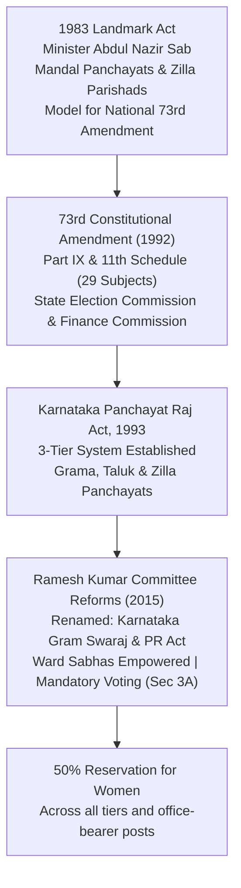
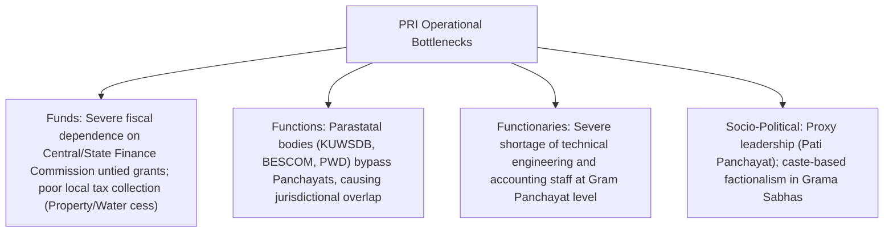

# Panchayati Raj System and Democratic Decentralization in Karnataka (ಕರ್ನಾಟಕದಲ್ಲಿ ಪಂಚಾಯತ್ ರಾಜ್ ಮತ್ತು ಪ್ರಜಾಸತ್ತಾತ್ಮಕ ವಿಕೇಂದ್ರೀಕರಣ)

> [!exam-focus]
> **Exam Weightage & Testing Patterns**: One of the most distinctive focus areas in KPSC exams. Accounts for 2-4 MCQs in Prelims and consistently yields a dedicated 15-mark question in Mains GS-2 Section 2.
> - **Prelims Traps**: Confusing Karnataka's 1983 Act (Mandal Panchayats & Zilla Parishads under Nazir Sab) with the 1993 Act (3-tier PRIs); confusing the constitutional minimum women reservation (33% under Article 243D) with Karnataka's statutory provision (**50% for women**); confusing Grama Sabha with Ward Sabha.
> - **Mains Dimensions**: Operationalizing Mahatma Gandhi's concept of *Gram Swaraj* via the 2015 Ramesh Kumar Committee reforms; devolution of the 3 F's (Funds, Functions, Functionaries); structural bottlenecks facing Panchayats (over-dependence on state grants, proxy leadership / *Sarpanch Pati* syndrome).

---

## 1. Decentralization Evolution in Karnataka

The flowchart above traces Karnataka's leadership in local self-governance: from pioneering the Nazir Sab model in 1983 to aligning with the 73rd Constitutional Amendment in 1993 and enacting radical grassroots participatory reforms under the 2015 Gram Swaraj amendments.

---

## 2. Historical Genesis: The Abdul Nazir Sab Revolution (1983)

- **The Pioneer**: Minister for Rural Development **Abdul Nazir Sab (ಅಬ್ದುಲ್ ನಜೀರ್ ಸಾಬ್)**, affectionately remembered as **"Neer Sab" (ನೀರ್ ಸಾಬ್)** for his mission to provide piped drinking water to every village, conceptualized real power devolution under Chief Minister Ramakrishna Hegde.
- **Karnataka Zilla Parishads, Taluk Panchayat Samithis, Mandal Panchayats and Nyaya Panchayats Act, 1983** (received presidential assent in 1985):
  - Created a unique **two-tier operational model**: **Mandal Panchayats** (group of villages with 8,000–12,000 population) and powerful **Zilla Parishads** headed by an elected Adhyaksha with the status of a Minister of State, served by an IAS officer as Chief Secretary.
  - Pioneered **25% reservation for women** and representation for SC/STs a decade before the 73rd Amendment.
  - This Karnataka model served as the blueprint for the national **L. M. Singhvi Committee (1986)** and **P. K. Thungon Committee (1988)**, which culminated in the 73rd Constitutional Amendment Act, 1992.

---

## 3. The 73rd Constitutional Amendment Act (1992)

- Inserted **Part IX (Articles 243 to 243O)** and the **Eleventh Schedule (29 Functional Subjects)** into the Constitution of India.
- **Mandatory (Compulsory) Provisions**:
  1. Organization of **Grama Sabha (Article 243A)** as the foundation of the PRI system.
  2. Establishment of a **three-tier PRI structure** at village, intermediate (taluk/block), and district levels in all states with populations over 20 lakhs (Article 243B).
  3. Direct elections to all seats across all three tiers (Article 243C).
  4. Reservation of seats for SC and ST in proportion to their population, and not less than **one-third (33.3%) reservation for women** (Article 243D).
  5. Fixed tenure of **five years**; elections to be conducted within six months of dissolution (Article 243E).
  6. Establishment of an independent **State Election Commission (Article 243K)**.
  7. Constitution of a **State Finance Commission (Article 243I)** every five years to review financial devolution.

---

## 4. The Karnataka Gram Swaraj and Panchayat Raj Act, 1993

Enacted on 30 April 1993 to implement the 73rd Amendment; substantially overhauled in 2015 based on the recommendations of the **K. R. Ramesh Kumar Committee**.

### 4.1 The Three-Tier Administrative Hierarchy

| Tier | Governance Body | Territorial Unit / Population | Political Executive | Permanent Civil Service Executive | Key Deliberative Bodies |
|---|---|---|---|---|---|
| **Tier 1 (Base)** | **Grama Panchayat (ಗ್ರಾಮ ಪಂಚಾಯಿತಿ)** | 5,000 to 7,000 population (1 member per 400 population) | **Adhyaksha & Upadhyaksha** (Elected by members; tenure 5 years) | **Panchayat Development Officer (PDO)** & Village Administrative Officers | **Grama Sabha & Ward Sabha (ವಾರ್ಡ್ ಸಭೆ)** |
| **Tier 2 (Intermediate)**| **Taluk Panchayat (ತಾಲ್ಲೂಕು ಪಂಚಾಯಿತಿ)** | Taluk / Block (1 member per 10,000 to 12,500 population) | **President & Vice-President** (Elected by members; tenure 5 years) | **Executive Officer (EO)** (Senior KAS / Group-A officer) | Taluk General Body & Standing Committees |
| **Tier 3 (Apex)** | **Zilla Panchayat (ಜಿಲ್ಲಾ ಪಂಚಾಯಿತಿ)** | Entire District (1 member per 35,000 to 40,000 population) | **President & Vice-President** (Elected by members; tenure 5 years) | **Chief Executive Officer (CEO)** (Senior IAS Officer) | District Planning Committee (DPC - Art 243ZD) |

### 4.2 Progressive & Unique Features in Karnataka
1. **50% Reservation for Women**: Karnataka amended Section 5 in 2010 to provide **50% reservation for women** in seats and Adhyaksha/Upadhyaksha posts across Grama, Taluk, and Zilla Panchayats.
2. **Institutionalization of Ward Sabha (ವಾರ್ಡ್ ಸಭೆ)**: Every constituency of a Grama Panchayat member forms a Ward Sabha; mandated to meet at least once every six months to select beneficiaries for government schemes, audit local works, and prepare village plan inputs.
3. **Panchayat Development Officer (PDO Cadre)**: Created a professional administrative cadre (PDO) to free village teachers and revenue accountants from administrative burdens.
4. **Social Justice Standing Committee (ಸಾಮಾಜಿಕ ನ್ಯಾಯ ಸಮಿತಿ)**: Compulsory committee at all three tiers, chaired by the Upadhyaksha (or an SC/ST member), overseeing welfare of women, children, SC/ST, and disabled citizens.
5. **District Planning Committee (DPC / ಜಿಲ್ಲಾ ಯೋಜನಾ ಸಮಿತಿ - Article 243ZD)**: Consolidates rural panchayat plans and urban municipal plans into a single draft district development plan; 80% members elected from ZP and urban local bodies.

---

## 5. Urban Local Governance: 74th Amendment in Karnataka

- **Constitutional Base**: Part IXA (Articles 243P to 243ZG) and **Twelfth Schedule (18 Functional Subjects)**.
- **Urban Classification in Karnataka**:
  1. *Bruhat Bengaluru Mahanagara Palike (BBMP)*: Governed by the specialized **BBMP Act, 2020** (creating a mega-city council with 243 wards, Mayor, Chief Commissioner, and Zonal Committees).
  2. *City Municipal Corporations (ಮಹಾನಗರ ಪಾಲಿಕೆಗಳು)*: Governed under the **Karnataka Municipal Corporations Act, 1976** (e.g., Mysuru, Hubballi-Dharwad, Mangaluru, Belagavi, Kalaburagi, Davanagere, Ballari, Shivamogga, Tumakuru, Vijayapura). Headed by Mayor and Municipal Commissioner (KAS/IAS).
  3. *City Municipal Councils (CMC / ನಗರಸಭೆ)*: Population over 50,000.
  4. *Town Municipal Councils (TMC / ಪುರಸಭೆ)*: Population between 20,000 and 50,000.
  5. *Town Panchayats (ಪಟ್ಟಣ ಪಂಚಾಯಿತಿ)*: Transitional urban areas with population between 10,000 and 20,000.

---

## 6. Challenges & Contemporary Reforms

The diagram above details the "3 F's" deficit (Funds, Functions, Functionaries) and socio-political challenges currently constraining the autonomy of rural local self-governments in Karnataka.

---

## 7. Related Vault Notes
- [[Indian_Constitutional_System]] — Federal distribution and Directive Principle Article 40.
- [[Lokayukta_RTI_and_Sakala_Karnataka]] — Grievance redressal and anti-corruption at local levels.
- [[Social_Welfare_and_Justice_Karnataka]] — Implementation of welfare schemes via Gram Panchayats.

---

## 8. Likely Questions & Verbatim PYQs

### Prelims Multiple-Choice Questions
- **PYQ (KPSC KAS 2017 Prelims P1)**: In Karnataka, what is the statutory percentage of reservation provided for women in Grama, Taluk, and Zilla Panchayats?
  - (A) 33%
  - (B) 25%
  - (C) 50% [Correct]
  - (D) 30%
- **PYQ (KPSC KAS 2014 Prelims P1)**: The legendary Rural Development Minister known as "Neer Sab" who pioneered the historic 1983 Karnataka Panchayat Raj Act was:
  - (A) K. Hanumanthaiah
  - (B) Abdul Nazir Sab [Correct]
  - (C) D. Devaraj Urs
  - (D) K. H. Ranganath
- **Expected Question (Prelims 2026)**: Under the Karnataka Gram Swaraj and Panchayat Raj Act, which official serves as the Chief Executive Officer (CEO) of a Zilla Panchayat?
  - *Answer*: A Senior IAS Officer appointed by the State Government.

### Mains Analytical Question & Answer Outline
- **Mains GS-2 Question**: *"Critically evaluate the functioning of Grama Sabhas in Karnataka. How did the Ramesh Kumar Committee reforms seek to revitalize grassroots participatory democracy?" (15 Marks / 250 Words)*
  - **Introduction**: Define Grama Sabha (Article 243A) as the fulcrum of direct participatory democracy in India, comprising all registered adult voters in a village panchayat.
  - **Traditional Malaises**: Low citizen attendance; meetings reduced to ritualistic paper exercises; dominance by village elites; manipulation of beneficiary lists for housing and pensions (Ashraya, BPL cards); marginalization of women and Dalits.
  - **Ramesh Kumar Committee (2015) Reforms**:
    - *Institutionalization of Ward Sabhas*: Devolved decision-making to smaller hamlet/ward levels to ensure physical accessibility for marginalized sections.
    - *Citizen Charter & Quorum Rules*: Fixed mandatory bi-annual meeting schedules with videography; quorum strictly enforced with mandatory representation of women and SC/ST.
    - *Financial Social Audits*: Mandated open reading and social auditing of all Panchayat expenditures (MGNREGA, 15th Finance Commission grants).
    - *Section 3A (Duty to Vote)*: Introduced the moral civic obligation to vote in local body elections.
  - **Conclusion**: Emphasize that Grama Sabhas can only achieve true *Gram Swaraj* if backed by digital transparency (Panchatantra 2.0 software) and proactive civil society watchdog mobilization.

---

> [!summary] Quick Revision Box (10 Non-Negotiable Facts)
> 1. **Abdul Nazir Sab (1983 Act)**: Pioneered Zilla Parishads and Mandal Panchayats in Karnataka.
> 2. **73rd Amendment (1992)**: Inserted Part IX (Articles 243-243O) and 11th Schedule (29 subjects).
> 3. **Karnataka 50% Women Quota**: Mandated in 2010 across all three tiers and office-bearer posts.
> 4. **PDO (Panchayat Development Officer)**: Administrative executive head of a Grama Panchayat.
> 5. **ZP Chief Executive Officer (CEO)**: Headed by an IAS officer; apex district coordinator.
> 6. **Article 243I**: State Finance Commission constituted every 5 years for tax devolution.
> 7. **Article 243K**: Independent State Election Commission conducting local body elections.
> 8. **District Planning Committee (Art 243ZD)**: Consolidates rural and urban local development plans.
> 9. **Ramesh Kumar Committee (2015)**: Retitled act to *Karnataka Gram Swaraj and Panchayat Raj Act*.
> 10. **BBMP Act, 2020**: Independent statutory legislation governing Bruhat Bengaluru Mahanagara Palike.
