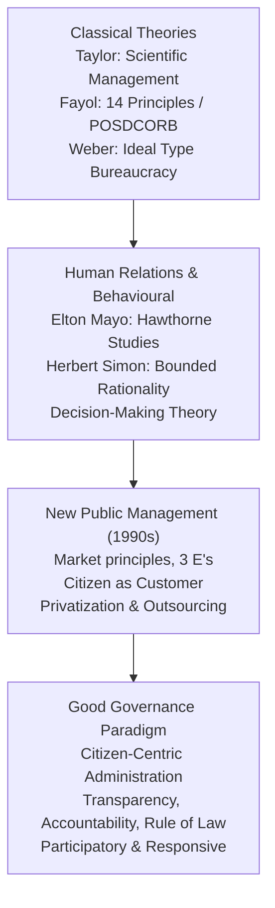
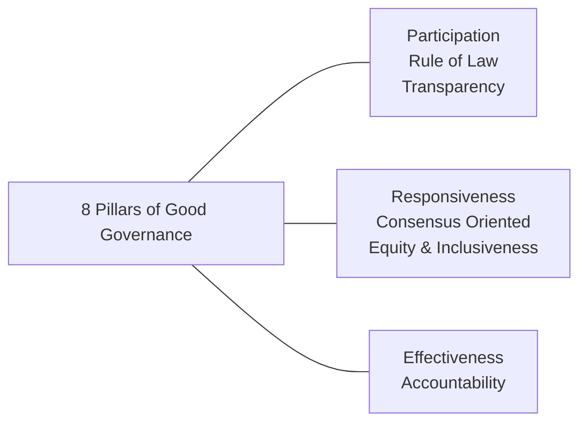

# Public Administration and Good Governance (ಸಾರ್ವಜನಿಕ ಆಡಳಿತ ಮತ್ತು ಉತ್ತಮ ಆಡಳಿತ)

> [!exam-focus]
> **Exam Weightage & Testing Patterns**: A core discipline in Mains GS-2 Section 3, generating 1-2 analytical questions (12.5 or 15 marks) exploring administrative theories, civil service neutrality, or Good Governance mechanisms.
> - **Prelims Traps**: Confusing administrative theory pioneers (e.g., F.W. Taylor's Scientific Management vs Henri Fayol's 14 Principles vs Elton Mayo's Hawthorne Experiments vs Herbert Simon's Bounded Rationality); mixing up Weberian Legal-Rational authority with Charismatic and Traditional authority.
> - **Mains Dimensions**: Relevance of Max Weber's classical bureaucracy in 21st-century digital India; generalist vs specialist debate in Indian civil services; New Public Management (NPM) vs New Public Service (NPS) paradigms.

---

## 1. Evolution of Administrative Thought

The diagram above illustrates the intellectual evolution of public administration over the last century: transitioning from mechanical, inward-looking efficiency paradigms to human behavioral models, market-driven New Public Management, and finally the contemporary human-rights and citizen-centric Good Governance model.

---

## 2. Foundational Administrative Theories

### 2.1 Scientific Management: F. W. Taylor (1856–1915)
- Published *The Principles of Scientific Management* (1911).
- **Core Axiom**: Replace rule-of-thumb traditions with scientific measurement to discover the "One Best Way" to perform any administrative or industrial task.
- **Key Concepts**:
  - Time and motion studies to standardize operations.
  - Functional Foremanship: Specializing supervisory functions.
  - Differential piece-rate wage system to incentivize individual worker productivity.
  - Mental Revolution: Mutual collaboration between workers and managers for shared economic expansion.

### 2.2 Administrative Management: Henri Fayol & Luther Gulick
- **Henri Fayol (1841–1925)**: Formulated the functional classification of management: Planning, Organizing, Commanding, Coordinating, and Controlling (POCCC). Enunciated **14 Principles of Management**, including Unity of Command, Unity of Direction, Division of Work, Scalar Chain, and Esprit de Corps.
- **Luther Gulick (1892–1993)**: Coined the famous acronym **POSDCORB** representing seven executive administrative functions:
  - **P**lanning (ಯೋಜನೆ)
  - **O**rganizing (ಸಂಘಟನೆ)
  - **S**taffing (ಸಿಬ್ಬಂದಿ ನಿರ್ವಹಣೆ)
  - **D**irecting (ನಿರ್ದೇಶನ)
  - **CO**ordinating (ಸಮನ್ವಯ)
  - **R**eporting (ವರದಿಗಾರಿಕೆ)
  - **B**udgeting (ಆಯವ್ಯಯ ನಿರ್ವಹಣೆ)

### 2.3 Bureaucratic Model: Max Weber (1864–1920)
- German sociologist who defined **Bureaucracy (ಅಧಿಕಾರಶಾಹಿ)** as the most efficient, rational, and calculable organizational structure.
- **Three Typologies of Legitimate Authority**:
  1. *Traditional Authority (ಸಾಂಪ್ರದಾಯಿಕ ಪ್ರಾಧಿಕಾರ)*: Grounded in ancient customs and hereditary lineage (e.g., monarchies, feudal patriarchy).
  2. *Charismatic Authority (ಆಕರ್ಷಕ / ವರ್ಚಸ್ವಿ ಪ್ರಾಧಿಕಾರ)*: Grounded in exceptional individual personal heroism, sanctity, or magnetic devotion (e.g., Mahatma Gandhi, revolutionary leaders).
  3. *Legal-Rational Authority (ಕಾನೂನು-ತಾರ್ಕಿಕ ಪ್ರಾಧಿಕಾರ)*: Grounded in impersonal, written, legally enacted rules and constitutional offices. **Bureaucracy is the pure organizational embodiment of Legal-Rational Authority**.
- **Defining Characteristics of Weberian Bureaucracy**:
  - Hierarchical chain of command with clear jurisdictional competencies.
  - Impersonal official conduct (*sine ira et studio* — without hatred or passion).
  - Written official documentation (*the file system*).
  - Merit-based recruitment through competitive examination and fixed salary/pension structures.
  - Strict separation of public office from personal property of the office-holder.

### 2.4 Human Relations & Behavioral Models
- **Elton Mayo & The Hawthorne Experiments (1924–1932)**:
  - Conducted at Western Electric Company, Chicago.
  - Proved that workplace productivity is governed primarily by **social norms, informal group dynamics, emotional recognition, and human relationships**, rather than physical conditions (lighting, rest breaks) or monetary incentives alone (**The Hawthorne Effect**).
- **Herbert Simon: Bounded Rationality (ಸೀಮಿತ ತರ್ಕಬದ್ಧತೆ)**:
  - Rejected the classical myth of the omniscient "Economic Man" who maximizes optimal decisions.
  - Formulated the model of **Administrative Man**, who operates under **Bounded Rationality** (constrained by imperfect information, cognitive human limits, and time pressure).
  - Decision-makers do not optimize; they seek a satisfactory and sufficient outcome (**"Satisficing" / ತೃಪ್ತಿದಾಯಕ ನಿರ್ಧಾರ**).

---

## 3. Civil Services in a Democratic System

### 3.1 Constitutional Architecture (Part XIV, Articles 308–323)
- **Article 309**: Recruitment and conditions of service regulated by legislative enactments.
- **Article 310: Doctrine of Pleasure (ರಾಷ್ಟ್ರಪತಿ/ರಾಜ್ಯಪಾಲರ ಪ್ರಸಾದದ ತತ್ವ)**: Civil servants hold office during the pleasure of the President (Union) or Governor (State).
- **Article 311: Constitutional Safeguards**: Provides vital protection to permanent civil servants against arbitrary dismissal, removal, or reduction in rank:
  - Clause (1): Cannot be dismissed by an authority subordinate to that which appointed them.
  - Clause (2): No dismissal without an inquiry informing them of charges and giving a **reasonable opportunity of being heard** (exceptions: criminal conviction, reasons of national security, or where reasonably impracticable).
- **Article 312: All-India Services (ಅಖಿಲ ಭಾರತ ಸೇವೆಗಳು)**: Common to both Centre and States (IAS, IPS, Indian Forest Service / IFS). Created by Rajya Sabha through a 2/3rd majority resolution.

### 3.2 Core Civil Service Principles
1. **Political Neutrality (ರಾಜಕೀಯ ತಟಸ್ಥತೆ)**: Serving whichever political party is democratically elected by the people with equal loyalty, efficiency, and professional detachment.
2. **Anonymity (ಅಜ್ಞಾತತ್ವ)**: The minister takes parliamentary responsibility and public credit or blame for policy outcomes, while civil servants work behind the scenes.
3. **Commitment to the Constitution**: Distinct from "committed bureaucracy" to a political regime, civil servants must be fiercely committed to constitutional values—secularism, social justice, equality, and rule of law.

---

## 4. Good Governance & Administrative Reforms

### 4.1 Concept & Dimensions of Good Governance (ಉತ್ತಮ ಆಡಳಿತ)
Conceptualized by the World Bank (1992) and UNDP, defining governance as the exercise of economic, political, and administrative authority to manage a country's affairs.
- **Eight Pillars of Good Governance**:
  1. *Participation*: Voice of all citizens, including women and minorities.
  2. *Rule of Law*: Fair legal frameworks enforced impartially.
  3. *Transparency*: Free flow of information and open decisions.
  4. *Responsiveness*: Serving all stakeholders within reasonable timeframes.
  5. *Consensus Orientation*: Mediating differing societal interests for broad consensus.
  6. *Equity and Inclusiveness*: Ensuring all members feel valued.
  7. *Effectiveness and Efficiency*: Sustainable utilization of resources.
  8. *Accountability*: Answerability of public and private institutions to the public.

The diagram above encapsulates the eight interlinked pillars of Good Governance identified by international governance bodies.

### 4.2 Major 2nd Administrative Reforms Commission (ARC) Recommendations
Chaired by **M. Veerappa Moily (2005–2009)**; submitted 15 comprehensive reports:
- *4th Report (Ethics in Governance)*: Codified civil service values, proposed National Integrity Index, recommended tightening Prevention of Corruption Act.
- *6th Report (Local Governance)*: Recommended clear activity mapping to devolve 3 F's to Panchayats.
- *10th Report (Personnel Administration)*: Proposed lateral entry at Senior Deputy Secretary/Joint Secretary levels for technical domains; performance-linked promotions replacing pure seniority; 360-degree appraisal.
- *12th Report (Citizen-Centric Administration)*: Mandated enforceable Citizen Charters, public grievance ombudsman, and time-bound service delivery guarantees (which inspired Karnataka's SAKALA Act).

---

## 5. Related Vault Notes
- [[Indian_Constitutional_System]] — Constitutional provisions for civil services (Articles 308-323).
- [[Lokayukta_RTI_and_Sakala_Karnataka]] — Statutory accountability mechanisms in action.
- [[Probity_in_Governance_and_Public_Funds]] — Moral philosophy and ethics in administration.

---

## 6. Likely Questions & Verbatim PYQs

### Prelims Multiple-Choice Questions
- **PYQ (KPSC KAS 2017 Prelims P1)**: The famous acronym "POSDCORB" summarizing the seven core functions of an administrative executive was formulated by which scholar?
  - (A) Henri Fayol
  - (B) Max Weber
  - (C) Luther Gulick [Correct]
  - (D) Herbert Simon
- **PYQ (KPSC KAS 2020 Prelims P1)**: Under Article 312 of the Indian Constitution, which institution has the exclusive power to pass a resolution initiating the creation of a new All-India Service?
  - (A) Lok Sabha
  - (B) Rajya Sabha [Correct]
  - (C) Union Cabinet
  - (D) Union Public Service Commission
- **Expected Question (Prelims 2026)**: The "Hawthorne Experiments" which gave birth to the Human Relations school of administrative management were conducted by:
  - *Answer*: Elton Mayo.

### Mains Analytical Question & Answer Outline
- **Mains GS-2 Question**: *"Examine the relevance of Max Weber's bureaucratic model in contemporary digital and citizen-centric governance in India." (15 Marks / 250 Words)*
  - **Introduction**: Introduce Max Weber's classical bureaucracy as the conceptual bedrock of modern civil service, predicated on legal-rational authority, hierarchy, written rules, and professional specialization.
  - **Enduring Strengths / Relevance**:
    - *Impartiality & Equal Protection*: Impersonal rule of law (*sine ira et studio*) shields administration from political whim, arbitrary nepotism, and caste/communal favoritism.
    - *Institutional Continuity & Predictability*: Procedural standardization ensures massive nationwide welfare delivery (PDS, elections, census) without breakdown.
  - **Dysfunctions in Modern Context (Red Tape)**:
    - *Goal Displacement*: Rigid adherence to procedural formalities over citizen welfare outcomes (means become ends).
    - *Rigidity vs Agility*: Hierarchical silos struggle to respond to fast-moving crisis management (disasters, public health outbreaks, cyber threats).
  - **Digital Adaptation (The Post-Weberian Shift)**:
    - E-governance portals (Bhoomi, SAKALA, faceless IT assessments) replace physical paper files with automated workflows, enhancing transparency while preserving Weberian rule-bound consistency.
  - **Conclusion**: Conclude that Weberian bureaucracy must evolve from a closed, inward-looking command structure into an empathetic, tech-enabled, and accountable public service network.

---

> [!summary] Quick Revision Box (10 Non-Negotiable Facts)
> 1. **F. W. Taylor**: Scientific Management; time-motion studies, "One Best Way".
> 2. **Luther Gulick**: POSDCORB acronym representing 7 executive functions.
> 3. **Max Weber**: Bureaucracy as legal-rational authority; impersonal, hierarchical, merit-based.
> 4. **Elton Mayo**: Hawthorne Experiments; proved social & informal human relations drive productivity.
> 5. **Herbert Simon**: Bounded Rationality; decision-makers "satisfice" rather than optimize.
> 6. **Article 311**: Protects civil servants against arbitrary dismissal without departmental inquiry.
> 7. **Article 312**: Rajya Sabha initiates creation of new All-India Services via 2/3rd resolution.
> 8. **Civil Service Anonymity**: Minister assumes parliamentary responsibility while civil servant advises behind scenes.
> 9. **Good Governance 8 Pillars**: Participatory, accountable, transparent, responsive, equitable, rule of law.
> 10. **2nd ARC Chairman**: M. Veerappa Moily (15 thematic administrative reform reports).
