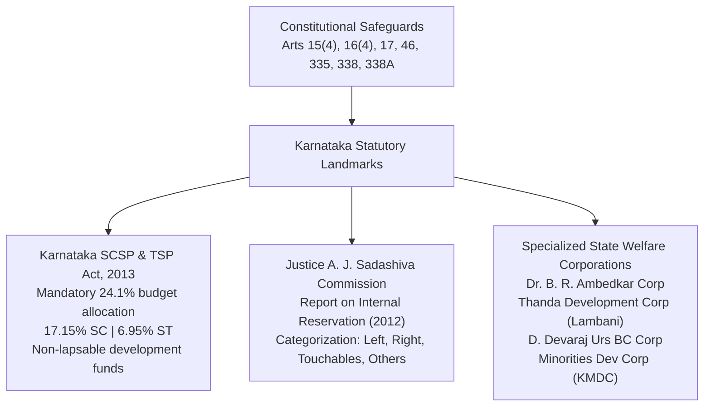

# Social Welfare, Affirmative Action and Social Justice in Karnataka (ಕರ್ನಾಟಕದಲ್ಲಿ ಸಮಾಜ ಕಲ್ಯಾಣ, ಮೀಸಲಾತಿ ಮತ್ತು ಸಾಮಾಜಿಕ ನ್ಯಾಯ)

> [!exam-focus]
> **Exam Weightage & Testing Patterns**: High-frequency scoring area in Mains GS-1 Section 2 (Social Perspective: 10–15 marks) and Prelims Paper 1. Focuses heavily on Karnataka-specific welfare legislations, internal reservation debates, and welfare corporations.
> - **Prelims Traps**: Confusing the budgetary allocation percentages under the Karnataka SCSP-TSP Act, 2013 (**24.1% total: 17.15% for SC and 6.95% for ST**); confusing the recommendations of the Justice A. J. Sadashiva Commission (SC internal reservation) with the Havanur Commission (OBC reservation); mixing up the mandates of different state welfare corporations.
> - **Mains Dimensions**: Assessing the operational efficacy of the landmark SCSP/TSP Act, 2013 in preventing fund diversion; examining the socio-legal complexities of the internal reservation (*O ಒಳಮೀಸಲಾತಿ*) matrix for Scheduled Castes; evaluating DBT-driven guarantee schemes vs asset-creation welfare.

---

## 1. Social Justice Institutional Architecture

The flowchart above outlines Karnataka's comprehensive social justice framework: bridging constitutional guarantees with groundbreaking state legislations, targeted budgetary earmarking, and statutory developmental boards for marginalized communities.

---

## 2. Constitutional Mandate for Weaker Sections

- **Article 15(4) & 15(5)**: Special provisions and reservations for the advancement of socially and educationally backward classes (OBCs), SCs, and STs in educational institutions.
- **Article 16(4) & 16(4A)**: Reservations in public appointments and promotions with consequential seniority for SC/STs.
- **Article 17**: Abolition of Untouchability; enforced through the **Protection of Civil Rights Act, 1955** and the **SC and ST (Prevention of Atrocities) Act, 1989 (POA Act)**.
- **Article 46**: Directive principle commanding the State to promote with special care the educational and economic interests of the weaker sections, especially SCs and STs, and protect them from social injustice and exploitation.
- **Article 335**: Claims of SC/STs to services and posts, consistent with administrative efficiency.
- **National Commissions**: **NCSC (Article 338)**, **NCST (Article 338A)**, and **NCBC (Article 338B - added by 102nd Amendment Act, 2018)**.

---

## 3. The Karnataka SCSP and TSP Act, 2013

- **Full Title**: **Karnataka Scheduled Castes Sub-Allocation and Tribal Sub-Allocation (Planning, Allocation and Utilization of Financial Resources) Act, 2013**.
- **Pioneering Distinction**: Karnataka was the **first state in India** (after Andhra Pradesh) to grant statutory legal backing to the Scheduled Castes Sub-Plan (SCSP) and Tribal Sub-Plan (TSP).
- **Core Provisions**:
  1. **Mandatory Budgetary Earmarking**: Mandates that the State Government earmark **24.1% of its total state scheme budget outlay** exclusively for the development of SCs and STs, strictly in proportion to their population in the state (Census 2011: **17.15% for Scheduled Castes** and **6.95% for Scheduled Tribes**).
  2. **Non-Lapsable Funds**: Unspent funds in any financial year do not lapse into the general pool; they must be carried forward to the next fiscal year for the same target group.
  3. **Strict Prohibition on Diversion**: Barred the diversion of SCSP/TSP funds for general administrative infrastructure (airports, flyovers, administrative buildings) unless the direct, quantifiable benefit to SC/ST households is empirically established.
  4. **State Nodal Agency**: Chaired by the Minister for Social Welfare, with the Chief Minister presiding over the apex State Council for SC/ST Development to monitor compliance.

---

## 4. The Internal Reservation Debate: Justice A. J. Sadashiva Commission

- **Background**: Longstanding grievance among marginalized sub-castes within the Scheduled Castes that the benefits of reservations were monopolized by relatively advanced groups, leading to demands for internal categorization (*ಒಳಮೀಸಲಾತಿ*).
- **Commission Appointed**: The State Government constituted a judicial commission headed by retired High Court Judge **Justice A. J. Sadashiva** in 2005; submitted its report in **June 2012**.
- **Categorization & Recommended Share**:
  Based on an empirical door-to-door survey of 96 lakh SC individuals across 101 sub-castes, the commission proposed dividing the 15% (now 17%) SC quota into four distinct categories:
  1. **SC Left / Madiga Group (ಮಾದಿಗ ಗುಂಪು)**: Comprising Madiga, Chamar, and allied sub-castes (recommended highest internal share ~6%).
  2. **SC Right / Chalavadi & Holeya Group (ಹೊಲೆಯ ಗುಂಪು)**: Comprising Holeya and allied sub-castes (recommended ~5%).
  3. **Touchables / Others (ಸ್ಪೃಶ್ಯ ಜಾತಿಗಳು)**: Lambani (Banjara), Bhovi, Koracha, and Korama (recommended ~3%).
  4. **Other Most Backward SC Sub-castes**: Nomadic, semi-nomadic, and minuscule SC groups (~1%).
- **Supreme Court Landmark Ruling (August 2024)**: A 7-judge Constitution Bench of the Supreme Court (*State of Punjab v. Davinder Singh*) historically affirmed that State Governments have the constitutional competence under Article 16(4) and 341 to create sub-classifications / internal reservations within the Scheduled Castes list to ensure equitable affirmative action for the most disadvantaged sub-groups.

---

## 5. Major State Welfare Development Corporations

| Corporation | Target Beneficiary Group | Key Economic & Self-Employment Schemes |
|---|---|---|
| **Dr. B. R. Ambedkar Development Corporation** | Scheduled Castes (SC) | *Self-Employment Scheme*, *Land Purchase Scheme (ಭೂ ಒಡೆತನ ಯೋಜನೆ)* purchasing arable land for landless female SC agricultural laborers, *Prerana* micro-finance |
| **Karnataka Thanda Development Corporation** | Lambani / Banjara community | Conversion of Lambani *Thandas* (hamlets) into statutory Revenue Villages (*ಕಂದಾಯ ಗ್ರಾಮಗಳು*), pucca housing, and skill development |
| **Maharshi Valmiki ST Development Corporation** | Scheduled Tribes (ST) | Micro-irrigation borewell subsidies (*Ganga Kalyana*), transport vehicle purchase loans, tribal enterprise incubation |
| **D. Devaraj Urs Backward Classes Development Corporation** | Other Backward Classes (OBC) | *Chaitanya* self-employment loan scheme, interest subsidies for higher education abroad, traditional artisan toolkits |
| **Karnataka Minorities Development Corporation (KMDC)** | Religious Minorities (Muslims, Christians, Jains, Buddhists, Sikhs, Parsis) | *Arivu Education Loan Scheme*, *Shrama Shakthi* artisan micro-credit, Swavalambana margin money loans |
| **Karnataka State Safai Karmachari Development Corporation** | Safai Karmacharis / Pourakarmikas | Mechanized cleaning equipment subsidies, rehabilitation grants, zero-interest loans to eliminate manual scavenging |

---

## 6. Related Vault Notes
- [[Indian_Constitutional_System]] — Articles 14, 15, 16, 17, and 46.
- [[Indian_Social_System]] — Caste hierarchies, dominant castes, and social stratification.
- [[Karnataka_Flagship_Schemes]] — Gruha Lakshmi, Yuva Nidhi, and Anna Bhagya welfare delivery.

---

## 7. Likely Questions & Verbatim PYQs

### Prelims Multiple-Choice Questions
- **PYQ (KPSC KAS 2017 Prelims P1)**: Under the Karnataka Scheduled Castes Sub-Allocation and Tribal Sub-Allocation Act, 2013, what percentage of the total state scheme budget outlay is statutorily earmarked for Scheduled Castes and Scheduled Tribes respectively?
  - (A) 15% for SC and 3% for ST
  - (B) 17.15% for SC and 6.95% for ST [Correct - Total 24.1%]
  - (C) 18% for SC and 7% for ST
  - (D) 20% for SC and 5% for ST
- **PYQ (KPSC KAS 2014 Prelims P1)**: The Land Purchase Scheme (Bhoomi Odetana Yojane), which purchases arable agricultural land from open market and transfers ownership to landless female agricultural laborers, is implemented by:
  - (A) Revenue Department
  - (B) Dr. B. R. Ambedkar Development Corporation [Correct]
  - (C) Karnataka Land Army
  - (D) RDPR Department
- **Expected Question (Prelims 2026)**: The judicial commission appointed by the Karnataka government to study and submit recommendations on the internal reservation for Scheduled Castes was headed by:
  - *Answer*: Justice A. J. Sadashiva (ಜಸ್ಟಿಸ್ ಎ. ಜೆ. ಸದಾಶಿವ ಆಯೋಗ).

### Mains Analytical Question & Answer Outline
- **Mains GS-1 Question**: *"Critically analyze the significance and implementation challenges of the Karnataka SCSP-TSP Act, 2013 in ensuring targeted social justice." (15 Marks / 250 Words)*
  - **Introduction**: Introduce the Karnataka SCSP and TSP Act, 2013 as a landmark affirmative fiscal statute mandating population-proportionate budgetary earmarking (24.1%: 17.15% SC, 6.95% ST).
  - **Core Progressive Achievements**:
    - *Guaranteed Fiscal Space*: Ensures over Rs. 35,000+ crore annually is statutorily reserved across state departments.
    - *Non-Lapsable Nature*: Unspent outlays are carried forward, preventing end-of-year lapsing.
    - *Individual Empowerment*: Massive financing of *Ganga Kalyana* borewells, land purchases for women, and post-matric overseas scholarships.
  - **Implementation Bottlenecks**:
    - *Accounting Diversions*: Clause 7(D) exemptions historically exploited to show general capital expenditure (power plants, dams, metro rail) as SC/ST benefits, diluting direct household impact.
    - *Delayed Sanctions*: Heavy end-of-year rush (*March Rush*) leading to hasty, sub-optimal procurement rather than strategic capacity building.
  - **Way Forward & Conclusion**: Strengthen Social Audits at Grama Sabha levels, implement strict biometric DBT, and direct funds toward quality residential schools (Morarji Desai, Kittur Rani Chennamma schools) and industrial entrepreneurship.

---

> [!summary] Quick Revision Box (10 Non-Negotiable Facts)
> 1. **Karnataka SCSP-TSP Act, 2013**: Mandates 24.1% of state budget (17.15% SC + 6.95% ST).
> 2. **Non-Lapsable Funds**: Statutory provision ensuring unspent SCSP-TSP money carries forward.
> 3. **Justice Sadashiva Commission**: Recommended internal reservation matrix for 101 SC sub-castes.
> 4. **August 2024 SC Verdict**: 7-judge bench upheld state power to sub-classify SCs for internal quota.
> 5. **Bhoomi Odetana Scheme**: Purchases agricultural land for landless female SC laborers.
> 6. **Article 17**: Enforced via Protection of Civil Rights Act (1955) & SC/ST POA Act (1989).
> 7. **Article 46**: Directive principle commanding state to promote educational/economic interests of SC/STs.
> 8. **102nd Amendment Act (2018)**: Granted constitutional status to National Commission for Backward Classes (Art 338B).
> 9. **Thanda Development Corp**: Converts Lambani hamlets into statutory Revenue Villages (*Kandaya Gramagalu*).
> 10. **Arivu Scheme**: Low-interest education loan implemented by Karnataka Minorities Dev Corp.
