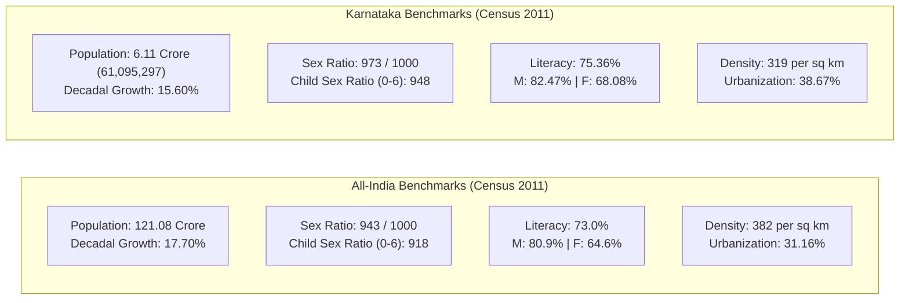

# Demographics of Karnataka and India: Census Benchmarks and Social Sector Indicators (ಕರ್ನಾಟಕ ಮತ್ತು ಭಾರತದ ಜನಸಂಖ್ಯಾಶಾಸ್ತ್ರ ಹಾಗೂ ಸಾಮಾಜಿಕ ಸೂಚ್ಯಂಕಗಳು)

> [!exam-focus]
> **Exam Weightage & Testing Patterns**: High-frequency factual scoring area in Prelims Paper 1 (Humanities: 3-5 MCQs) and Mains GS-1 Section 2 (Social Perspective).
> - **Prelims Traps**: Confusing Karnataka's overall sex ratio (973) with child sex ratio (948); confusing the district with highest sex ratio (Udupi: 1,094 females per 1,000 males) with highest literacy (Dakshina Kannada: 88.57%); confusing lowest literacy district (Yadgir: 51.83%) with lowest density district (Uttara Kannada: 140 per sq km).
> - **Mains Dimensions**: Capitalizing on the Demographic Dividend via vocational skill training; addressing regional demographic fault-lines between Northern Karnataka (high fertility, low literacy) and Southern/Coastal Karnataka (replacement TFR, high human development).

---

## 1. Demographic Comparison Dashboard (Census Benchmarks)

The comparative dashboard above juxtaposes Karnataka's demographic performance against the national average, demonstrating superior social development parameters: higher literacy (+2.36%), healthier sex ratio (+30 points), and significantly higher urbanization (+7.51%).

---

## 2. Karnataka District-Wise Demographic Extremes

| Demographic Indicator | Karnataka State Average | Highest District (Record High) | Lowest District (Record Low) |
|---|---|---|---|
| **Total Population** | 61,095,297 (6.11 Crore) | **Bengaluru Urban** (96.21 Lakh) | **Kodagu** (5.54 Lakh) |
| **Population Density** | 319 persons / sq km | **Bengaluru Urban** (4,381 / sq km) | **Uttara Kannada** (140 / sq km) |
| **Sex Ratio (Overall)**| 973 females / 1000 males | **Udupi** (1,094) & **Kodagu** (1,018) | **Bengaluru Urban** (916) |
| **Child Sex Ratio (0–6)**| 948 females / 1000 males | **Kodagu** (978) & **Udupi** (958) | **Belagavi** (931) & **Bagalkot** (935) |
| **Overall Literacy Rate**| 75.36% | **Dakshina Kannada** (88.57%) | **Yadgir** (51.83%) |
| **Male Literacy Rate** | 82.47% | **Dakshina Kannada** (93.13%) | **Yadgir** (62.25%) |
| **Female Literacy Rate**| 68.08% | **Dakshina Kannada** (84.13%) | **Yadgir** (41.38%) |
| **Urban Population %** | 38.67% | **Bengaluru Urban** (90.94%) | **Kodagu** (14.61%) |
| **Decadal Growth Rate**| 15.60% | **Bengaluru Urban** (47.18%) | **Chikkamagaluru** (-0.26% - negative!) |

---

## 3. Vital Health & Social Sector Indicators

### 3.1 Maternal & Infant Mortality Transitions
- **Maternal Mortality Ratio (MMR / ತಾಯಂದಿರ ಮರಣ ಪ್ರಮಾಣ)**:
  - Number of maternal deaths per 100,000 live births.
  - Karnataka's MMR has fallen dramatically to **~69 per 1 lakh live births**, successfully achieving the **UN Sustainable Development Goal (SDG 3.1) target of < 70** well ahead of 2030 (All-India average: 97).
- **Infant Mortality Rate (IMR / ಶಿಶು ಮರಣ ಪ್ರಮಾಣ)**:
  - Number of infant deaths (under 1 year) per 1,000 live births.
  - Karnataka stands at approximately **~19 per 1,000 live births** (All-India average: ~28).
- **Total Fertility Rate (TFR / ಒಟ್ಟು ಫಲವತ್ತತೆ ದರ)**:
  - Number of children born to a woman across reproductive age.
  - Karnataka's TFR has reached **1.7** (NFHS-5), well below the demographic replacement level of **2.1**, confirming the state has entered the advanced stage of demographic transition.

### 3.2 Flagship Health and Nutrition Programs
1. **Mathru Poorna Scheme (ಮಾತೃಪೂರ್ಣ ಯೋಜನೆ)**: Provides one hot, nutritionally balanced meal (rice, dal, boiled egg/sprouts, milk, chikki) daily to pregnant and lactating mothers at Anganwadi centers, addressing maternal anemia and low birth-weight babies.
2. **Ayushman Bharat - Arogya Karnataka (AB-ArK)**: Unified health assurance scheme providing cashless tertiary healthcare coverage up to Rs. 5 lakh per family per year for BPL households across empaneled public and private hospitals.
3. **Pushtikara Aahara / Ksheera Bhagya**: Provides free fortified milk to school and anganwadi children 5 days a week to combat child stunting and wasting.

---

## 4. The Demographic Dividend (ಜನಸಂಖ್ಯಾ ಲಾಭಾಂಶ)

- Over **65% of Karnataka's population** lies within the working-age window (15–59 years), creating a historic 25-to-30-year opportunity for economic expansion.
- **The Challenge of Skill Mismatch**: While Southern Karnataka absorbs skilled engineering and service labor, Northern Karnataka faces severe youth underemployment, necessitating vocational skill initiatives (Karnataka Skill Development Mission / KSDC) and industrial decentralization through the *Beyond Bengaluru* cluster policy.

---

## 5. Related Vault Notes
- [[Karnataka_Budget_and_Economic_Survey]] — Healthcare and education allocations.
- [[Poverty_and_Rural_Development]] — NFHS-5 Multidimensional Poverty indicators.
- [[Social_Welfare_and_Justice_Karnataka]] — Targeted welfare for marginalized demographics.

---

## 6. Likely Questions & Verbatim PYQs

### Prelims Multiple-Choice Questions
- **PYQ (KPSC KAS 2017 Prelims P1)**: According to the 2011 Census of India, which district in Karnataka recorded the highest literacy rate?
  - (A) Bengaluru Urban
  - (B) Udupi
  - (C) Dakshina Kannada [Correct - 88.57%]
  - (D) Mysuru
- **PYQ (KPSC KAS 2020 Prelims P1)**: According to the 2011 Census, which district of Karnataka registered a negative decadal population growth rate (-0.26%)?
  - (A) Kodagu
  - (B) Chikkamagaluru [Correct]
  - (C) Hassan
  - (D) Uttara Kannada
- **Expected Question (Prelims 2026)**: What is the overall sex ratio of Karnataka as per the 2011 Census?
  - *Answer*: 973 females per 1,000 males.

---

> [!summary] Quick Revision Box (10 Non-Negotiable Facts)
> 1. **Karnataka Population (2011)**: 61,095,297 (6.11 Crore); 9th most populous state.
> 2. **Overall Sex Ratio**: 973 females per 1,000 males (All-India: 943).
> 3. **Highest Sex Ratio District**: Udupi (1,094), followed by Kodagu (1,018).
> 4. **Overall Literacy Rate**: 75.36% (Male: 82.47%, Female: 68.08%).
> 5. **Highest Literacy District**: Dakshina Kannada (88.57%), lowest Yadgir (51.83%).
> 6. **Urban Population Share**: 38.67% in Karnataka (All-India: 31.16%).
> 7. **Negative Growth District**: Chikkamagaluru (-0.26% decadal growth).
> 8. **Lowest Density District**: Uttara Kannada (140 persons per sq km).
> 9. **Karnataka TFR**: 1.7 (below replacement level of 2.1).
> 10. **Mathru Poorna Scheme**: Hot cooked nutritious daily meal for pregnant women at Anganwadis.
