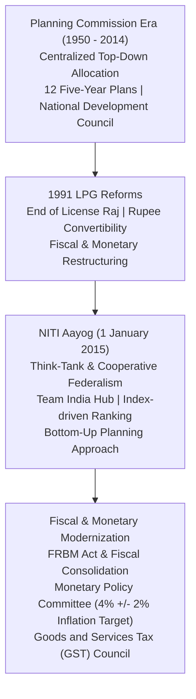

# Indian Economic Planning, NITI Aayog and Structural Economic Reforms (ಭಾರತೀಯ ಆರ್ಥಿಕ ಯೋಜನೆ, ನೀತಿ ಆಯೋಗ ಮತ್ತು ಸುಧಾರಣೆಗಳು)

> [!exam-focus]
> **Exam Weightage & Testing Patterns**: A core pillars topic in Prelims Paper 1 (6-8 questions) and Mains GS-1 Section 3 (Indian Economy) and GS-3 Section 3.
> - **Prelims Traps**: Confusing the models of Five-Year Plans (1st FYP Harrod-Domar vs 2nd FYP Mahalanobis heavy industry model vs 5th FYP Garibi Hatao); confusing the organizational hubs of NITI Aayog (Team India Hub vs Knowledge and Innovation Hub); misidentifying Monetary Policy Committee (MPC) composition (6 members: 3 RBI, 3 Union appointed).
> - **Mains Dimensions**: Assessing NITI Aayog's cooperative and competitive federalism model versus the erstwhile Planning Commission's top-down allocation model; structural impacts of the Goods and Services Tax (GST) regime on state fiscal autonomy.

---

## 1. Economic Policy Transition Architecture

The flowchart above outlines the evolution of Indian economic policy: from centralized Soviet-style Five-Year Plans to market-oriented LPG reforms in 1991 and institutional governance restructuring through NITI Aayog, inflation-targeting MPC, and the federal GST architecture.

---

## 2. Legacy of Five-Year Plans (1951–2017)

- **Planning Commission**: Set up on 15 March 1950 via an extra-constitutional executive resolution; chaired by the Prime Minister. National Development Council (NDC, 1952) served as the apex approving body.
- **Milestone Five-Year Plans**:
  - *1st FYP (1951–1956)*: Based on the **Harrod-Domar Model**; focused on agriculture, irrigation (Bhakra Nangal, Damodar Valley), and price stability. Growth achieved: 3.6% (target 2.1%).
  - *2nd FYP (1956–1961)*: Based on the **Nehru-Mahalanobis Strategy**; focused on rapid industrialization and basic capital goods / heavy industries (Bhilai, Durgapur, Rourkela steel plants). Formulated the Industrial Policy Resolution, 1956.
  - *3rd FYP (1961–1966)*: Aimed at self-sustaining growth; severely disrupted by the 1962 Sino-Indian War, 1965 Indo-Pak War, and consecutive severe droughts, forcing three **Plan Holidays (1966–1969)**.
  - *4th FYP (1969–1974)*: Under Indira Gandhi; aimed at "Growth with Stability and Progressive Self-reliance"; 14 major commercial banks nationalized in 1969.
  - *5th FYP (1974–1979)*: Focused on poverty removal (**"Garibi Hatao"**) and self-reliance; terminated early by the Janata Party government, introducing the **Rolling Plan (1978–1980)**.
  - *8th FYP (1992–1997)*: Inaugurated post-LPG reforms; based on the **John W. Miller Model**; human resource development, private sector investment, export growth. Achieved high growth of 6.8%.
  - *12th FYP (2012–2017)*: The final Five-Year Plan; themed ***"Faster, More Inclusive and Sustainable Growth"***. Dissolved mid-way with the creation of NITI Aayog.

---

## 3. NITI Aayog (National Institution for Transforming India)

- **Establishment**: Replaced the Planning Commission on **1 January 2015** by an executive resolution.
- **Core Philosophy**: Shift from a "one-size-fits-all" centralized command model to **Cooperative Federalism (ಸಹಕಾರಿ ಒಕ್ಕೂಟ ವ್ಯವಸ್ಥೆ)**, recognizing that strong states make a strong nation.
- **Key Structural Distinctions**:
  - *No Financial Allocation Powers*: Unlike the Planning Commission, NITI Aayog has **no power to allocate plan funds or grants** to state governments; financial transfers are governed exclusively by the constitutional **Finance Commission (Article 280)** and the Ministry of Finance.
  - *Governing Council*: Comprises the Prime Minister, Chief Ministers of all States and Union Territories with legislatures, and Lt. Governors of other UTs, embedding state leadership at the highest policy table.
- **Two Operational Hubs**:
  1. **Team India Hub (ಟೀಮ್ ಇಂಡಿಯಾ ಹಬ್)**: Serves as the continuous interface between state governments and the central ministries.
  2. **Knowledge and Innovation Hub (ಜ್ಞಾನ ಮತ್ತು ನಾವೀನ್ಯತೆ ಹಬ್)**: Builds think-tank capacities, research analytics, and best-practice sharing.
- **Index-Driven Competitive Federalism**:
  - *SDG India Index*: Ranks states annually on performance across the 17 UN Sustainable Development Goals (Karnataka consistently ranks as a "Front Runner" state).
  - *India Innovation Index (III)*: Measures state innovation ecosystems (Karnataka has ranked #1 among Major States multiple times due to its Bengaluru R&D ecosystem).
  - *Export Preparedness Index (EPI)* & *Composite Water Management Index (CWMI)*.
- **Strategic Policy Horizon**: Replaced Five-Year Plans with three cascading planning horizons:
  - **15-Year Vision Document** (2017–2032)
  - **7-Year Strategic Framework**
  - **3-Year Action Agenda**

---

## 4. Modern Monetary & Fiscal Architecture

### 4.1 Monetary Policy Committee (MPC / ಹಣಕಾಸು ನೀತಿ ಸಮಿತಿ)
- Statutory body constituted under the amended **Reserve Bank of India Act, 1934 (Section 45ZB)** in 2016.
- **Composition (6 Members)**:
  - 3 RBI members: RBI Governor (Chairperson with casting vote), Deputy Governor in charge of monetary policy, and one RBI officer.
  - 3 External independent members appointed by the Central Government on the recommendation of a search committee.
- **Flexible Inflation Targeting (FIT) Framework**: Mandated to maintain Consumer Price Index (CPI) inflation at **4% with a tolerance band of +/- 2%** (between 2% and 6%). Meets at least four times a year.

### 4.2 Goods and Services Tax (GST) Council (ಸರಕು ಮತ್ತು ಸೇವಾ ತೆರಿಗೆ ಮಂಡಳಿ)
- Created by the **101st Constitutional Amendment Act, 2016**, inserting **Article 279A**.
- **Federal Composition**: Chaired by Union Finance Minister; Union Minister of State for Finance; State Finance/Taxation Ministers of all States.
- **Voting Weightage**:
  - Central Government has **one-third (33.3%)** of the total votes cast.
  - All State Governments together have **two-thirds (66.7%)** of the total votes cast.
  - Decision threshold: **Three-fourths (75%) majority** of weighted votes present and voting, guaranteeing that neither Centre nor States can unilaterally impose tax decisions without federal consensus.

---

## 5. Related Vault Notes
- [[Karnataka_Budget_and_Economic_Survey]] — State-level fiscal deficit and revenue trends.
- [[Poverty_and_Rural_Development]] — Poverty eradication metrics and welfare transfers.
- [[Indian_Constitutional_System]] — Article 279A, Article 280, and federal financial relations.

---

## 6. Likely Questions & Verbatim PYQs

### Prelims Multiple-Choice Questions
- **PYQ (KPSC KAS 2017 Prelims P1)**: The second Five-Year Plan (1956–1961) of India was based on the economic development model formulated by which scholar?
  - (A) Harrod-Domar
  - (B) P. C. Mahalanobis [Correct]
  - (C) K. N. Raj
  - (D) C. Rangarajan
- **PYQ (KPSC KAS 2020 Prelims P1)**: Under the Flexible Inflation Targeting (FIT) framework in India, the statutory inflation target assigned to the Monetary Policy Committee (MPC) is:
  - (A) 3% with +/- 1% tolerance band
  - (B) 4% with +/- 2% tolerance band [Correct]
  - (C) 5% with +/- 2% tolerance band
  - (D) 6% fixed target
- **Expected Question (Prelims 2026)**: In the GST Council constituted under Article 279A of the Indian Constitution, what is the collective voting weightage assigned to all State Governments together?
  - *Answer*: Two-thirds (66.7%) of the total weighted votes cast.

### Mains Analytical Question & Answer Outline
- **Mains GS-1 / GS-3 Question**: *"Evaluate the shift from the Planning Commission to NITI Aayog. To what extent has NITI Aayog fostered genuine 'Cooperative Federalism' in India?" (15 Marks / 250 Words)*
  - **Introduction**: Briefly explain that NITI Aayog was established on 1 January 2015 to replace the 65-year-old Planning Commission, shifting India's development paradigm from bureaucratic allocation to cooperative federalism.
  - **Structural Advancements under NITI Aayog**:
    - *Abolition of Financial Leverage*: Ending discretionary plan fund distribution eliminated fiscal patronage; states are no longer treated as subordinate beggars at Yojana Bhavan.
    - *Governing Council Platform*: Chief Ministers are institutional co-drivers of national policy agendas, participating in sub-groups on agriculture, Swachh Bharat, and digital payments.
    - *Competitive Benchmarking*: Rigorous indices (SDG Index, Innovation Index, Water Management Index) incentivize healthy inter-state competition driven by empirical data rather than ideological rhetoric.
  - **Remaining Criticisms & Concerns**:
    - States express frustration over the absence of a formal forum for financial redressal outside the Ministry of Finance.
    - Top-down centrally sponsored schemes (CSS) still constrain state fiscal flexibility.
    - Lack of permanent secretariat integration with state-level planning boards.
  - **Conclusion**: Conclude that while NITI Aayog has modernized India's policy think-tank architecture, cooperative federalism will remain incomplete without institutionalizing regular Inter-State Council (Article 263) meetings and expanding state fiscal autonomy.

---

> [!summary] Quick Revision Box (10 Non-Negotiable Facts)
> 1. **1st FYP (1951–56)**: Harrod-Domar model; agriculture & irrigation focus.
> 2. **2nd FYP (1956–61)**: Nehru-Mahalanobis model; heavy industries & capital goods focus.
> 3. **Plan Holidays (1966–69)**: Three annual plans following wars and consecutive droughts.
> 4. **12th FYP (2012–17)**: Last Five-Year Plan; "Faster, More Inclusive and Sustainable Growth".
> 5. **NITI Aayog (1 Jan 2015)**: Replaced Planning Commission; think-tank; zero fund allocation powers.
> 6. **NITI Governing Council**: PM, all State CMs, and UT Lt. Governors.
> 7. **Monetary Policy Committee**: 6 members (3 RBI, 3 Govt); 4% +/- 2% CPI inflation target.
> 8. **GST Council (Art 279A)**: 101st Amendment; Centre has 1/3rd vote, States have 2/3rd votes; 75% threshold.
> 9. **India Innovation Index**: Ranked Karnataka #1 among major states due to Bengaluru R&D ecosystem.
> 10. **SDG India Index**: NITI Aayog's annual assessment tool measuring state progress on 17 UN SDGs.
