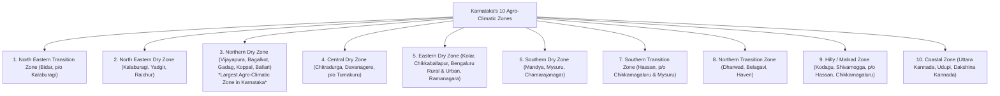

# Agriculture, Agro-Climatic Zones and Irrigation Systems in Karnataka (ಕರ್ನಾಟಕದ ಕೃಷಿ, ಕೃಷಿ-ಹವಾಮಾನ ವಲಯಗಳು ಮತ್ತು ನೀರಾವರಿ ವ್ಯವಸ್ಥೆಗಳು)

> [!exam-focus]
> **Exam Weightage & Testing Patterns**: High-yield core topic across Prelims Paper 2 (Karnataka Affairs: 4-6 MCQs) and Mains GS-3 Section 3 (guaranteed 15-mark question on agricultural sustainability, dryland farming, or irrigation projects).
> - **Prelims Traps**: Confusing Karnataka's agro-climatic zones (Karnataka has exactly **10 Agro-Climatic Zones**, with the Northern Dry Zone being the largest); confusing GI tags of agricultural crops (Kalaburagi Red Gram / Tur, Coorg Arabica Coffee, Nanjanagud Rasabale, Udupi Mattu Gulla); misidentifying Asia's largest cocoon market (Ramanagara).
> - **Mains Dimensions**: Overcoming chronic dryland agrarian distress in Northern Karnataka via micro-irrigation and *Krishi Bhagya*; assessing Karnataka's e-trading revolution (Rashtriya e-Market Services - ReMS); legal and environmental bottlenecks delaying Upper Bhadra and Mekedatu irrigation projects.

---

## 1. The 10 Agro-Climatic Zones of Karnataka

Karnataka is classified into **10 Agro-Climatic Zones** based on rainfall pattern, soil typology, elevation, and cropping systems:

The diagram above details the geographical taxonomy of the 10 agro-climatic zones, transitioning from the heavy rainfall coastal and hilly tracts in the west to the arid and semi-arid dry belts in the north and east.

---

## 2. Major Agricultural Crops & Commercial Leadership

Karnataka possesses one of the most diversified crop portfolios in India:
1. **Coffee (ಕಾಫಿ)**: Karnataka is the undisputed leader in India, producing **over 70% of the nation's total coffee output**. Grown across the shaded slopes of Kodagu, Chikkamagaluru, and Hassan (*Arabica and Robusta* varieties).
2. **Sericulture / Silk (ರೇಷ್ಮೆ)**: Produces over **45% of India's mulberry raw silk**. Ramanagara hosts the largest silk cocoon market in Asia.
3. **Millets / Siri Dhanya (ಸಿರಿಧಾನ್ಯಗಳು)**: Pioneer state in nutri-cereals. Promotes *Ragi* (finger millet in southern dry zone) and *Jowar* (sorghum in northern dry zone), alongside minor millets (Foxtail - Navane, Little - Saame, Kodo - Haraka, Barnyard - Oodalu).
4. **Pulses (ಬೇಳೆಕಾಳುಗಳು)**: Kalaburagi is celebrated as the **"Pulse Bowl of Karnataka" (ತೊಗರಿ ಕಣಜ)**, producing world-famous GI-tagged *Kalaburagi Red Gram (ತೊಗರಿ)*.
5. **Commercial Cash Crops**:
   - *Sugarcane (ಕಬ್ಬು)*: Concentrated in the irrigated belts of Belagavi (leading sugar producer) and Mandya (*Sugar City / ಸಕ್ಕರೆ ನಗರಿ*).
   - *Cotton (ಹತ್ತಿ)*: Grown on the black vertisols of Haveri, Dharwad, and Raichur (*Cotton City / ಹತ್ತಿ ನಗರಿ*).
   - *Sunflowers & Oilseeds*: Leading producer of sunflower seeds in India.

### Agricultural Geographical Indications (GI Tags) of Karnataka
| Crop / Produce | Geographical Region | Distinctive Attribute |
|---|---|---|
| **Kalaburagi Red Gram** | Kalaburagi / Afzalpur | High protein content, distinctive taste, rich calcium soil origin |
| **Coorg Arabica Coffee** | Kodagu district | Grown under unique native shade trees; delicate aroma |
| **Monsooned Malabar Arabica**| Coastal & Western Ghats | Post-harvest cured by monsoon winds; low acidity |
| **Nanjanagud Rasabale** | Mysuru (Nanjangud) | Highly fragrant desert banana; unique soil and water properties |
| **Udupi Mattu Gulla** | Mattu village, Udupi | Brinjal with green stripes, low seed count; historical offering to Sri Krishna |
| **Kamalapur Red Banana** | Kalaburagi | Rare red skin banana rich in potassium and vitamin C |
| **Byadgi Chilli** | Haveri (Byadgi) | Deep red color (high oleoresin content) with mild pungency |

---

## 3. Dryland Agriculture & Innovative State Schemes

Because **over 70% of cultivable land in Karnataka is rainfed**, the state has introduced specialized climate-resilient programs:

### 3.1 Krishi Bhagya Scheme (ಕೃಷಿ ಭಾಗ್ಯ ಯೋಜನೆ)
- Designed to transform rainfed farming into a secure livelihood enterprise across dryland taluks.
- **Components**:
  1. Excavation of on-farm **Krishi Honda (ಕೃಷಿ ಹೊಂಡ / Farm Ponds)** to harvest surface monsoon runoff.
  2. Provision of **polythene / tarpaulin lining** to prevent seepage loss.
  3. Supply of **diesel / electric pumpsets** with 80–90% subsidy to lift harvested water.
  4. Installation of **micro-irrigation equipment (Drip / Sprinkler)** for protective, life-saving irrigation during terminal dry spells.
  5. Erection of **Shade Nets and Polyhouses** around farm ponds for high-value horticulture.

### 3.2 Raitha Siri Scheme (ರೈತ ಸಿರಿ ಯೋಜನೆ)
- Provides a direct financial cash incentive of **Rs. 10,000 per hectare** directly into the bank accounts of farmers cultivating climate-smart millets (Siri Dhanya), reducing groundwater over-extraction and ensuring nutritional security.

### 3.3 ReMS: Unified Market Platform (ರಾಷ್ಟ್ರೀಯ ಇ-ಮಾರ್ಕೆಟ್ ಸರ್ವೀಸಸ್)
- Karnataka pioneered agricultural market reforms by setting up **Rashtriya e-Market Services (ReMS)** in 2014, integrating 160+ APMC mandis onto a single electronic Unified Market Platform (UMP).
- Precursor to the national **e-NAM (National Agriculture Market)**; enables automated assaying, transparent electronic bidding, and direct DBT payments to farmers, breaking local cartelization.

---

## 4. Major Irrigation Projects of Karnataka

| Project Name | Dam Location / District | River System | Gross Storage / Ayacut Area | Command Districts Benefited |
|---|---|---|---|---|
| **Upper Krishna Project (UKP)** | Almatti & Narayanapura (Vijayapura / Yadgir) | Krishna River | Almatti: 123 TMC Command: 6.22 Lakh Ha | Vijayapura, Bagalkot, Kalaburagi, Yadgir, Raichur |
| **Tungabhadra Project** | Hosapete (Vijayanagara) | Tungabhadra River | Pampa Sagara: 101 TMC Command: 3.62 Lakh Ha | Ballari, Vijayanagara, Koppal, Raichur |
| **Krishna Raja Sagara (KRS)** | Kannambadi (Mandya) | Cauvery River | 49.45 TMC Command: 1.95 Lakh Ha | Mandya, Mysuru, Bengaluru drinking water |
| **Kabini Dam** | H.D. Kote (Mysuru) | Kabini River | 19.5 TMC | Mysuru, Chamarajanagar |
| **Hemavathi Dam** | Gorur (Hassan) | Hemavathi River | 37.1 TMC | Hassan, Mandya, Tumakuru |
| **Malaprabha Project** | Naviluteertha (Belagavi) | Malaprabha River | Renuka Sagara: 37.7 TMC | Belagavi, Dharwad, Bagalkot, Gadag |
| **Ghataprabha Project** | Hidkal (Belagavi) | Ghataprabha River | Raja Lakhamagouda: 51 TMC | Belagavi, Bagalkot |
| **Upper Bhadra Project** | Lakkavalli to Tarikere / Chitradurga | Bhadra River | 29.9 TMC diversion | Drought-prone Chitradurga, Tumakuru, Davanagere, Chikkamagaluru |

---

## 5. Related Vault Notes
- [[Karnataka_Physiography_and_Rivers]] — River basin hydrology and interstate water tribunals.
- [[Karnataka_Budget_and_Economic_Survey]] — Agricultural budgetary allocations and crop statistics.
- [[Poverty_and_Rural_Development]] — Convergence of farm ponds with MGNREGA.

---

## 6. Likely Questions & Verbatim PYQs

### Prelims Multiple-Choice Questions
- **PYQ (KPSC KAS 2017 Prelims P2)**: Which of the following is the largest Agro-Climatic Zone in Karnataka in terms of geographical area?
  - (A) Eastern Dry Zone
  - (B) Northern Dry Zone [Correct]
  - (C) Southern Transition Zone
  - (D) Hilly Zone
- **PYQ (KPSC KAS 2020 Prelims P2)**: The innovative agricultural scheme "Krishi Bhagya", aimed at securing rainfed farming through on-farm farm ponds and micro-irrigation, was launched in Karnataka to primarily assist:
  - (A) Coastal commercial farmers
  - (B) Dryland and rainfed farmers [Correct]
  - (C) Sugarcane farmers of Mandya
  - (D) Plantation growers of Kodagu
- **Expected Question (Prelims 2026)**: Which district in Karnataka is officially recognized as the "Pulse Bowl of Karnataka" and holds a Geographical Indication (GI) tag for Red Gram?
  - *Answer*: Kalaburagi (ಗುಲ್ಬರ್ಗಾ / ಕಲಬುರಗಿ).

### Mains Analytical Question & Answer Outline
- **Mains GS-3 Question**: *"Discuss the significance of the 10 Agro-Climatic Zones of Karnataka in formulating localized, climate-resilient crop plans. How can dryland farming technologies stabilize farmer incomes?" (15 Marks / 250 Words)*
  - **Introduction**: Outline Karnataka's unique agricultural diversity, spanning 10 distinct agro-climatic zones ranging from heavy-rainfall coastal belts (4,000 mm) to extremely arid northern plains (<500 mm).
  - **Importance of Zone-Specific Planning**:
    - Avoids disastrous monoculture (e.g., prevents cultivation of water-intensive sugarcane in arid Northern Dry Zones where it depletes groundwater).
    - Facilitates crop alignment: Promotes millets and pulses in Dry Zones; coffee, pepper, and spices in Hilly Zones; and plantation/paddy crops in Coastal belts.
  - **Dryland Technologies for Income Stabilization**:
    - *Krishi Bhagya Infrastructure*: Farm ponds (*Krishi Honda*) provide life-saving protective irrigation during critical flowering/pod-filling stages of rainfed crops, rescuing yields during dry spells.
    - *Millet Value Addition*: *Raitha Siri* subsidies paired with secondary processing units turn coarse grains into packaged superfoods, yielding higher market realizations.
    - *Unified Market Digital Access*: ReMS platform reduces middleman commissions and ensures competitive electronic discovery of farm-gate prices.
  - **Conclusion**: Emphasize that localized agro-climatic planning combined with micro-irrigation and soil moisture conservation (*watershed management*) is the only sustainable pathway to climate-proof Karnataka's agriculture.

---

> [!summary] Quick Revision Box (10 Non-Negotiable Facts)
> 1. **Karnataka Agro-Climatic Zones**: Exactly 10 zones; Northern Dry Zone is the largest.
> 2. **Rainfed Agriculture Share**: Over 70% of cultivable land in Karnataka is rainfed.
> 3. **Coffee Monopoly**: Karnataka produces over 70% of India's total coffee output.
> 4. **Silk Monopoly**: Karnataka produces over 45% of India's mulberry raw silk.
> 5. **Asia's Largest Cocoon Market**: Ramanagara (ರಾಮನಗರ ರೇಷ್ಮೆ ಮಾರುಕಟ್ಟೆ).
> 6. **Pulse Bowl of Karnataka**: Kalaburagi; GI-tagged Kalaburagi Red Gram (Tur).
> 7. **Krishi Bhagya Scheme**: Farm ponds (Krishi Honda) with polythene lining and micro-irrigation.
> 8. **Raitha Siri**: Direct incentive of Rs. 10,000/ha for cultivating millets (Siri Dhanya).
> 9. **ReMS (2014)**: Karnataka's pioneer unified electronic agricultural marketing platform.
> 10. **Upper Bhadra Project**: National project status diversion scheme irrigating central dry districts.
