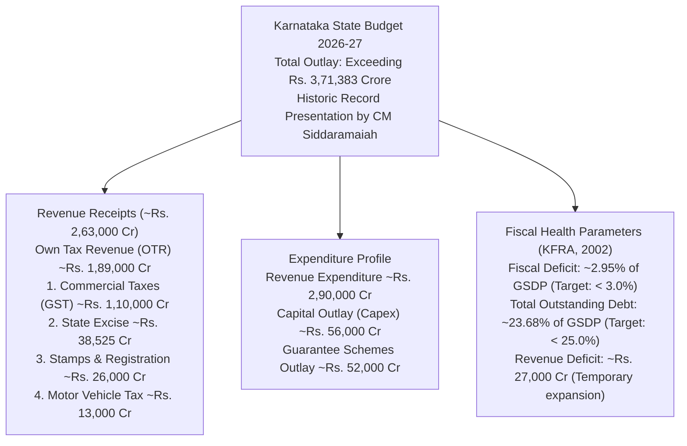
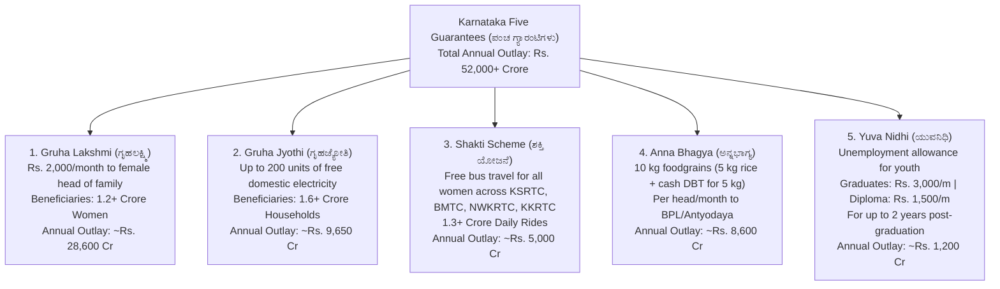

# Karnataka State Budget and Economic Survey (ಕರ್ನಾಟಕ ರಾಜ್ಯ ಆಯವ್ಯಯ ಮತ್ತು ಆರ್ಥಿಕ ಸಮೀಕ್ಷೆ)

> [!exam-focus]
> **Exam Weightage & Testing Patterns**: This is the single highest-scoring topic for Karnataka-specific economics across Prelims Paper 2 Section 1 (State Importance: 5-8 MCQs) and Mains GS-3 Section 3 (guaranteed 15-mark essay question on state finances, GSDP composition, or Five Guarantees).
> - **Prelims Traps**: Confusing Karnataka's sectoral GSVA contributions (Services ~64% > Industry ~21% > Agriculture ~15%) with employment shares (Agriculture employs ~43% of workforce despite contributing only ~15% to GSVA); mixing up KFRA statutory debt ceiling (25% of GSDP) and fiscal deficit ceiling (3% of GSDP).
> - **Mains Dimensions**: Assessing the macro-fiscal sustainability of universal Direct Benefit Transfer (DBT) guarantee schemes (~Rs. 52,000 crore outlay) vis-à-vis state capital expenditure (*Capex*); addressing the intra-state developmental chasm identified by the Dr. D. M. Nanjundappa Committee.

---

## 1. Karnataka Macro-Fiscal Dashboard (As of 2026)

The diagram above details the fiscal architecture of Karnataka: revenue generation dominated by robust State Own Tax Revenues (Commercial Taxes/GST and State Excise) sustaining massive universal welfare outlays while holding fiscal deficit and debt indicators strictly within Karnataka Fiscal Responsibility Act (KFRA) statutory guardrails.

---

## 2. Karnataka Economic Survey: Sectoral Shares & GSDP

### 2.1 Macroeconomic Overview
- **Real GSDP Growth Rate**: Projected at **6.8% to 7.2%** (consistently outpacing national GDP growth by 0.5%–1.0 percentage points).
- **Per Capita Income (ತಲಾ ಆದಾಯ)**: Stands at approximately **Rs. 3,32,000 per annum** (at current prices), ranking Karnataka among the top 3 major states in India and ~70% higher than the national average.
- **Gross State Value Added (GSVA) Sectoral Contribution**:
  1. **Tertiary / Services Sector (ಸೇವಾ ವಲಯ)**: **~64%** of GSVA. Karnataka is the IT capital of India (*Silicon Valley of India*), with Bengaluru contributing over 40% of national software and IT/ITeS exports.
  2. **Secondary / Industry Sector (ಕೈಗಾರಿಕಾ ವಲಯ)**: **~21%** of GSVA. Driven by automobile manufacturing (Bidadi, Narasapura), aerospace and defense, electronics hardware, pharmaceuticals, and machine tools.
  3. **Primary / Agriculture Sector (ಕೃಷಿ ವಲಯ)**: **~15%** of GSVA. Heavily weather-dependent (over 70% rainfed agriculture), yet sustains approximately **43% of the state's total labor force**, highlighting the structural challenge of disguised unemployment and lower labor productivity in farming.

### 2.2 Sectoral Matrix & Structural Dualism
| Sector | Share in GSVA (%) | Share in Workforce (%) | Dominant Driver Industries / Sub-sectors | Strategic State Policy Intervention |
|---|---|---|---|---|
| **Agriculture & Allied** | ~15% | ~43% | Pulses (Tur in Kalaburagi), Ragi, Jowar, Sugarcane, Sericulture (Silk), Coffee (70% of India) | *Krishi Bhagya*, Micro-irrigation, *Raitha Siri* millet subsidies |
| **Industry & Manufacturing** | ~21% | ~22% | Aerospace (HAL, Boeing, Airbus R&D), Automobile, Biotechnology, Heavy Engineering | *Karnataka Industrial Policy 2020-25*, Beyond Bengaluru Cluster Seed Fund |
| **Services** | ~64% | ~35% | IT/ITeS, Fintech, Global Capability Centers (GCCs), Biotechnology research, Logistics | *Karnataka IT Policy*, Startup Policy, GCC Policy 2024–2029 |

---

## 3. The Five Guarantee Schemes: Fiscal & Social Dimensions

In the 2026-27 fiscal year, the Government of Karnataka earmarked an unprecedented **Rs. 52,000+ crore** for its flagship five universal welfare guarantees, implemented via Aadhaar-seeded Direct Benefit Transfer (DBT) and digital authentication through *Seva Sindhu*:

The flowchart above outlines the operational scope and fiscal resource allocations dedicated to Karnataka's five foundational social protection pillars.

### Macro-Economic Evaluation of the Guarantees:
- **Positive Demand Stimulus**: Cash transfers directly into the hands of bottom-quintile households and rural women created an immediate **Keynesian consumption multiplier**, spurring local rural demand for groceries, clothing, and primary essentials.
- **Female Economic Empowerment**: The *Shakti* scheme catalyzed unprecedented female labor mobility (women workers travelling safely to textile factories and urban service jobs) and school/college female attendance.
- **Fiscal Strain on Capital Outlay**: Absorbs nearly **14% of the total state budget outlay**, limiting discretionary capital allocations (*Capex*) for major infrastructure projects (expressways, metro extensions, new irrigation canals) and necessitating elevated excise taxes and motor vehicle levies.

---

## 4. Regional Imbalances & The Nanjundappa Committee

- **The High Power Committee on Redressal of Regional Imbalances**: Chaired by renowned economist **Dr. D. M. Nanjundappa (2000–2002)**.
- **Findings**: Uncovered deep structural disparity between developed southern districts (Bengaluru Urban, Mysuru, Mandya, Dakshina Kannada) and severely backward northern districts:
  - Identified **114 Taluks as backward** out of 175 taluks (subdivided into *Most Backward*, *More Backward*, and *Backward*).
  - Recommended the implementation of a dedicated **Special Development Plan (SDP / ವಿಶೇಷ ಅಭಿವೃದ್ಧಿ ಯೋಜನೆ)** over an eight-year timeframe to inject targeted capital into agriculture, education, and healthcare in backward taluks.
- **Kalyana Karnataka Region Development Board (KKRDB)**: Established under Article 371(J) of the Constitution for Bidar, Kalaburagi, Yadgir, Raichur, Koppal, Ballari, and Vijayanagara; allocated **Rs. 5,000 crore** in the 2026-27 budget for the *Kalyana Patha* rural road network and *Akshara Avishkara* model school infrastructure.

---

## 5. Related Vault Notes
- [[Indian_Economic_Planning_and_Reforms]] — National macroeconomic planning and GST Council.
- [[Poverty_and_Rural_Development]] — Multidimensional poverty and rural employment.
- [[Karnataka_Agriculture_and_Irrigation]] — Agro-climatic zones and irrigation schemes.

---

## 6. Likely Questions & Verbatim PYQs

### Prelims Multiple-Choice Questions
- **PYQ (KPSC KAS 2017 Prelims P2)**: In the Gross State Value Added (GSVA) of Karnataka's economy, which sector accounts for the largest percentage share?
  - (A) Agriculture and Allied Sector
  - (B) Industrial and Manufacturing Sector
  - (C) Services Sector [Correct - ~64%]
  - (D) Mining and Quarrying Sector
- **PYQ (KPSC KAS 2020 Prelims P2)**: The High Power Committee on Redressal of Regional Imbalances in Karnataka, which identified 114 backward taluks and recommended the Special Development Plan, was headed by:
  - (A) Dr. D. M. Nanjundappa [Correct]
  - (B) L. G. Havanur
  - (C) P. R. Nayak
  - (D) K. R. Ramesh Kumar
- **Expected Question (Prelims 2026)**: Under the Karnataka Fiscal Responsibility Act (KFRA), 2002, what is the statutory ceiling prescribed for the state's total outstanding debt as a percentage of GSDP?
  - *Answer*: 25% of GSDP.

### Mains Analytical Question & Answer Outline
- **Mains GS-3 Question**: *"Examine the fiscal implications of universal Direct Benefit Transfer (DBT) welfare schemes on Karnataka's capital formation and economic growth." (15 Marks / 250 Words)*
  - **Introduction**: Note that Karnataka presents a unique fiscal case study, allocating over Rs. 52,000 crore (~14% of budget outlay) to five universal guarantee schemes (Gruha Lakshmi, Gruha Jyothi, Shakti, Anna Bhagya, Yuva Nidhi) in the 2026-27 Budget while complying with KFRA fiscal deficit targets (<3% GSDP).
  - **Short-Term Welfare & Macro-Stimulus**:
    - *Social Security & Poverty Buffer*: Immediate alleviation of inflationary stress on BPL households; guaranteed Rs. 2,000 cash transfer directly to female heads increases women's intra-household agency.
    - *Local Demand Injection*: Cash transfers to low-income deciles exhibit high marginal propensity to consume (MPC), rapidly circulating through village economies and stimulating retail markets.
  - **Fiscal Vulnerabilities & Capital Crowding-Out**:
    - *Compressed Capital Outlay*: High committed revenue expenditure leaves limited fiscal space for vital long-term physical infrastructure (irrigation canals, urban mass transit, power grids).
    - *Revenue Deficit Pressure*: Pushes revenue deficit to around Rs. 27,000 crore, requiring commercial borrowing to finance revenue expenditure.
    - *Tax Exhaustion*: Heavy reliance on non-GST state taxes (State Excise, Stamps duty, Motor Vehicle Tax) reaches practical saturation limits.
  - **Way Forward & Conclusion**: Suggest rationalizing beneficiary registries (excluding high-income income-tax payees using *Kutumba* dynamic data integration), shifting from universal subsidies to targeted conditional transfers, and leveraging Public-Private Partnerships (PPP) for capital infrastructure to safeguard long-term economic growth.

---

> [!summary] Quick Revision Box (10 Non-Negotiable Facts)
> 1. **Karnataka Budget Outlay 2026-27**: Over Rs. 3,71,383 crore; presented by CM Siddaramaiah.
> 2. **GSVA Sectoral Shares**: Services ~64% (dominant), Industry ~21%, Agriculture ~15%.
> 3. **Agricultural Paradox**: Contributes only ~15% to GSVA but employs over 43% of workforce.
> 4. **Per Capita Income**: ~Rs. 3.32 lakh per annum (among top 3 major states in India).
> 5. **Commercial Taxes / GST**: Single largest source of State Own Tax Revenue (>Rs. 1.10 lakh crore).
> 6. **Five Guarantee Outlay**: Exceeds Rs. 52,000+ crore annually across five schemes.
> 7. **Gruha Lakshmi**: Rs. 2,000/month DBT to female heads of family; largest outlay (~Rs. 28,600 crore).
> 8. **KFRA Fiscal Guardrails**: Fiscal Deficit < 3.0% of GSDP; Total Outstanding Debt < 25.0% of GSDP.
> 9. **Dr. D. M. Nanjundappa Committee (2002)**: Identified 114 backward taluks; proposed Special Dev Plan.
> 10. **KKRDB Allocation 2026-27**: Rs. 5,000 crore earmarked for Kalyana Karnataka regional development.
