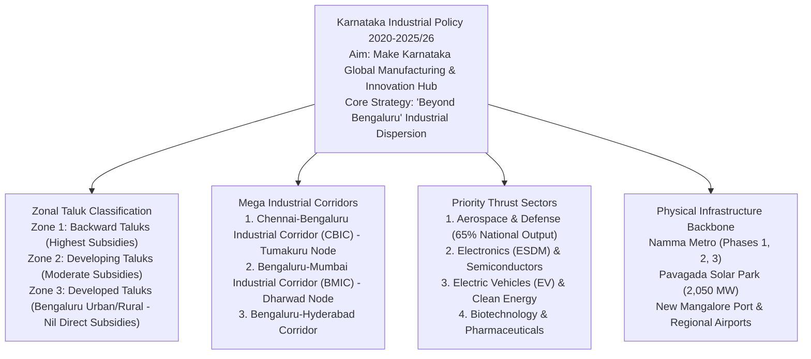

# Industrial Policy, Infrastructure and Cluster Development in Karnataka (ಕರ್ನಾಟಕದ ಕೈಗಾರಿಕಾ ನೀತಿ, ಮೂಲಸೌಕರ್ಯ ಮತ್ತು ಕೈಗಾರಿಕಾ ಕಾರಿಡಾರ್‌ಗಳು)

> [!exam-focus]
> **Exam Weightage & Testing Patterns**: A standard fixture in Mains GS-3 Section 3 (10–15 marks) and Prelims Paper 2 Section 1 (State Economy: 3-5 MCQs).
> - **Prelims Traps**: Confusing industrial corridor nodes (Tumakuru Node is on CBIC, whereas Dharwad Node is on BMIC); confusing Pavagada Solar Park capacity (**2,050 MW / Shakti Sthala**, Tumakuru) with other renewable projects; misidentifying aerospace manufacturing shares (Karnataka produces **over 65% of India's aerospace components**).
> - **Mains Dimensions**: Assessing the efficacy of the "Beyond Bengaluru" cluster policy in reversing regional developmental imbalances; analyzing the competitiveness of the electronics and semiconductor hardware ecosystem in Karnataka; multi-modal logistics bottlenecks.

---

## 1. Industrial Architecture Overview

The flowchart above outlines Karnataka's industrial strategy: shifting from an over-concentrated Bengaluru service economy to regional manufacturing clusters along dedicated freight corridors, incentivized by tiered zonal tax holidays and renewable energy infrastructure.

---

## 2. Karnataka Industrial Policy (2020–2025/2026)

- **Vision**: Position Karnataka as the leading destination in Asia for advanced manufacturing, R&D, and technology incubation, generating over 20 lakh jobs.
- **Categorization of Taluks (ವಲಯ ವಿಂಗಡಣೆ)**:
  - *Zone 1 (Economically Backward Taluks)*: Highest production-linked incentives (turnover-based investment subsidy up to 2.5% of annual turnover for 7 years), 100% exemption from stamp duty, electricity duty exemptions. Includes most taluks of Kalyana Karnataka and Northern Maidan.
  - *Zone 2 (Developing Taluks)*: Moderate incentives to attract medium-scale manufacturing outside tier-1 cities.
  - *Zone 3 (Developed Urban Centers)*: Encompasses Bengaluru Urban and Bengaluru Rural districts; zero direct capital subsidies, nudging major industrial investments to shift outward.
- **"Beyond Bengaluru" Policy (ಬಿಯಾಂಡ್ ಬೆಂಗಳೂರು)**:
  - Actively establishes dedicated industrial and technology clusters:
    - *Mysuru*: Semiconductor components, PCB manufacturing, and electronics system design.
    - *Hubballi-Dharwad*: FMCG corridor, consumer durable manufacturing, and heavy engineering.
    - *Belagavi*: Precision engineering, foundries, and aerospace machining.
    - *Kalaburagi / Bidar*: Textile parks and pharmaceutical manufacturing.
    - *Mangaluru*: Petrochemicals, coastal logistics, IT/fintech SEZs, and marine food processing.
    - *Tumakuru*: Machine tools, heavy machinery, and Japanese Industrial Township (JIT).

---

## 3. Dedicated Industrial Corridors & Priority Sectors

### 3.1 Mega Industrial Corridors
1. **Chennai-Bengaluru Industrial Corridor (CBIC)**:
   - Covers Tamil Nadu, Karnataka, and Andhra Pradesh.
   - **Tumakuru Industrial Node (ವಸಂತನರಸಾಪುರ)**: Encompasses 8,484 acres developed by NICDIT and KIADB; houses the **Japan Industrial Township (JIT)** and India's first integrated machine tool park.
2. **Bengaluru-Mumbai Industrial Corridor (BMIC)**:
   - Connects peninsular India with western seaports.
   - **Dharwad Industrial Node**: Hub for automotive manufacturing, electrical machinery, and precision fabrication.

### 3.2 Leadership in High-Tech Thrust Sectors
- **Aerospace and Defense (ಏರೋಸ್ಪೇಸ್ ಮತ್ತು ರಕ್ಷಣಾ ವಲಯ)**:
  - Karnataka was the first state in India to announce a dedicated Aerospace Policy (2013, updated 2022).
  - Produces **over 65% of India's aerospace components** and **70% of military helicopters and aircraft** (home to HAL, ISRO, DRDO labs, Boeing Engineering Center, Airbus, and Collins Aerospace).
  - Operates the dedicated **Devanahalli Aerospace SEZ & Defense Park** adjacent to Kempegowda International Airport.
- **Electronics System Design & Manufacturing (ESDM) and Semiconductors**:
  - Anchored by Foxconn's mega manufacturing facility at Devanahalli (*Project Elephant*); semiconductor testing and packaging units at Mysuru and Electronic City.
- **Electric Vehicles (EV) and Energy Storage**:
  - Karnataka was the **first state in India to launch an Electric Vehicle Policy in 2017**.
  - Strong EV manufacturing ecosystem: Ola Electric, Ather Energy, Mahindra Electric, and battery manufacturing parks.
- **Biotechnology (ಜೈವಿಕ ತಂತ್ರಜ್ಞಾನ)**:
  - Known as the **Biotech Capital of India**, housing over 60% of the country's biotech companies (Biocon, Syngene).
  - Bangalore Bioinnovation Centre (BBC) at Electronic City operates as India's premier life sciences incubator.

---

## 4. Physical & Energy Infrastructure Backbone

### 4.1 Renewable Energy: Pavagada Solar Park (ಶಕ್ತಿ ಸ್ಥಲ)
- Located at Pavagada in Tumakuru district (historically drought-prone semi-arid tract).
- Developed by Karnataka Solar Power Development Corporation Limited (KSPDCL - JV of SECI and KREDL).
- **Capacity: 2,050 Megawatts (MW)**: One of the **largest operational single-site solar power parks in the world**.
- **Innovative Land Lease Model**: Land was not acquired through forced displacement; over 13,000 acres were leased directly from 2,300 local farmers on 28-year contracts with annual inflation-adjusted lease rentals, providing guaranteed income to drought-affected families.

### 4.2 Transport & Connectivity Infrastructure
- **Aviation**:
  - *Kempegowda International Airport (BLR)*: Terminal 2 ("Terminal in a Garden") received UNESCO's Prix Versailles world architectural prize; India's leading perishables and pharma air-cargo gateway.
  - *Regional Aviation (UDAN)*: Fast-expanding regional airports at Shivamogga (Kuvempu Airport), Vijayapura, Belagavi, Hubballi, Kalaburagi, and newly developed Hassan airport.
- **Urban Mass Transit: Namma Metro (ನಮ್ಮ ಮೆಟ್ರೋ)**:
  - Operated by Bangalore Metro Rail Corporation Limited (BMRCL).
  - Network spans Purple Line, Green Line, Yellow Line (Driverless CBTC), Pink Line, and Phase 2B Blue Line connecting Silk Board to Kempegowda Airport (38 km).
- **Maritime**:
  - **New Mangalore Port Authority (NMPA)**: Deep-water all-weather port handling iron ore pellets, POL products, LPG, and coffee exports.

---

## 5. Related Vault Notes
- [[Karnataka_Budget_and_Economic_Survey]] — Fiscal health, GSDP, and state revenue.
- [[Science_and_Technology_Developments]] — Space technology and R&D ecosystem.
- [[Karnataka_Physiography_and_Rivers]] — Ports, coastal plain, and mineral geography.

---

## 6. Likely Questions & Verbatim PYQs

### Prelims Multiple-Choice Questions
- **PYQ (KPSC KAS 2017 Prelims P2)**: The world-renowned "Pavagada Solar Park" (Shakti Sthala) with an operational capacity of 2,050 MW is located in which district of Karnataka?
  - (A) Chitradurga
  - (B) Ballari
  - (C) Tumakuru [Correct]
  - (D) Koppal
- **PYQ (KPSC KAS 2020 Prelims P2)**: Under the Chennai-Bengaluru Industrial Corridor (CBIC), which location in Karnataka has been developed as the primary Integrated Industrial Node?
  - (A) Bidadi
  - (B) Vasanthanarasapura (Tumakuru) [Correct]
  - (C) Malur
  - (D) Narasapura
- **Expected Question (Prelims 2026)**: What percentage of India's total aerospace and defense aircraft manufacturing is accounted for by the state of Karnataka?
  - *Answer*: Over 65%.

### Mains Analytical Question & Answer Outline
- **Mains GS-3 Question**: *"Critically evaluate the 'Beyond Bengaluru' industrial policy initiative of the Government of Karnataka. Has it successfully addressed the regional concentration of manufacturing?" (15 Marks / 250 Words)*
  - **Introduction**: Highlight that while Karnataka is an economic powerhouse contributing over 8% of national GDP, its economic value addition has historically been hyper-concentrated in the Bengaluru metropolitan region (which generates over 35% of GSDP).
  - **Core Provisions of 'Beyond Bengaluru'**:
    - Progressive Zonal categorization: Denies direct capital incentives to Zone 3 (Bengaluru Urban) while offering generous turnover-based subsidies, stamp duty waivers, and power concessions in Zone 1 (backward northern taluks).
    - Establishing secondary cluster hubs tailored to local competencies: Engineering at Belagavi, FMCG at Dharwad, textiles at Kalaburagi, electronics hardware at Mysuru.
  - **Notable Successes**:
    - Tumakuru has emerged as an industrial powerhouse on the CBIC corridor (Japanese industrial township, food processing, machine tools).
    - Mysuru has attracted prominent ESDM and semiconductor testing investments.
    - Hubballi-Dharwad has developed a robust consumer goods manufacturing belt.
  - **Persistent Challenges**:
    - Logistics & Infrastructure Deficit: Secondary cities still lack international air connectivity, high-speed rail links, and specialized testing laboratories.
    - Talent Retention: Young engineering and IT talent continues migrating to Bengaluru due to superior urban social infrastructure, night life, and career mobility.
  - **Conclusion**: Conclude that true industrial dispersal requires investing in tier-2 urban livability (smart city infrastructure, world-class schools, and hospitals) alongside industrial land subsidies.

---

> [!summary] Quick Revision Box (10 Non-Negotiable Facts)
> 1. **Pavagada Solar Park (Shakti Sthala)**: 2,050 MW capacity; Tumakuru district.
> 2. **Aerospace Leadership**: Karnataka produces over 65% of India's aerospace output.
> 3. **First EV Policy (2017)**: Karnataka was the first state in India to introduce an Electric Vehicle policy.
> 4. **Tumakuru Node (CBIC)**: Major industrial node housing the Japan Industrial Township (JIT).
> 5. **Dharwad Node (BMIC)**: Primary node on the Bengaluru-Mumbai Industrial Corridor.
> 6. **Industrial Policy Zonal System**: Zone 1 (highest subsidies), Zone 2 (moderate), Zone 3 (Bengaluru - nil direct subsidies).
> 7. **Biotech Capital**: Karnataka accounts for over 60% of India's biotechnology companies.
> 8. **Foxconn Mega Plant**: Setting up major iPhone manufacturing unit at Devanahalli.
> 9. **New Mangalore Port (NMPA)**: Karnataka's premier all-weather major deep-water seaport.
> 10. **Terminal 2 (KIA Bengaluru)**: "Terminal in a Garden" recognized by UNESCO Prix Versailles.
