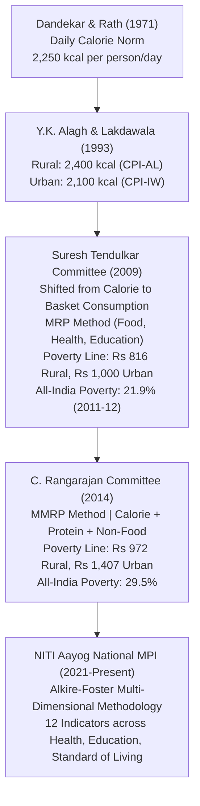

# Poverty Alleviation, Multidimensional Poverty and Rural Development Initiatives (ಬಡತನ ನಿರ್ಮೂಲನೆ, ಬಹುಆಯಾಮದ ಬಡತನ ಮತ್ತು ಗ್ರಾಮೀಣಾಭಿವೃದ್ಧಿ ಯೋಜನೆಗಳು)

> [!exam-focus]
> **Exam Weightage & Testing Patterns**: A standard topic in Prelims Paper 1 (Humanities: 3-5 MCQs) and Mains GS-1 Section 3 (Economy & Rural Development: 15-mark essay question on poverty metrics or rural livelihood schemes).
> - **Prelims Traps**: Confusing poverty line calculation committees (Lakdawala 1993 calorie norm vs Tendulkar 2009 consumption expenditure basket vs Rangarajan 2014 nutrition plus non-food normative basket); confusing NITI Aayog's Multidimensional Poverty Index (MPI: 12 indicators) with Global MPI (10 indicators - India added Antenatal Care and Bank Accounts).
> - **Mains Dimensions**: Assessing MGNREGA as a rights-based safety net vs an engine of climate-resilient rural asset creation; the transformative role of Karnataka's *Sanjeevini* (NRLM) Self-Help Group (SHG) ecosystem in women's economic mobilization.

---

## 1. Evolution of Poverty Estimation in India

The flowchart above illustrates the transition in Indian poverty estimation: from early subsistence calorie measurements to consumption expenditure baskets and modern multidimensional deprivation indexing.

---

## 2. NITI Aayog National Multidimensional Poverty Index (MPI)

- **Methodology**: Adapts the Oxford Poverty and Human Development Initiative (OPHI) / UNDP **Alkire-Foster method**.
- **Three Dimensions and 12 Weighted Indicators**:
  1. **Health (ಆರೋಗ್ಯ - 1/3rd Weight)**:
     - *Nutrition* (1/6th): Any child, adolescent, or adult found undernourished.
     - *Child & Adolescent Mortality* (1/12th): Any child has died in the family in past 5 years.
     - *Antenatal Care* (1/12th - *India specific indicator*): At least 4 ANC visits for women.
  2. **Education (ಶಿಕ್ಷಣ - 1/3rd Weight)**:
     - *Years of Schooling* (1/6th): Not a single member has completed 6 years of schooling.
     - *School Attendance* (1/6th): Any school-age child not attending school.
  3. **Standard of Living (ಜೀವನ ಮಟ್ಟ - 1/3rd Weight, 1/36th each)**:
     - *Cooking Fuel* (clean LPG/biogas vs dung/firewood).
     - *Sanitation* (improved flush/pit toilet).
     - *Drinking Water* (safe water within 30 mins).
     - *Housing* (pucca structure).
     - *Electricity*.
     - *Assets* (television, vehicle, etc.).
     - *Bank Account* (*India specific indicator*): No household member has a bank/post office account.
- **Poverty Headcount in Karnataka**:
  - Multidimensional poverty in Karnataka declined sharply from **13.11% in NFHS-4 (2015-16)** to **7.58% in NFHS-5 (2019-21)**, dropping further to approximately **~5.4% by 2024–2026**.
  - Wide intra-state divergence remains: Southern and coastal districts (Bengaluru Urban < 1.5%, Udupi < 1.8%) boast near-zero deprivation, whereas northern districts (Yadgir ~25%, Raichur ~21%, Kalaburagi ~16%) exhibit the highest multidimensional deprivations in nutrition, sanitation, and clean cooking fuel.

---

## 3. Flagship Rural Development & Livelihood Schemes

### 3.1 Mahatma Gandhi NREGA (ಮಹಾತ್ಮ ಗಾಂಧಿ ಉದ್ಯೋಗ ಖಾತರಿ ಯೋಜನೆ: 2005)
- **Statutory Right**: Guarantees at least **100 days of wage employment** in a financial year to every rural household whose adult members volunteer to do unskilled manual work.
- **Operational Rules**:
  - *Demand-Driven*: Work must be provided within **15 days of application**; failing which the state must pay an **Unemployment Allowance** (Section 7).
  - *Panchayat Primacy*: Grama Panchayats plan and execute at least 50% of works; Grama Sabha conducts mandatory bi-annual **Social Audits**.
  - *Gender Focus*: At least **one-third (33.3%) of beneficiaries must be women** (in Karnataka, women comprise over 52% of active workers).
  - *Wage-Material Ratio*: Strictly maintained at 60:40 across all works.
  - *Karnataka Geo-Tagging*: Geo-tagging of all created community assets (farm ponds, desilting of tanks under *Jalamrutha*, trenching) through the *Bhuvan* satellite portal.

### 3.2 DAY-NRLM / Sanjeevini (ಸಂಜೀವಿನಿ - ಗ್ರಾಮೀಣ ಜೀವನೋಪಾಯ ಅಭಿಯಾನ)
- Implemented in Karnataka by the **Karnataka State Rural Livelihood Promotion Society (KSRLPS - Sanjeevini)**.
- **Core Strategy**: Mobilize rural poor women into **Self-Help Groups (SHGs / ಸ್ತ್ರೀ ಶಕ್ತಿ ಸಂಘಗಳು)**, federating them into Village Organizations (VOs) and Gram Panchayat Level Federations (GPLFs).
- **Financial Architecture**:
  - Revolving Fund (RF) and Community Investment Fund (CIF) injected directly to build creditworthiness.
  - Intensive Bank Linkage for micro-enterprises (sericulture, dairy farming, millet processing, handlooms).

### 3.3 Rural Housing Programs
- **PMAY-Gramin (ಪ್ರಧಾನಮಂತ್ರಿ ಆವಾಸ್ ಯೋಜನೆ - ಗ್ರಾಮೀಣ)**: Financial assistance to BPL rural families to construct pucca houses with a minimum floor area of 25 sq meters, bundled with toilet construction under Swachh Bharat and power connections under Saubhagya.
- **Karnataka State Housing Board & Rajiv Gandhi Housing Corporation (RGHCL)**:
  - *Basava Vasathi Yojane (ಬಸವ ವಸತಿ ಯೋಜನೆ)*: State-funded housing scheme for rural homeless BPL families.
  - *Dr. B. R. Ambedkar Nivas Yojane*: Housing subsidies for rural SC/ST families.

### 3.4 Jal Jeevan Mission / Mane Manege Gange (ಜಲ ಜೀವನ್ ಮಿಷನ್ / ಮನೆ ಮನೆಗೆ ಗಂಗೆ)
- Aims to provide **Functional Household Tap Connections (FHTC)** supplying **55 liters of potable drinking water per capita per day (lpcd)** to every rural household.
- Supported in Karnataka by Multi-Village Schemes (MVS) drawing from perennial river reservoirs (Cauvery, Krishna, Tungabhadra) to tackle fluoride, arsenic, and salinity groundwater contamination in Kolar, Chikkaballapur, and Raichur districts.

---

## 4. Related Vault Notes
- [[Indian_Economic_Planning_and_Reforms]] — National macroeconomic planning and NITI Aayog.
- [[Karnataka_Budget_and_Economic_Survey]] — State budget allocations for rural development.
- [[Panchayati_Raj_and_Decentralization_Karnataka]] — Grama Panchayat role in executing MGNREGA and housing.

---

## 5. Likely Questions & Verbatim PYQs

### Prelims Multiple-Choice Questions
- **PYQ (KPSC KAS 2017 Prelims P1)**: The Suresh Tendulkar Committee (2009) appointed by the Planning Commission recommended measuring the poverty line on the basis of which of the following criteria?
  - (A) Minimum intake of 2400 calories in rural areas
  - (B) Monthly per capita consumption expenditure across a diversified basket including health and education [Correct]
  - (C) Ownership of land and livestock
  - (D) Access to formal banking institutions
- **PYQ (KPSC KAS 2020 Prelims P1)**: Under the Mahatma Gandhi National Rural Employment Guarantee Act (MGNREGA), what is the minimum proportion of wage employment statutorily reserved for women?
  - (A) 25%
  - (B) 33.3% (One-third) [Correct]
  - (C) 50%
  - (D) 40%
- **Expected Question (Prelims 2026)**: In NITI Aayog's National Multidimensional Poverty Index (MPI), which two indicators were added specifically for the Indian context over and above the global 10 indicators?
  - *Answer*: Antenatal Care (Health dimension) and Bank Account (Standard of Living dimension).

### Mains Analytical Question & Answer Outline
- **Mains GS-1 / GS-3 Question**: *"Evaluate the effectiveness of MGNREGA as a social safety net and an instrument of rural asset creation in Karnataka's drought-prone districts." (15 Marks / 250 Words)*
  - **Introduction**: Introduce MGNREGA as India's premier demand-driven employment guarantee statute, providing vital livelihood buffers in arid and drought-vulnerable rural ecosystems.
  - **Role as a Social Safety Net in Karnataka**:
    - *Distress Migration Mitigation*: During severe drought years in Northern Maidan (Kalaburagi, Vijayapura, Ballari), guaranteed local wage work mitigates forced distress migration of rural families to Bengaluru or Mumbai.
    - *Gender Parity & Financial Inclusion*: Women represent over 52% of the workforce in Karnataka, earning equal statutory daily wages transferred directly into bank accounts via Aadhaar-enabled DBT.
  - **Asset Creation & Climate Resilience**:
    - Construction of farm ponds (*Krishi Bhagya* convergence), percolation tanks, check dams, and contour bunding improves groundwater tables.
    - Afforestation drives along roadside channels and Grama Natham lands.
  - **Operational Bottlenecks**: Delayed wage payments caused by delayed central fund disbursements; bureaucratic corruption in material component procurement (40%); under-utilization of Social Audits in weak Grama Panchayats.
  - **Conclusion**: Emphasize convergence of MGNREGA works with watershed restoration and climate-smart agriculture to build permanent productive rural wealth.

---

> [!summary] Quick Revision Box (10 Non-Negotiable Facts)
> 1. **Tendulkar Poverty Line (2011-12)**: All-India poverty at 21.9% (Rs. 816 rural, Rs. 1,000 urban).
> 2. **Rangarajan Poverty Line (2014)**: All-India poverty at 29.5% (Rs. 972 rural, Rs. 1,407 urban).
> 3. **NITI Aayog National MPI**: 12 indicators across 3 dimensions (Health, Education, Living Standard).
> 4. **Karnataka MPI Score**: Multidimensional poverty fell from 13.11% (NFHS-4) to 7.58% (NFHS-5).
> 5. **MGNREGA 100 Days**: Demand-driven legal guarantee; 1/3rd jobs reserved for women.
> 6. **Unemployment Allowance**: Payable if MGNREGA work is not provided within 15 days of application.
> 7. **Sanjeevini (KSRLPS)**: Karnataka's rural livelihood mission organizing women SHG federations.
> 8. **Jal Jeevan Mission Target**: 55 liters per capita per day (lpcd) tap water to every rural home.
> 9. **Basava Vasathi Yojane**: State housing scheme for homeless rural BPL families.
> 10. **MGNREGA Ratio**: 60:40 wage-to-material expenditure ratio strictly enforced.
