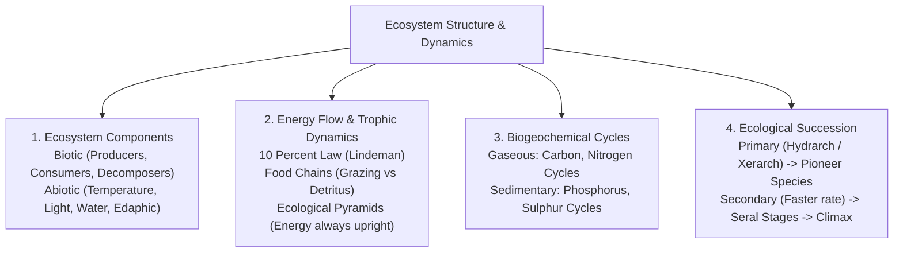
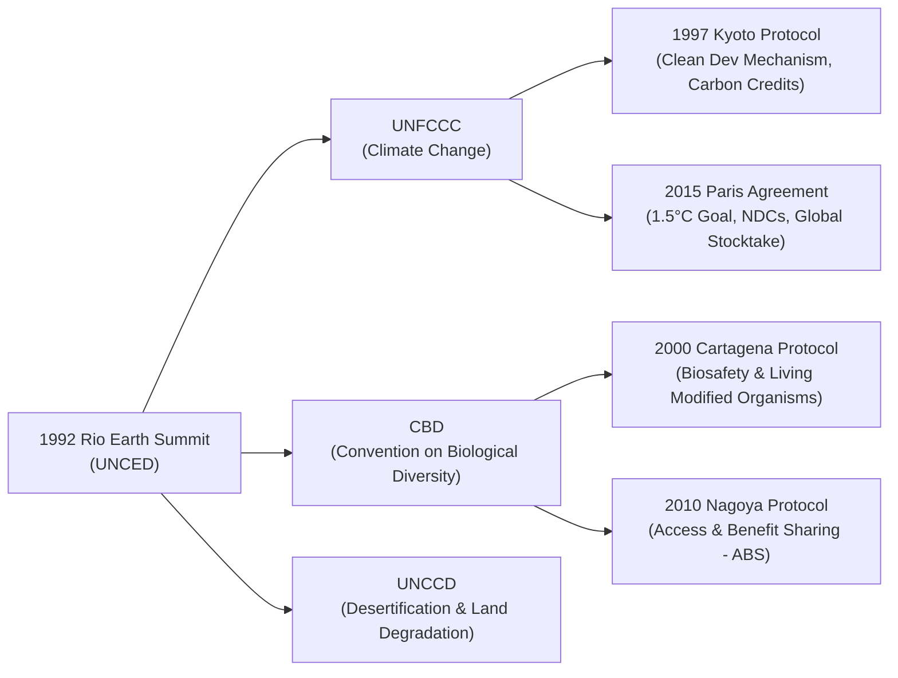

# Environment, Ecology, Biodiversity and Climate Change (ಪರಿಸರ, ಪರಿಸರ ವಿಜ್ಞಾನ, ಜೀವವೈವಿಧ್ಯ ಮತ್ತು ಹವಾಮಾನ ಬದಲಾವಣೆ)

> [!exam-focus]
> **Exam Weightage & Testing Patterns**: High-priority core topic in Prelims Paper 2 Section 2 (10-12 MCQs) and Mains GS-3 Section 2.
> - **Prelims Traps**: Confusing greenhouse gases by GWP (SF6 > HFCs > N2O > CH4 > CO2); mixing Ramsar criteria with UNESCO Natural Heritage criteria; confusing National Ambient Air Quality Standards (NAAQS: 12 pollutants) with Air Quality Index (AQI: 8 pollutants).
> - **Mains Dimensions**: Assessing India's Panchamrit commitments versus development imperatives; evaluating Karnataka State Action Plan on Climate Change (KSAPCC 2.0); analyzing carbon credit trading schemes under the Energy Conservation (Amendment) Act.

---

## 1. Fundamentals of Ecology & Ecosystems

The diagram above details the operational architecture of ecosystems, illustrating the directional flow of thermodynamic energy, biogeochemical element cycling, and community succession toward ecological equilibrium.

### 1.1 Trophic Dynamics & Ecological Pyramids
- **Lindeman's 10% Energy Efficiency Rule**: Only ~10% of energy stored as biomass in a given trophic level is transferred to the next trophic level; 90% is lost via metabolic respiration and entropy.
- **Pyramids Comparison**:
  - *Pyramid of Numbers*: Upright in grasslands; inverted in single-tree ecosystems supporting hyper-parasites.
  - *Pyramid of Biomass*: Upright in terrestrial forests; **inverted in aquatic / marine ecosystems** (phytoplankton turnover is rapid with minimal instantaneous biomass supporting larger zooplankton).
  - *Pyramid of Energy*: **Always upright without exception**, abiding by the Second Law of Thermodynamics.

### 1.2 Ecological Concepts for KAS
- **Ecotone (ಪರಿಸರ ಪರಿವರ್ತನಾ ವಲಯ)**: Transition zone between two distinct biomes (e.g., mangroves between terrestrial and marine; marshland). Exhibiting the **"Edge Effect" (ಅಂಚಿನ ಪರಿಣಾಮ)** where species density and richness exceed either bordering community.
- **Ecological Niche (ಪರಿಸರ ಗೂಡು)**: The unique functional status, trophic role, and spatial habitat of an organism within its ecological community (defined by Joseph Grinnell and G.E. Hutchinson). Two species cannot indefinitely occupy identical ecological niches (Gause's Competitive Exclusion Principle).
- **Keystone Species (ಪ್ರಮುಖ ಪ್ರಭೇದ)**: Species whose presence and role exert disproportionately large control over community structure relative to their numerical abundance (e.g., Tiger in Bandipur, Ficus trees producing year-round fig fruit in Western Ghats).

---

## 2. Biodiversity & Conservation Paradigms

### 2.1 Biodiversity Levels & Measurement
1. **Genetic Diversity**: Variation of genes within a species (e.g., over 50,000 distinct rice strains in India).
2. **Species Diversity**: Variety of species within a habitat, measured through:
   - *Alpha Diversity*: Species richness within a single homogeneous community.
   - *Beta Diversity*: Degree of species turnover/change between adjacent habitats along an environmental gradient.
   - *Gamma Diversity*: Total landscape or regional species diversity.
3. **Ecosystem Diversity**: Diversity of ecological habitats, biomes, and biological communities across geographical regions.

### 2.2 Conservation Strategies: In-situ vs Ex-situ
| Type | Characteristics | Key Protected Areas in India & Karnataka |
|---|---|---|
| **In-situ Conservation (ಸ್ಥಳೀಯ ಸಂರಕ್ಷಣೆ)** | Protection of genetic resources within natural ecosystems and natural habitats. | **National Parks (5 in Karnataka)**: Bandipur, Nagarhole, Kudremukh, Anshi, Bannerghatta. **Wildlife Sanctuaries (33 in KA)**: Cauvery, Bhadra, Dandeli, Sharavathi. **Biosphere Reserves**: Nilgiri Biosphere Reserve (includes Bandipur & Nagarhole). **Conservation Reserves**: Bankapura Peacock Sanctuary, Hornbill Conservation Reserve. |
| **Ex-situ Conservation (ಪರ-ಸ್ಥಳೀಯ ಸಂರಕ್ಷಣೆ)** | Preservation of components of biological diversity outside their natural habitats. | **Botanical Gardens**: Lalbagh Botanical Garden (Bengaluru). **Zoological Gardens**: Sri Chamarajendra Zoological Gardens (Mysuru Zoo), Bannerghatta Biological Park. **Gene & Seed Banks**: National Bureau of Plant Genetic Resources (NBPGR, New Delhi). |

---

## 3. Global Environmental Conventions & Protocols

The diagram above displays the multilateral treaties originating from the landmark 1992 Rio Earth Summit (Rio Conventions), along with their subsequent protocols governing global climate, biosafety, and equitable genetic resource distribution.

### 3.1 Landmark Treaties
- **Ramsar Convention on Wetlands (1971)**: Intergovernmental treaty for conservation and wise use of wetlands. Karnataka hosts 4 designated Ramsar sites:
  1. *Ranganathittu Bird Sanctuary (ರಂಗನತಿಟ್ಟು)* (Mandya) - Designated 2022.
  2. *Aghanashini Estuary (ಅಘನಾಶಿನಿ)* (Uttara Kannada) - Designated 2024.
  3. *Ankasamudra Bird Conservation Reserve (ಅಂಕಸಮುದ್ರ)* (Vijayanagara) - Designated 2024.
  4. *Magadi Kere Conservation Reserve (ಮಾಗಡಿ ಕೆರೆ)* (Gadag) - Designated 2024.
- **CITES (1973)**: Convention on International Trade in Endangered Species of Wild Fauna and Flora. Classifies species into Appendix I (commercial trade banned), Appendix II, and Appendix III.
- **Basel, Rotterdam & Stockholm Conventions (BRS Triad)**:
  - *Basel*: Transboundary movements of hazardous wastes.
  - *Rotterdam*: Prior Informed Consent (PIC) procedure for certain hazardous chemicals and pesticides in international trade.
  - *Stockholm*: Elimination of Persistent Organic Pollutants (POPs - the "dirty dozen").
- **Montreal Protocol (1987)** & **Kigali Amendment (2016)**: Phasing out ozone-depleting substances (CFCs, HCFCs) and hydrofluorocarbons (HFCs, potent GHGs). World Ozone Day celebrated on **16 September**.

---

## 4. India's Climate Action & Karnataka Initiatives

### 4.1 India's Enhanced Nationally Determined Contributions (NDCs) & Panchamrit (ಪಂಚಾಮೃತ)
At COP26 (Glasgow) and formally submitted to the UNFCCC:
1. Reach non-fossil energy capacity of **500 GW by 2030**.
2. Meet **50% of energy requirements from renewable energy by 2030**.
3. Reduce total projected carbon emissions by **1 billion tonnes by 2030**.
4. Reduce emissions intensity of GDP by **45% by 2030** compared to 2005 levels.
5. Achieve target of **Net-Zero Emissions by 2070**.

### 4.2 Mission LiFE (Lifestyle for Environment - ಪರಿಸರಕ್ಕಾಗಿ ಜೀವನಶೈಲಿ)
- Launched by Prime Minister Narendra Modi at COP26 and operationalized worldwide with UN Secretary-General António Guterres. Focuses on individual and community demand-side interventions across 7 themes: Save Energy, Save Water, Say No to Single-Use Plastic, Adopt Sustainable Food Systems, Reduce Waste, Adopt Healthy Lifestyles, Reduce E-Waste.

### 4.3 Karnataka State Action Plan on Climate Change (KSAPCC 2.0)
- Prepared under the nodal coordination of the **Environmental Management and Policy Research Institute (EMPRI - ಬೆಂಗಳೂರು)**.
- Identifies vulnerability zones:
  - *North Interior Karnataka (ಬೆಳಗಾವಿ, ಕಲಬುರಗಿ, ವಿಜಯಪುರ)*: High vulnerability to drought, extreme heat waves, and rain deficits.
  - *Coastal Karnataka (ಉಡುಪಿ, ದಕ್ಷಿಣ ಕನ್ನಡ, ಉತ್ತರ ಕನ್ನಡ)*: Vulnerable to sea-level rise, coastal erosion, saltwater intrusion into aquifers, and cyclonic storm surges.
  - *Western Ghats (ಮಲೆನಾಡು)*: Vulnerable to slope instability, severe landslides (e.g., Wayanad-Kodagu disaster vulnerabilities), and fragmentation of endemic flora.

---

## 5. Environmental Pollution & Legal Safeguards

### 5.1 Air Quality Standards & Pollutants
- **National Ambient Air Quality Standards (NAAQS)**: Formulated under the Air (Prevention and Control of Pollution) Act, 1981 by CPCB. Monitors **12 pollutants**: PM10, PM2.5, SO2, NO2, CO, NH3, O3, Lead (Pb), Benzene, Benzo(a)pyrene, Arsenic, Nickel.
- **National Air Quality Index (AQI)**: Public health communication metric monitoring **8 pollutants**: PM10, PM2.5, NO2, SO2, CO, O3, NH3, and Pb. Evaluated across 6 categories (Good, Satisfactory, Moderate, Poor, Very Poor, Severe).

### 5.2 Key Environmental Legislation in India
1. **Wildlife (Protection) Act, 1972 (WPA)**: Amended in 2022 to reduce Schedules from 6 to 4 and align with CITES Appendices.
2. **Water (Prevention and Control of Pollution) Act, 1974**: Established Central and State Pollution Control Boards (KSPCB in Karnataka).
3. **Air (Prevention and Control of Pollution) Act, 1981**: Expanded PCB mandates to atmospheric contamination and noise pollution.
4. **Environment (Protection) Act, 1986 (EPA)**: Umbrella legislation enacted under Article 253 of the Constitution in the aftermath of the Bhopal Gas Tragedy (1984). Notified Coastal Regulation Zone (CRZ) rules and Environmental Impact Assessment (EIA).
5. **Biological Diversity Act, 2002**: Three-tier structure:
   - *National Biodiversity Authority (NBA, Chennai)*.
   - *State Biodiversity Boards (Karnataka Biodiversity Board - KBB, Bengaluru)*.
   - *Biodiversity Management Committees (BMCs)* at Panchayat/Urban local body level, preparing **People's Biodiversity Registers (PBRs)**.
6. **National Green Tribunal Act, 2010 (NGT)**: Established judicial body for expeditious disposal of environmental disputes within 6 months. Guided by principles of natural justice and sustainable development.

---

## Likely Questions & PYQs

### Model Question 1 (Prelims)
**Q**: Which one of the following ecological pyramids is NEVER inverted under any circumstances?
A) Pyramid of biomass in a deep lake
B) Pyramid of numbers in a parasitic forest ecosystem
C) Pyramid of energy in an ecosystem
D) Pyramid of biomass in a temperate grassland
*Answer*: **C**
*Explanation*: Energy transfer across trophic levels is governed by the Second Law of Thermodynamics and Lindeman's 10% law. Energy is dissipated as heat at each step; therefore, the pyramid of energy is always strictly upright.

### Model Question 2 (Prelims)
**Q**: Consider the following wetlands in Karnataka:
1. Ranganathittu Bird Sanctuary
2. Aghanashini Estuary
3. Ankasamudra Bird Conservation Reserve
4. Magadi Kere Conservation Reserve
How many of the above are designated Ramsar Sites of International Importance as of 2026?
A) Only one
B) Only two
C) Only three
D) All four
*Answer*: **D**
*Explanation*: All four wetlands are officially designated Ramsar sites. Ranganathittu was declared in 2022; Aghanashini, Ankasamudra, and Magadi Kere were added in 2024, raising Karnataka's total Ramsar sites to four.

### Model Question 3 (Mains GS-3 - 15 Marks)
**Q**: Examine the vulnerability profile of Karnataka across agro-ecological zones to climate change. Critically evaluate the adaptation strategies outlined in the Karnataka State Action Plan on Climate Change (KSAPCC 2.0).

---

> [!summary]
> **Key Revision Points**:
> - Pyramid of energy is always upright; aquatic biomass pyramid is inverted.
> - Ecotone exhibits the Edge Effect; Keystone species maintain disproportionate ecosystem balance.
> - Karnataka has 4 Ramsar sites: Ranganathittu, Aghanashini, Ankasamudra, Magadi Kere.
> - India's COP26 Panchamrit targets: 500 GW non-fossil by 2030, 50% RE by 2030, 45% carbon intensity reduction, Net-Zero by 2070.
> - EMPRI coordinates KSAPCC 2.0; Western Ghats and North Interior Karnataka represent extreme vulnerability hotspots.
