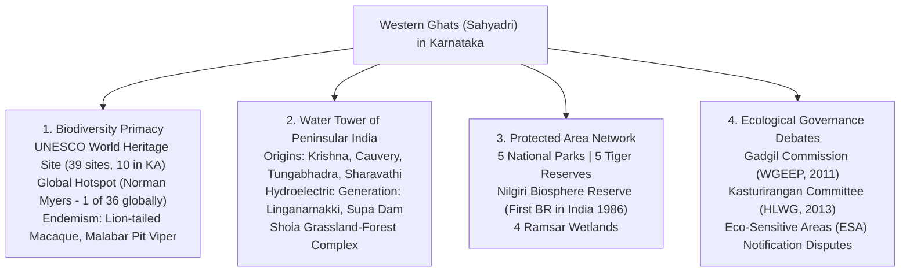
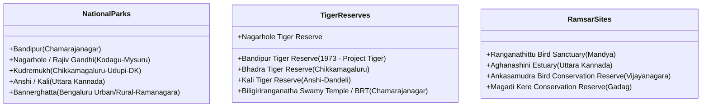
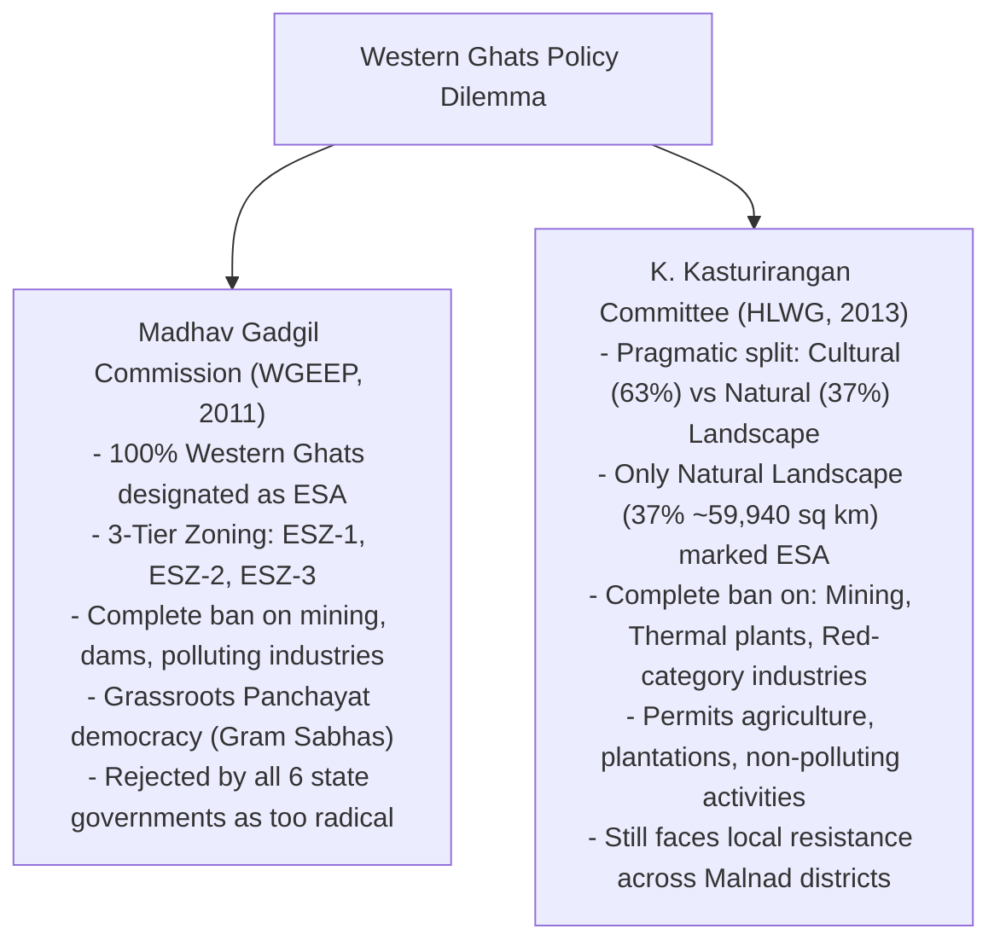

# Biodiversity of Karnataka and Western Ghats Ecology (ಕರ್ನಾಟಕದ ಜೀವವೈವಿಧ್ಯ ಮತ್ತು ಪಶ್ಚಿಮ ಘಟ್ಟಗಳ ಪರಿಸರ ವಿಜ್ಞಾನ)

> [!exam-focus]
> **Exam Weightage & Testing Patterns**: One of the most frequently tested areas in both Prelims Paper 2 (8-10 questions on National Parks, Tiger Reserves, Endemism, Ramsar sites) and Mains GS-3 Section 2 (Western Ghats conservation vs development dilemmas).
> - **Prelims Traps**: Confusing Karnataka's 5 National Parks (Bannerghatta is the only one with a biological park/butterfly park; Kudremukh has origin of Tunga, Bhadra, and Netravati); confusing Gadgil Commission (WGEEP - strict 3-tier ESZ) with Kasturirangan Committee (HLWG - 37% natural landscape as ESA); mixing tiger census ranks (Karnataka is 2nd with 563 tigers, just behind MP with 785).
> - **Mains Dimensions**: Analyzing the ecological-economic friction in Western Ghats development; the controversy over Yettinahole river diversion and Sharavathi pumped storage project; community-based forest rights under the Forest Rights Act (FRA 2006) in Malnad.

---

## 1. Western Ghats (ಸಹ್ಯಾದ್ರಿ): Global Biodiversity Hotspot

The diagram above illustrates the ecological importance of Karnataka's Western Ghats, functioning as peninsular India's hydrological lifeline, biodiversity reservoir, and center of conservation policy debates.

### 1.1 Ecological Profile & Endemism
- **Global Hotspot Status**: One of Norman Myers' original biodiversity hotspots, fulfilling two criteria:
  1. Contains at least **1,500 species of vascular plants as endemics** (>0.5% of world's total).
  2. Has lost at least **70% of its primary native vegetation**.
- **UNESCO World Heritage Site**: Inscribed in 2012; Karnataka contains **10 of the 39 serial heritage clusters**, including Pushpagiri, Brahmagiri, Talacauvery, Kudremukh, and Agumbe.
- **Endemic Fauna & Flora**:
  - *Lion-tailed Macaque (ಸಿಂಹಬಾಲದ ಸಿಂಹ)*: Endemic to evergreen rainforests of Western Ghats (Sharavathi Valley, Someshwara).
  - *Nilgiri Tahr (ನೀಲಗಿರಿ ತಹ್ರ್)*: Found in southern fringes bordering Nilgiris.
  - *Malabar Gliding Frog* & *Kottigehar Dancing Frog (Micrixalus kottigeharensis)*: Endemic to Malnad streams.
  - *Shola Ecosystem (ಶೋಲಾ ಅರಣ್ಯಗಳು)*: Stunted tropical montane evergreen forest patches nestled in valleys surrounded by rolling montane grasslands at altitudes above 1,500 meters (Kudremukh, Bababudangiri).

---

## 2. Protected Area Network in Karnataka

Karnataka has **5 National Parks**, **33 Wildlife Sanctuaries**, and **5 Tiger Reserves**.

The class structure above organizes Karnataka's premier conservation estates across National Parks, Project Tiger Reserves, and internationally recognized Ramsar wetland sites.

### 2.1 Detailed Profile of the 5 National Parks
1. **Bandipur National Park (ಬಂಡೀಪುರ)** (Chamarajanagar District):
   - Formed in 1974; part of the Nilgiri Biosphere Reserve.
   - One of India's first Project Tiger reserves (1973).
   - High density of Bengal tigers, Asiatic elephants, and Indian leopards.
2. **Nagarhole National Park / Rajiv Gandhi NP (ನಾಗರಹೊಳೆ)** (Kodagu & Mysuru Districts):
   - Named after the meandering stream *Nagarahole* ('Snake River').
   - Contiguous with Bandipur and Wayanad (Kerala). Renowned for Kabini river reservoir safari and predator density.
3. **Kudremukh National Park (ಕುದುರೆಮುಖ)** (Chikkamagaluru, Udupi, Dakshina Kannada):
   - Named after the distinctive horse-face peak (1,892 m).
   - Major Shola-grassland ecosystem. Origin of three sacred rivers: **Tunga, Bhadra, and Netravati**. Historic landmark Supreme Court verdict ended iron-ore mining by KIOCL inside the park.
4. **Anshi National Park / Kali Tiger Reserve (ಅಣಶಿ / ಕಾಳಿ)** (Uttara Kannada):
   - Evergreen rainforest habitat in the Kali river basin. Home to the rare melanistic leopard (Black Panther) and great Indian hornbill.
5. **Bannerghatta National Park (ಬನ್ನೇರುಘಟ್ಟ)** (Bengaluru Urban/Rural):
   - Located on the periphery of Bengaluru. Contains a biological park, safari, rescue center, and **India's first Butterfly Park** (opened 2006). Crucial elephant corridor connecting BMTP to Hosur forests.

### 2.2 Status of Tigers & Elephants in Karnataka
- **Tiger Population (Status of Tigers in India 2022 Report)**:
  - Karnataka ranks **2nd in India with 563 tigers** (Madhya Pradesh ranks 1st with 785).
  - Bandipur and Nagarhole are among the highest tiger density landscapes globally.
- **Elephant Population**:
  - Karnataka ranks **1st in India** with over **6,000 Asiatic wild elephants**, accounting for ~25% of India's total elephant population.

---

## 3. Western Ghats Conservation Committees: Gadgil vs Kasturirangan

The flowchart above outlines the divergent conservation paradigms between the ecocentric Madhav Gadgil Report and the pragmatic landscape-split Kasturirangan Report.

### Comparative Breakdown:
| Parameter | Madhav Gadgil Report (WGEEP 2011) | K. Kasturirangan Report (HLWG 2013) |
|---|---|---|
| **Coverage** | Entire Western Ghats (~1,29,037 sq km) declared Eco-Sensitive. | Only **37% (Natural Landscape)** (~59,940 sq km) declared ESA. |
| **Zoning** | 3-tier graded zoning: Eco-Sensitive Zone 1, 2, and 3. | Single-tier ESA covering natural forest patches. |
| **Human Inhabitation** | Imposed strict curbs across inhabited villages in ESZ-1. | Excluded **Cultural Landscape (63%)** with human settlements and plantations. |
| **Mining & Quarries** | Indefinite ban in ESZ-1 & ESZ-2; phase-out in 5 years in ESZ-3. | Complete ban on mining, quarrying, and sand mining within ESA. |
| **Hydroelectric Projects** | Banned large storage dams (specifically Athirappilly and Gundia). | Strict case-by-case EIA with 30% ecological flow mandate. |
| **Governance Structure** | Proposed statutory Western Ghats Ecology Authority (WGEA). | Recommended existing monitoring mechanisms under EPA 1986. |

---

## 4. Major Environmental Conflicts & Challenges in Karnataka

1. **Human-Wildlife Conflict (ಮಾನವ-ವನ್ಯಜೀವಿ ಸಂಘರ್ಷ)**: Severe crop raiding and human casualties by elephants in Hassan, Kodagu, and Chikkamagaluru. Response includes elephant proof trenches (EPT), solar fencing, railway barricades, and Rapid Response Teams (Elephant Task Force).
2. **Yettinahole Drinking Water Project (ಎತ್ತಿನಹೊಳೆ ಯೋಜನೆ)**: Diversion of 24 TMC of floodwaters from Netravati tributaries in Sakaleshpura to drought-prone Kolar, Chikkaballapura, and Bengaluru Rural. Criticized by environmentalists for endangering Western Ghats forests and estuarine fisheries in Mangaluru.
3. **Sharavathi Pumped Storage Hydroelectric Project (ಶರಾವತಿ ಪಂಪ್ಡ್ ಸ್ಟೋರೇಜ್)**: Proposed 2,000 MW underground pumped storage within Sharavathi Valley Wildlife Sanctuary; faces environmental opposition due to forest submergence and threat to Lion-tailed Macaque habitat.
4. **Forest Fires & Lantana camara Weed Infestation**: Proliferation of invasive *Lantana camara* and *Senna spectabilis* choking native fodder in Bandipur and Nagarhole.

---

## Likely Questions & PYQs

### Model Question 1 (Prelims)
**Q**: Which of the following rivers originating in the Kudremukh National Park flow into the Arabian Sea?
A) Tunga
B) Bhadra
C) Netravati
D) Hemavathi
*Answer*: **C**
*Explanation*: Three rivers originate at Gangamoola in Kudremukh: Tunga and Bhadra flow east towards the Bay of Bengal, while the Netravati flows west through Dakshina Kannada into the Arabian Sea.

### Model Question 2 (Prelims)
**Q**: What percentage of the Western Ghats was recommended to be declared as Eco-Sensitive Area (ESA) by the High-Level Working Group chaired by Dr. K. Kasturirangan?
A) 100%
B) 63%
C) 37%
D) 25%
*Answer*: **C**
*Explanation*: The Kasturirangan Committee differentiated between Cultural (63%) and Natural Landscapes (37%), recommending that only the 37% Natural Landscape be notified as Eco-Sensitive Area.

### Model Question 3 (Mains GS-3 - 15 Marks)
**Q**: Compare and contrast the recommendations of the Madhav Gadgil and K. Kasturirangan committees regarding Western Ghats conservation. Why have state governments and local communities in Karnataka resisted the notification of Eco-Sensitive Areas?

---

> [!summary]
> **Key Revision Points**:
> - Karnataka has 5 National Parks (Bandipur, Nagarhole, Kudremukh, Anshi, Bannerghatta).
> - Bannerghatta houses India's first butterfly park (2006).
> - Karnataka is #2 in Tigers (563) and #1 in Elephants (>6,000).
> - Gadgil recommended 100% Western Ghats as ESZ; Kasturirangan recommended 37% (natural landscape only).
> - Kudremukh is origin of Tunga, Bhadra (east-flowing) and Netravati (west-flowing).
