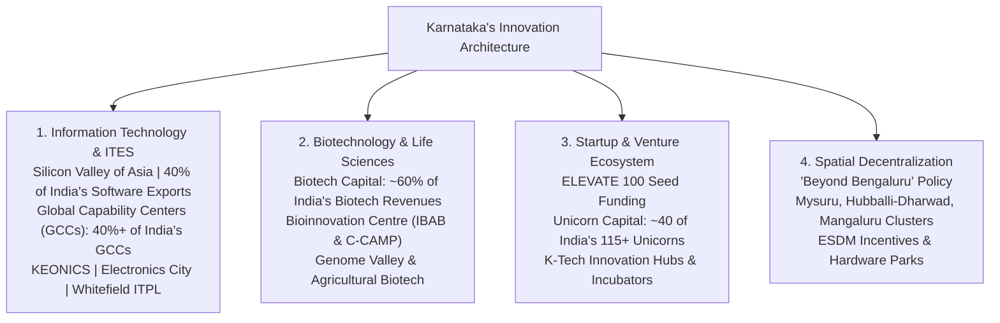

# Karnataka IT, BT and Innovation Ecosystem (ಕರ್ನಾಟಕದ ಮಾಹಿತಿ ತಂತ್ರಜ್ಞಾನ, ಜೈವಿಕ ತಂತ್ರಜ್ಞಾನ ಮತ್ತು ನಾವೀನ್ಯತಾ ಪರಿಸರ ವ್ಯವಸ್ಥೆ)

> [!exam-focus]
> **Exam Weightage & Testing Patterns**: High-yield syllabus area in Prelims Paper 2 Section 2 and Mains GS-3 Section 1 (Section 1 Question on Karnataka's Knowledge Economy, Innovation, and Startup Policies).
> - **Prelims Traps**: Confusing state nodal agencies (KITS - Karnataka Innovation and Technology Society vs K-Tech vs KEONICS); misidentifying "Beyond Bengaluru" cluster cities (Hubballi-Dharwad, Mysuru, Mangaluru, Belagavi, Shivamogga, Kalaburagi); confusing venture funding schemes (KITVEN fund vs ELEVATE 100).
> - **Mains Dimensions**: Analyzing Karnataka's competitive advantage in IT/ITeS services and biotechnology; assessing spatial inequality resulting from Bengaluru's primacy and evaluating policy efficacy of "Beyond Bengaluru"; examining intellectual property (IP) creation and deep-tech innovation in the state.

---

## 1. Karnataka: India's Innovation & Tech Capital

The diagram above illustrates the multi-dimensional structure of Karnataka's knowledge economy, showcasing its dominant national share across IT exports, biotechnology revenues, startup incubation, and regional dispersion initiatives.

### 1.1 Structural Economic Significance
- **National Leadership**: Karnataka contributes approximately **38% to 40% of India's total software and IT service exports** and is home to over 2 million IT professionals.
- **Biotechnology Primacy**: The state houses over **60% of India's biotechnology companies** and generates more than 50% of the national biotechnology workforce and revenue.
- **Global Capability Centers (GCCs)**: Karnataka hosts over **400 premier Global Capability Centers**, representing leading Fortune 500 corporations in aerospace, fintech, healthcare, and retail analytics.
- **India Innovation Index (NITI Aayog)**: Karnataka has consistently secured the **Rank 1 position among Major States** on the NITI Aayog India Innovation Index, driven by high human capital, research density, VC funding, and patent filings.

---

## 2. Institutional Framework & Nodal Agencies

1. **Department of Electronics, IT, Bt and S&T (ಇ-ಆಡಳಿತ ಮತ್ತು ಐಟಿ-ಬಿಟಿ ಇಲಾಖೆ)**: Administrative department formulating state technology policies.
2. **KITS (Karnataka Innovation and Technology Society)**: Implementing agency executing startup initiatives, biotech infrastructure, and skill development programs.
3. **KEONICS (Karnataka State Electronics Development Corporation Ltd)**: Established in 1976; established **Electronics City (ಇಲೆಕ್ಟ್ರಾನಿಕ್ಸ್ ಸಿಟಿ)** on Hosur Road in Bengaluru, creating the physical foundation for India's IT revolution.
4. **IBAB (Institute of Bioinformatics and Applied Biotechnology)**: Located at Biotech Park, Electronic City, providing specialized bioinformatics research and industry-ready talent.
5. **C-CAMP (Centre for Cellular and Molecular Platforms)**: An initiative supported by the Department of Biotechnology (Govt of India) and Karnataka Govt, acting as a deep-tech bio-incubator fostering life sciences startups.

---

## 3. Flagship Policy Frameworks

### 3.1 Karnataka IT Policy 2020-2025 & Beyond
- **Strategic Vision**: Transform Karnataka into a global leader in emerging technologies (AI, Robotics, Blockchain, Quantum Computing, IoT) while geographically expanding IT operations outside Bengaluru.
- **Core Targets**:
  - Achieve 30% contribution to India's digital economy target.
  - Create over 60 lakh direct and indirect technology jobs.
  - Decentralize growth by building robust IT ecosystems in Tier-2 and Tier-3 cities.

### 3.2 "Beyond Bengaluru" (ಬಿಯಾಂಡ್ ಬೆಂಗಳೂರು) Initiative
Recognizing the infrastructural stress and traffic congestion of Bengaluru Urban, the Government of Karnataka rolled out the **"Beyond Bengaluru" Policy**:
- **Target Growth Clusters**:
  1. *Mysuru Cluster*: IT, ESDM (Electronics System Design & Manufacturing), cyber security, and clean mobility.
  2. *Hubballi-Dharwad-Belagavi Cluster*: Manufacturing IT, automotive software, agri-tech, and AI-driven precision engineering.
  3. *Mangaluru-Udupi Cluster*: Fintech, health-tech, marine biotechnology, and BPO operations.
  4. *Shivamogga & Kalaburagi Clusters*: Regional IT-BPO centres and local incubation hubs.
- **Fiscal Incentives**:
  - Subsidized lease rentals and land allotment through KIADB.
  - Reimbursement of Employee Provident Fund (EPF) and training costs.
  - Power tariff concessions and stamp duty exemptions.

### 3.3 Karnataka Biotechnology Policy
- Known as the **Bio-Economy Policy**, aiming to elevate Karnataka's bio-economy to $50 Billion.
- Thrust Areas:
  - *Biopharma*: Biosimilars, vaccines, monoclonal antibodies.
  - *Agri-Biotechnology*: Climate-resilient seeds, bio-fertilizers, tissue culture.
  - *Industrial Biotechnology*: Bio-fuels, enzyme engineering, synthetic biology.
  - *Bioinformatics & Genomics*: Next-generation sequencing and personalized medicine.

### 3.4 Karnataka Startup Policy & ELEVATE Program
- **ELEVATE 100 Scheme**: Flagship grant-in-aid startup support mechanism providing up to **Rs. 50 Lakhs** equity-free seed funding for innovative, early-stage startups selected through a competitive pitch process.
- **Special Windows**:
  - *ELEVATE Kalyana Karnataka*: Targeted seed funding reserved for entrepreneurs from the 371J backward region.
  - *ELEVATE Women*: Dedicated funding allocation for women-founded technology enterprises.
  - *KITVEN (Karnataka Information Technology Venture Capital Fund)*: State-sponsored SEBI-registered venture capital fund providing equity investments to startups.

---

## 4. Deep-Tech, AI and Future Frontiers

### 4.1 Centers of Excellence (CoEs)
The Government of Karnataka has established specialized CoEs in partnership with premier industry bodies (NASSCOM, IESA) and academic institutions (IISc):
- **CoE in Artificial Intelligence & Data Science** (Bengaluru).
- **CoE in Internet of Things (IoT)** (Bengaluru).
- **CoE in Cyber Security (CySecK)** (Housed at IISc Bengaluru to secure state digital infrastructure and nurture cybersecurity startups).
- **CoE in Aerospace and Defense** (Focusing on digital twinning, simulation, and defense avionics).
- **CoE in Agri-Innovation** (Focusing on drone sensors, satellite imagery for crop insurance, and precision irrigation).

### 4.2 Semiconductor & ESDM Push
- Karnataka approved the setup of advanced semiconductor assembly, testing, marking, and packaging (ATMP) facilities and design houses.
- Accounts for over **85% of India's chip design talent**, with global semiconductor design giants (Intel, Qualcomm, Texas Instruments, AMD, NVIDIA) operating major R&D campuses in Bengaluru.

---

## Likely Questions & PYQs

### Model Question 1 (Prelims)
**Q**: Which state-sponsored program in Karnataka provides grant-in-aid seed funding of up to Rs. 50 Lakhs to promising early-stage technology startups?
A) Amrutha Surabhi
B) ELEVATE 100
C) Yuva Snehi
D) Udyog Mitra
*Answer*: **B**
*Explanation*: The ELEVATE scheme administered by KITS under the Department of Electronics, IT/BT provides equity-free seed grants of up to Rs. 50 Lakhs for innovative tech startups in Karnataka.

### Model Question 2 (Prelims)
**Q**: Which organization founded Electronics City in Bengaluru in 1976?
A) KIADB
B) KEONICS
C) KINFRA
D) KITS
*Answer*: **B**
*Explanation*: KEONICS (Karnataka State Electronics Development Corporation Ltd), under the leadership of R. K. Baliga, conceived and established Electronics City in 1976, laying the foundation for Bengaluru's IT boom.

### Model Question 3 (Mains GS-3 - 12.5 Marks)
**Q**: "While Bengaluru has cemented its position as the Silicon Valley of India, regional imbalance in technology investments poses serious infrastructural challenges." In this context, analyze the objectives and key strategies of Karnataka's 'Beyond Bengaluru' policy.

---

> [!summary]
> **Key Revision Points**:
> - Karnataka accounts for ~40% of India's IT exports and ~60% of biotech revenues.
> - Consistently ranks #1 in NITI Aayog India Innovation Index (Major States).
> - KEONICS developed Electronics City in 1976 under R.K. Baliga.
> - "Beyond Bengaluru" targets Mysuru, Hubballi-Dharwad, and Mangaluru as growth clusters.
> - ELEVATE provides up to Rs. 50 Lakh seed funding; CySecK CoE is at IISc.
