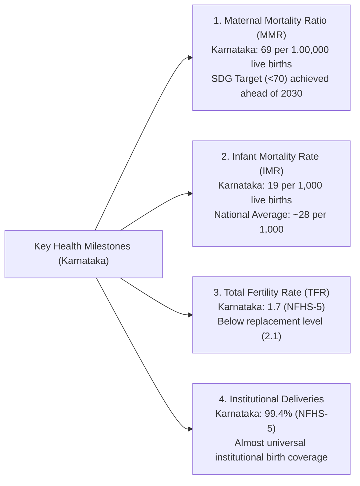
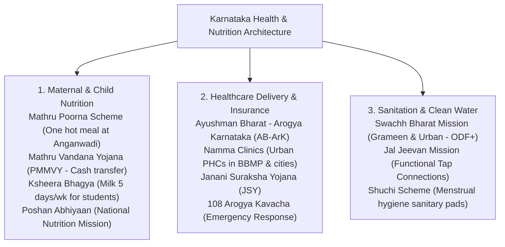

# Public Health, Sanitation and Nutrition in Karnataka (ಕರ್ನಾಟಕದ ಸಾರ್ವಜನಿಕ ಆರೋಗ್ಯ, ನೈರ್ಮಲ್ಯ ಮತ್ತು ಪೌಷ್ಟಿಕಾಂಶ)

> [!exam-focus]
> **Exam Weightage & Testing Patterns**: High-yield syllabus area across Prelims Paper 2 Section 2 and Mains GS-3 Section 2 (Health, Disease Burden & Sanitation).
> - **Prelims Traps**: Confusing vector-borne disease vectors (KFD is tick-borne: *Haemaphysalis spinigera*, not mosquito-borne; Dengue/Chikungunya by *Aedes aegypti*; Malaria by *Anopheles*; Filariasis by *Culex*); confusing health metrics (Karnataka's MMR is 69 per 1 lakh live births, achieving the SDG target <70; IMR is ~19 per 1,000 live births); mixing Mathru Poorna (hot cooked meal for pregnant/lactating women at anganwadis) with Mathru Vandana (cash incentive PMMVY).
> - **Mains Dimensions**: Assessing the regional disparity in health infrastructure between South Karnataka and Kalyana Karnataka; evaluating anemia and malnutrition indicators in NFHS-5; analyzing Universal Health Coverage under Ayushman Bharat - Arogya Karnataka.

---

## 1. Demographic & Public Health Indicators: Karnataka vs National Benchmarks

The diagram above details Karnataka's demographic performance metrics, showing that the state has surpassed SDG targets in Maternal Mortality Ratio and replacement-level fertility.

### Comparative Indicator Table (NFHS-5 & SRS Data):
| Health / Demographic Indicator | Karnataka Level | All-India Benchmark | SDG Target (2030) |
|---|---|---|---|
| **Maternal Mortality Ratio (MMR)** (per 1,00,000 live births) | **69** | 97 | < 70 |
| **Infant Mortality Rate (IMR)** (per 1,000 live births) | **19** | 28 | <= 12 |
| **Under-Five Mortality Rate (U5MR)** | **21** | 32 | <= 25 |
| **Total Fertility Rate (TFR)** | **1.7** | 2.0 | 2.1 (Replacement) |
| **Sex Ratio at Birth (SRB)** (females per 1000 males) | **916** (SRS) / **978** (NFHS-5) | 907 / 929 | 950+ |
| **Institutional Deliveries** | **99.4%** | 88.6% | 100% |
| **Full Immunization Coverage (12-23 months)** | **84.1%** | 76.4% | 90%+ |

---

## 2. Epidemiology & Disease Burden in Karnataka

### 2.1 Kyasanur Forest Disease (KFD / ಮಂಗನ ಕಾಯಿಲೆ)
- **Nature**: Zoonotic viral hemorrhagic disease caused by Kyasanur Forest Disease virus (Flaviviridae family).
- **History & Geography**: First identified in 1957 in **Kyasanur forest, Shivamogga district**. Endemic across Western Ghats districts (Shivamogga, Uttara Kannada, Chikkamagaluru, Udupi, Kodagu).
- **Transmission Vector**: Hard tick ***Haemaphysalis spinigera***.
- **Hosts & Reservoirs**: Black-faced langurs (*Semnopithecus entellus*) and red-faced bonnet macaques (*Macaca radiata*) are highly susceptible hosts. Death of monkeys serves as an early sentinel indicator of outbreak.
- **Control**: Formalin-inactivated vaccine, vector control using tick repellents (DEP/DEET), and the dedicated **Virus Diagnostic Laboratory (VDL)** at Shivamogga.

### 2.2 Vector-Borne & Communicable Diseases
- **Dengue & Chikungunya**: Transmitted by the day-biting ***Aedes aegypti*** mosquito. Karnataka conducts intense IEC campaigns during monsoon and dry-day observances.
- **Tuberculosis (TB)**: State actively executing National TB Elimination Programme (NTEP) targeting TB elimination. Deployment of CBNAAT/Truenat molecular diagnostic machines in all Taluk hospitals, Nikshay Poshan Yojana direct benefit transfers (Rs. 500/month nutritional support), and community Ni-kshay Mitras.
- **Non-Communicable Diseases (NCDs)**: Shift towards chronic lifestyle disorders (Hypertension, Diabetes Mellitus, Cardiovascular diseases, Cervical and Breast Cancer). Screened at Primary Health Centers (PHCs) via the **Comprehensive Primary Health Care (CPHC) - NCD portal**.

---

## 3. Nutrition & Malnutrition Profile (NFHS-5 Analysis)

Despite impressive economic growth, child and maternal nutritional indicators reveal significant challenges, particularly in Northern Karnataka:
- **Child Nutritional Deficits (Under 5 years)**:
  - *Stunting (ಕುಬ್ಜತೆ - Low height-for-age)*: **35.4%** in Karnataka (indicates chronic undernutrition).
  - *Wasting (ತೆಳ್ಳಗಾಗುವುದು - Low weight-for-height)*: **19.5%** (indicates acute malnutrition).
  - *Severely Wasted*: **7.2%**.
  - *Underweight (ಕಡಿಮೆ ತೂಕ - Low weight-for-age)*: **32.9%**.
- **Anemia Burden (ರಕ್ತಹೀನತೆ)**:
  - Children (6-59 months): **65.5%** are anemic.
  - Women (15-49 years): **47.8%** are anemic.
  - Pregnant Women: **45.7%** are anemic.
- **Regional Disparity**: Kalyana Karnataka districts (Yadgir, Raichur, Kalaburagi) exhibit stunting rates above 40%, contrasting with coastal and southern districts (Udupi, Mandya) where rates are below 25%.

---

## 4. State Health & Nutrition Interventions

The flowchart above outlines Karnataka's tiered interventions spanning maternal-child nutrition, universal health insurance, urban health clinics, and sanitation infrastructure.

### 4.1 Flagship Health & Nutrition Schemes
1. **Ayushman Bharat - Arogya Karnataka (AB-ArK)**:
   - Co-branded Universal Health Coverage scheme.
   - Provides cashless secondary and tertiary medical care of up to **Rs. 5 Lakhs per family per year** for eligible BPL families. APL families receive 30% co-payment support up to Rs. 1.5 Lakhs.
2. **Mathru Poorna Scheme (ಮಾತೃಪೂರ್ಣ ಯೋಜನೆ)**:
   - Launched to curb maternal malnutrition and low birth-weight.
   - Provides **one nutritious, hot cooked meal daily** (rice, dal/sambar, egg/sprouted gram, milk, vegetable) to pregnant and lactating mothers for 15 months at Anganwadi centres, along with Iron Folic Acid (IFA) tablets.
3. **Ksheera Bhagya Scheme (ಕ್ಷೀರಭಾಗ್ಯ ಯೋಜನೆ)**:
   - Provides 150 ml of nutritious milk 5 days a week to school children (Class 1 to 10) and Anganwadi children, utilizing surplus milk procurement by KMF (Nandini).
4. **Namma Clinics (ನಮ್ಮ ಕ್ಲಿನಿಕ್)**:
   - Established across municipal corporations, especially in BBMP (Bengaluru) wards and district headquarters, to deliver free outpatient consultation, basic diagnostic tests, and essential drugs in urban slums.
5. **Shuchi Scheme (ಶುಚಿ ಯೋಜನೆ)**:
   - Distribution of free sanitary napkins to adolescent school girls aged 10-19 years in government and aided schools to promote menstrual hygiene.

---

## 5. Water, Sanitation & Environmental Health

- **Swachh Bharat Mission (Grameen) Phase-II**:
  - Transition from Open Defecation Free (ODF) to **ODF Plus (ODF+)**.
  - Key focus areas: Solid Waste Management (SWM), Greywater Management (soak pits and stabilization ponds), Faecal Sludge Management, and plastic waste recycling units at Gram Panchayat level.
- **Jal Jeevan Mission (Mane Manege Gange - ಮನೆ ಮನೆಗೆ ಗಂಗೆ)**:
  - Providing Functional Household Tap Connections (FHTC) providing 55 liters per capita per day (lpcd) of potable water to all rural households.
  - Critical in addressing waterborne pathogens (diarrhea, cholera, enteric fever) and fluorosis in endemic districts (Kolar, Pavagada, Koppal).

---

## Likely Questions & PYQs

### Model Question 1 (Prelims)
**Q**: Kyasanur Forest Disease (KFD), commonly known as 'Monkey Fever', is transmitted to humans through the bite of which of the following vectors?
A) Aedes aegypti mosquito
B) Haemaphysalis spinigera tick
C) Phlebotomus sandfly
D) Anopheles stephensi mosquito
*Answer*: **B**
*Explanation*: KFD is caused by a flavivirus and transmitted primarily by the forest tick *Haemaphysalis spinigera*. Monkeys act as common hosts, and their death frequently flags an impending human outbreak.

### Model Question 2 (Prelims)
**Q**: Which of the following statements regarding Karnataka's demographic indicators as per official health data is/are correct?
1. Karnataka has achieved the Sustainable Development Goal (SDG) target of Maternal Mortality Ratio (MMR) below 70 per 1,00,000 live births.
2. The Total Fertility Rate (TFR) in Karnataka is below the replacement level of 2.1.
Select the correct answer:
A) 1 only
B) 2 only
C) Both 1 and 2
D) Neither 1 nor 2
*Answer*: **C**
*Explanation*: Both statements are correct. Karnataka's MMR stands at 69 (SDG target is <70), and its TFR is 1.7 (well below the 2.1 replacement level).

### Model Question 3 (Mains GS-3 - 12.5 Marks)
**Q**: Analyze the paradox between Karnataka's high economic performance and the persistent rates of child stunting and female anemia reported in NFHS-5. Suggest actionable policy measures to address regional malnutrition disparities in the state.

---

> [!summary]
> **Key Revision Points**:
> - MMR in Karnataka is 69 (SDG target <70 achieved); IMR is 19; TFR is 1.7.
> - KFD is caused by Flavivirus and transmitted by *Haemaphysalis spinigera* ticks (first found in Shivamogga 1957).
> - Child stunting is 35.4% and wasting is 19.5% in Karnataka (NFHS-5), with severe disparity in Kalyana Karnataka.
> - Mathru Poorna provides one hot cooked meal daily to pregnant/lactating mothers at Anganwadis.
> - AB-ArK provides up to Rs. 5 Lakhs cashless health coverage for BPL families.
