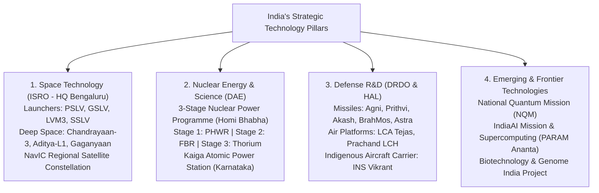
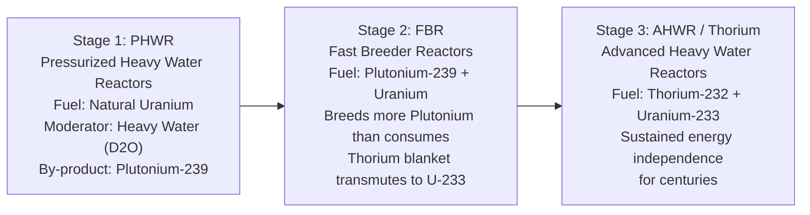

# Science and Technology in Development: Space, Nuclear, Defense and Emerging Tech (ವಿಜ್ಞಾನ ಮತ್ತು ತಂತ್ರಜ್ಞಾನ: ಬಾಹ್ಯಾಕಾಶ, ಪರಮಾಣು, ರಕ್ಷಣೆ ಮತ್ತು ಉದಯೋನ್ಮುಖ ತಂತ್ರಜ್ಞಾನಗಳು)

> [!exam-focus]
> **Exam Weightage & Testing Patterns**: High-yield core topic across Prelims Paper 2 Section 2 (General Science & Technology: 6-8 MCQs) and Mains GS-3 Section 1 (mandatory 15-mark essay question on ISRO missions, nuclear energy, or AI policy).
> - **Prelims Traps**: Confusing launch vehicles (PSLV: 4-stage solid-liquid alternate vs GSLV Mk-II: 3-stage with cryogenic upper stage vs LVM3: heavy-lift 2 solid boosters + liquid core + high-thrust cryogenic stage); confusing Chandrayaan-3 landing site name (**"Shiv Shakti Point" / ಶಿವಶಕ್ತಿ ಪಾಯಿಂಟ್**) with Chandrayaan-2 impact site (**"Tiranga Point"**); misidentifying stages of Homi Bhabha's three-stage nuclear plan.
> - **Mains Dimensions**: Assessing the indigenization of defense manufacturing through iDEX and DAP 2020; the strategic imperative of the Gaganyaan human spaceflight mission; ethical and regulatory frameworks for Artificial Intelligence under the IndiaAI Mission.

---

## 1. National Science & Technology Ecosystem

The diagram above details India's strategic high-technology triad (Space, Nuclear, Defense) alongside emerging frontier domains (Quantum, AI, Genomics), heavily anchored by premier research laboratories and defense establishments in Karnataka.

---

## 2. Space Technology: ISRO's Landmark Missions

Headquartered at *Antariksh Bhavan* in Bengaluru, the Indian Space Research Organisation (ISRO) operates as one of the world's premier space agencies.

### 2.1 Fleet of Launch Vehicles
1. **PSLV (Polar Satellite Launch Vehicle - "Workhorse of ISRO")**:
   - Four-stage vehicle using alternate solid and liquid propulsion: **Stage 1 (Solid) -> Stage 2 (Liquid - Vikas engine) -> Stage 3 (Solid) -> Stage 4 (Liquid)**.
   - Capable of placing 1,750 kg into Sun-Synchronous Polar Orbits (SSPO) and sub-GTO trajectories (launched Chandrayaan-1, Mangalyaan, and Aditya-L1).
2. **GSLV (Geosynchronous Satellite Launch Vehicle Mk-II)**:
   - Three-stage rocket: Solid booster + Liquid core + Indigenous Cryogenic Upper Stage (CE-7.5 engine using liquid oxygen and liquid hydrogen at -250°C).
3. **LVM3 (Launch Vehicle Mark 3 - Formerly GSLV Mk-III - "Fat Boy")**:
   - Heavy-lift launch vehicle: Two massive S200 solid rocket boosters strapped to an L110 twin-Vikas liquid core, powered by the high-thrust indigenous **CE-20 cryogenic engine**.
   - Placed Chandrayaan-2, **Chandrayaan-3**, and OneWeb commercial constellations into orbit (payload capacity 4,000 kg to GTO and 8,000 kg to LEO).
4. **SSLV (Small Satellite Launch Vehicle)**:
   - Low-cost, quick-assembly 3-stage solid vehicle capable of putting up to 500 kg satellites into low Earth orbits within 72 hours of turnaround.

### 2.2 Historic Deep-Space & Exploration Missions
- **Chandrayaan-3 (ಚಂದ್ರಯಾನ-3)**:
  - Launched on 14 July 2023 via LVM3; historic soft-landing achieved on **23 August 2023** near the lunar South Pole.
  - India became the **first country to land near the lunar South Pole** and the **fourth country in the world** to soft-land on the Moon (after USSR, USA, China).
  - Landing site christened ***"Shiv Shakti Point" (ಶಿವಶಕ್ತಿ ಪಾಯಿಂಟ್)***; August 23 proclaimed **National Space Day (ರಾಷ್ಟ್ರೀಯ ಬಾಹ್ಯಾಕಾಶ ದಿನ)**.
  - Payloads: *Vikram Lander* (ChASTE measuring thermal conductivity, ILSA measuring moonquakes, ChaSTE) and *Pragyan Rover* (APXS and LIBS confirming sulfur and elements on lunar surface).
- **Aditya-L1 (ಆದಿತ್ಯ-L1, September 2023)**:
  - India's first dedicated space-based observatory to study the Sun.
  - Successfully placed in a halo orbit around the **Sun-Earth Lagrange Point 1 (L1)**, situated ~1.5 million km from Earth, allowing continuous, unobstructed viewing of the solar corona, flares, and coronal mass ejections (CMEs).
- **Gaganyaan Programme (ಗಗನಯಾನ)**:
  - India's premier human spaceflight mission aiming to send a 3-member crew to a 400 km low Earth orbit for a 3-day mission and return them safely to Earth waters.
  - Tested Crew Escape System via TV-D1; humanoid robot astronaut ***Vyommitra (ವ್ಯೋಮಮಿತ್ರ)*** developed at ISRO Bengaluru for un-crewed test flights.
- **NavIC (Navigation with Indian Constellation / IRNSS)**:
  - Autonomous regional satellite navigation system providing precise positioning service (<10 meters accuracy) across India and extending 1,500 km beyond its borders using 7 operational satellites (3 Geostationary, 4 Geosynchronous).

---

## 3. Nuclear Technology & Homi Bhabha's Three-Stage Plan

- Formulated by the father of India's nuclear programme, **Dr. Homi Jehangir Bhabha**, to overcome India's limited domestic Uranium reserves (~1–2% of world) while exploiting its vast **Thorium reserves (monazite sands of Kerala and coastal Karnataka - over 25% of the world's thorium)**.

The diagram above details India's three-stage nuclear fuel cycle: using natural uranium in PHWRs to produce plutonium, utilizing plutonium in fast breeder reactors to convert thorium into fissile Uranium-233, and ultimately operating thorium-based reactors for long-term self-sufficiency.

- **Kaiga Atomic Power Station (ಕೈಗಾ ಪರಮಾಣು ವಿದ್ಯುತ್ ಸ್ಥಾವರ)**:
  - Located in Uttara Kannada district, Karnataka, on the banks of the Kali River.
  - Operates four indigenous Pressurized Heavy Water Reactors (PHWR) of 220 MW each (Total capacity 880 MW).
  - **World Record**: Kaiga Unit-1 set an unbroken world record for the **longest continuous uninterrupted commercial operation of 962 days** (surpassing the British Heysham-2 reactor) in December 2018.

---

## 4. Defense Technology & Indigenization

- **Integrated Guided Missile Development Programme (IGMDP, 1983)**:
  - Conceptualized by Dr. A. P. J. Abdul Kalam; developed the **"PATNA"** missile suite:
    1. **P**rithvi: Surface-to-surface short-range ballistic missile.
    2. **A**gni: Surface-to-surface intermediate to intercontinental ballistic missile (Agni-V with MIRV - Multiple Independently Targetable Re-entry Vehicle capability tested in 2024 under *Mission Divyastra*).
    3. **T**rishul: Surface-to-air short-range quick-reaction missile.
    4. **N**ag: 3rd generation anti-tank guided fire-and-forget missile (Helicopter variant: *Helina / Dhruvastra*).
    5. **A**kash: Medium-range surface-to-air multi-target air defense missile system.
- **BrahMos Supersonic Cruise Missile**: Joint venture between India (DRDO) and Russia (NPO Mashinostroyeniya); speeds of Mach 2.8 to 3.0; world's fastest operational cruise missile.
- **Indigenous Aircraft & Marine Systems**:
  - *LCA Tejas (ತೇಜಸ್)*: Light Combat Aircraft designed by Aeronautical Development Agency (ADA) and manufactured by HAL in Bengaluru.
  - *Prachand Light Combat Helicopter (LCH)*: Indigenously designed by HAL for high-altitude warfare (Siachen glacier).
  - *INS Vikrant*: India's first indigenously designed and constructed aircraft carrier (commissioned 2022).

---

## 5. Emerging & Frontier Technologies

1. **National Quantum Mission (NQM)**: Approved with an outlay of Rs. 6,003 crore to develop intermediate-scale quantum computers (50–1000 physical qubits), quantum communication (satellite-based quantum key distribution over 2,000 km), and quantum sensors.
2. **IndiaAI Mission**: Comprehensive national framework investing over Rs. 10,000 crore to build compute infrastructure (10,000+ GPUs), foundational AI models in Indic languages, and datasets for public service delivery.
3. **Genome India Project**: Successfully sequenced 10,000 human genomes representing India's genetic diversity, coordinated by the Centre for Brain Research (CBR) at the Indian Institute of Science (IISc), Bengaluru, to drive precision medicine and disease resistance.

---

## 6. Related Vault Notes
- [[Karnataka_Industrial_Policy_and_Infrastructure]] — Aerospace and defense manufacturing in Bengaluru.
- [[Environment_Biodiversity_Climate]] — Nuclear energy as low-carbon baseload power.
- [[Public_Health_and_Sanitation_Karnataka]] — Medical isotopes and biotechnology innovations.

---

## 7. Likely Questions & Verbatim PYQs

### Prelims Multiple-Choice Questions
- **PYQ (KPSC KAS 2017 Prelims P2)**: The Kaiga Atomic Power Station in Karnataka operates which type of nuclear reactor technology?
  - (A) Boiling Water Reactor (BWR)
  - (B) Pressurized Heavy Water Reactor (PHWR) [Correct]
  - (C) Fast Breeder Reactor (FBR)
  - (D) High Temperature Gas-cooled Reactor (HTGR)
- **PYQ (KPSC KAS 2020 Prelims P2)**: The lunar soft-landing site of ISRO's historic Chandrayaan-3 mission near the Moon's South Pole was officially named as:
  - (A) Tiranga Point
  - (B) Shiv Shakti Point [Correct]
  - (C) Jawahar Point
  - (D) Vikram Sthal
- **Expected Question (Prelims 2026)**: What is the main fissile fuel intended to be utilized in Stage 3 of India's three-stage nuclear power programme?
  - *Answer*: Thorium-232 / Uranium-233.

### Mains Analytical Question & Answer Outline
- **Mains GS-3 Question**: *"Examine the technological significance of ISRO's Chandrayaan-3 and Aditya-L1 missions in advancing India's deep-space and scientific capabilities." (15 Marks / 250 Words)*
  - **Introduction**: Introduce 2023 as an inflection point in Indian space exploration, with Chandrayaan-3 achieving lunar South Pole soft-landing and Aditya-L1 establishing India's first solar observatory at the L1 Lagrange point.
  - **Technological Breakthroughs of Chandrayaan-3**:
    - *Autonomous Hazard Detection & Avoidance*: Upgraded Lander Hazard Detection and Avoidance Camera (LHDAC) and expanded landing zone (4 km x 2.4 km) enabling autonomous real-time trajectory correction.
    - *Scientific Payloads*: ChaSTE recorded an unexpected 50°C temperature gradient between lunar surface and 8 cm depth; LIBS confirmed elemental sulfur, iron, and titanium on the lunar regolith.
    - *Global Prestige*: Elevated India into the elite club of lunar-landing nations while demonstrating frugal engineering (~$75 million budget).
  - **Strategic Significance of Aditya-L1**:
    - *Halo Orbit Insertion at L1*: Uninterrupted 24/7 observation of the Sun without eclipses, positioned 1.5 million km away.
    - *Space Weather Forecasting*: Monitoring coronal mass ejections (CMEs) that disrupt communication satellites, GPS grids, and power transmission networks on Earth.
  - **Conclusion**: Emphasize how these successes position India as an indispensable commercial space partner (via NewSpace India Limited - NSIL) and lay the technological stepping stones for Gaganyaan and the proposed *Bharatiya Antariksha Station* (2035).

---

> [!summary] Quick Revision Box (10 Non-Negotiable Facts)
> 1. **Chandrayaan-3 (23 August 2023)**: Soft-landed near lunar South Pole; site named *Shiv Shakti Point*.
> 2. **National Space Day**: Celebrated annually on August 23 to commemorate Chandrayaan-3.
> 3. **Aditya-L1**: Placed in halo orbit around Sun-Earth Lagrange Point 1 (1.5 million km away).
> 4. **PSLV Stages**: 4-stage solid-liquid alternate propulsion (Solid-Liquid-Solid-Liquid).
> 5. **LVM3 Engine**: Powered by high-thrust indigenous CE-20 cryogenic upper stage.
> 6. **Kaiga Unit-1 Record**: World record for continuous operation of 962 days without shutdown.
> 7. **3-Stage Nuclear Plan**: Stage 1 (PHWR - Natural U), Stage 2 (FBR - Pu-239), Stage 3 (Thorium - U-233).
> 8. **Vyommitra**: Female humanoid robot astronaut developed by ISRO for Gaganyaan test flights.
> 9. **NavIC (IRNSS)**: 7-satellite regional navigation constellation providing <10 m accuracy.
> 10. **National Quantum Mission**: Rs. 6,003 crore national initiative developing quantum computing and sensors.
