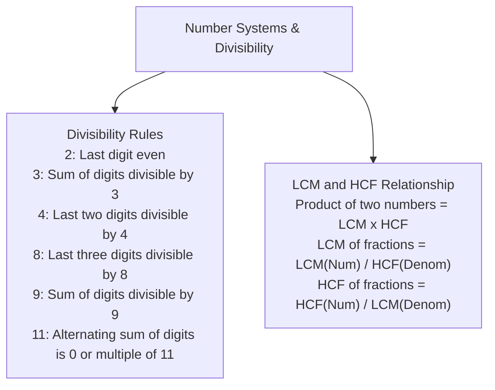

# Basic Numeracy and Quantitative Aptitude (ಮೂಲಭೂತ ಸಂಖ್ಯಾಶಾಸ್ತ್ರ ಮತ್ತು ಗಣಿತ ಸಾಮರ್ಥ್ಯ)

> [!exam-focus]
> **Exam Weightage & Testing Patterns**: High-yield quantitative segment in Prelims Paper 2 Section 3 (10 to 12 MCQs, 20 to 24 Marks). Strictly benchmarked at **SSLC (Class 10) Standard**.
> - **Prelims Traps**: Confusing Simple Interest (linear growth on initial principal) with Compound Interest (exponential compounding); failing to convert units in Time-Speed-Distance (km/hr to m/s: multiply by $5/18$); mixing inverse proportions in Time & Work.
> - **Top High-Frequency Topics**: Percentages (ಶೇಕಡಾವಾರು), Profit & Loss (ಲಾಭ ಮತ್ತು ನಷ್ಟ), Simple & Compound Interest (ಸರಳ ಮತ್ತು ಚಕ್ರಬಡ್ಡಿ), Ratios & Proportions (ಅನುಪಾತ ಮತ್ತು ಸಮಾನುಪಾತ), Time & Work (ಸಮಯ ಮತ್ತು ಕೆಲಸ), Time Speed & Distance, Averages, LCM & HCF.

---

## 1. Number Systems & Divisibility Rules

The diagram above details essential number properties and fraction arithmetic applied in competitive arithmetic problem solving.

---

## 2. Core Quantitative Formulas & Techniques

### 2.1 Percentages, Profit and Loss
- **Percentage Change**:
  $$\% 	ext{ Change} = rac{	ext{New Value} - 	ext{Original Value}}{	ext{Original Value}} 	imes 100$$
- **Successive Percentage Change**: If a value changes by $+a\%$ and then by $+b\%$:
  $$	ext{Net Change } \% = a + b + rac{ab}{100}$$
- **Profit & Loss**:
  $$	ext{Gain } \% = rac{	ext{SP} - 	ext{CP}}{	ext{CP}} 	imes 100 \quad ; \quad 	ext{Loss } \% = rac{	ext{CP} - 	ext{SP}}{	ext{CP}} 	imes 100$$
- **Discount on Marked Price (MP)**:
  $$	ext{SP} = 	ext{MP} 	imes \left(1 - rac{D\%}{100}
ight)$$

### 2.2 Simple and Compound Interest
- **Simple Interest (SI)**:
  $$	ext{SI} = rac{P 	imes R 	imes T}{100} \quad ; \quad 	ext{Amount } A = P + 	ext{SI}$$
- **Compound Interest (CI)** (Compounded Annually):
  $$A = P \left(1 + rac{R}{100}
ight)^T \quad ; \quad 	ext{CI} = A - P$$
- **Difference between CI and SI for 2 Years**:
  $$	ext{Difference}_{2	ext{ yrs}} = P \left(rac{R}{100}
ight)^2$$

### 2.3 Time and Work (ಸಮಯ ಮತ್ತು ಕೆಲಸ)
- If person A finishes work in $x$ days, A's 1-day work rate is $rac{1}{x}$.
- If person B finishes work in $y$ days, combined work rate is:
  $$	ext{Rate}_{(A+B)} = rac{1}{x} + rac{1}{y} = rac{x+y}{xy} \implies 	ext{Total Days} = rac{xy}{x+y}$$
- **Efficiency Method (LCM Technique)**:
  - Assume Total Work = $	ext{LCM}(x, y)$.
  - Find individual daily efficiencies (Units/day).
  - Divide total units by combined efficiency to get total days.

### 2.4 Time, Speed and Distance (ಸಮಯ, ವೇಗ ಮತ್ತು ದೂರ)
- **Basic Formula**: $	ext{Distance} = 	ext{Speed} 	imes 	ext{Time}$.
- **Unit Conversion**:
  $$1 	ext{ km/hr} = rac{5}{18} 	ext{ m/s} \quad ; \quad 1 	ext{ m/s} = rac{18}{5} 	ext{ km/hr}$$
- **Average Speed**:
  $$	ext{Average Speed} = rac{	ext{Total Distance}}{	ext{Total Time}}$$
  - If equal distances are covered at speeds $u$ and $v$:
    $$	ext{Average Speed} = rac{2uv}{u+v}$$
- **Relative Speed**:
  - Moving in **opposite directions**: $	ext{Relative Speed} = u + v$.
  - Moving in **same direction**: $	ext{Relative Speed} = |u - v|$.

---

## Likely Questions & PYQs

### Model Question 1 (Arithmetic - Percentages)
**Q**: The price of petrol rises by 25%. By what percentage must a motorist reduce petrol consumption so that monthly expenditure on petrol remains unchanged?
A) 25%
B) 20%
C) 16.66%
D) 33.33%
*Answer*: **B**
*Explanation*: Let original price = 100, original consumption = 100. Expenditure = $100 	imes 100 = 10,000$.
New price = 125. Required new consumption $= 10,000 / 125 = 80$.
Reduction $= 100 - 80 = 20\%$.
Using shortcut: $rac{r}{100 + r} 	imes 100 = rac{25}{125} 	imes 100 = 20\%$.

### Model Question 2 (Time & Work)
**Q**: A can complete a project in 12 days, while B can complete the same project in 24 days. If they work together, how many days will they take to complete the project?
A) 6 days
B) 8 days
C) 9 days
D) 10 days
*Answer*: **B**
*Explanation*:
$	ext{Days} = rac{xy}{x+y} = rac{12 	imes 24}{12 + 24} = rac{288}{36} = 8 	ext{ days}$.
Or using LCM: Total work = $	ext{LCM}(12, 24) = 24$ units.
A's efficiency = 2 units/day; B's efficiency = 1 unit/day.
Together = $2 + 1 = 3$ units/day.
Days taken = $24 / 3 = 8$ days.

### Model Question 3 (Simple vs Compound Interest)
**Q**: The difference between compound interest and simple interest on a sum of money at 10% per annum for 2 years is Rs. 150. What is the principal sum?
A) Rs. 12,000
B) Rs. 15,000
C) Rs. 18,000
D) Rs. 20,000
*Answer*: **B**
*Explanation*:
$	ext{Difference} = P 	imes \left(rac{R}{100}
ight)^2$.
$150 = P 	imes \left(rac{10}{100}
ight)^2 = P 	imes rac{1}{100}$.
$P = 150 	imes 100 = 	ext{Rs. } 15,000$.

---

> [!summary]
> **Key Revision Points**:
> - Convert km/h to m/s by multiplying by $5/18$.
> - For equal distances, average speed is $rac{2uv}{u+v}$, never $rac{u+v}{2}$.
> - Difference between CI and SI for 2 years is $P(R/100)^2$.
> - Price rise of $r\%$ requires consumption cut of $rac{r}{100+r} 	imes 100\%$.
