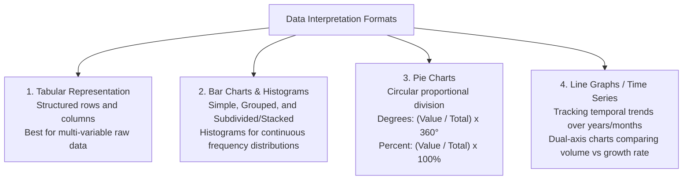

# Data Interpretation, Data Sufficiency and Statistical Analysis (ದತ್ತಾಂಶ ವಿಶ್ಲೇಷಣೆ, ದತ್ತಾಂಶ ಸಮರ್ಪಕತೆ ಮತ್ತು ಸಂಖ್ಯಾಶಾಸ್ತ್ರೀಯ ವ್ಯಾಖ್ಯಾನ)

> [!exam-focus]
> **Exam Weightage & Testing Patterns**: Dual-stage significance across Prelims Paper 2 Section 3 (6 to 8 MCQs, 12 to 16 Marks) and Mains GS-1 Section 3 (Data Collection, Analysis, and Statistical Interpretation - dedicated 20 to 25 marks).
> - **Prelims Traps**: Calculating absolute numbers from percentage shares without verifying total base values; misreading dual y-axis scales in combined bar-line charts; degree to percentage conversion in pie charts ($100\% = 360^\circ \implies 1\% = 3.6^\circ$).
> - **Mains Dimensions**: Explaining differences between Primary vs Secondary data sources; calculating Mean, Median, Mode and Standard Deviation; analyzing sampling methods (Stratified vs Systematic vs Cluster) used in government socio-economic surveys.

---

## 1. Data Representation Formats

The flowchart above outlines the primary chart models evaluated in KPSC preliminary and mains examinations.

### 1.1 Essential Calculation Shortcuts for DI
1. **Pie Chart Conversion Rules**:
   - $10\% = 36^\circ$
   - $25\% = 90^\circ$
   - $50\% = 180^\circ$
   - Value $=rac{	heta^\circ}{360^\circ} 	imes 	ext{Total Base Value}$
2. **Growth Rate Calculation**:
   $$	ext{CAGR / Growth Rate} = rac{	ext{Value}_{	ext{current}} - 	ext{Value}_{	ext{base}}}{	ext{Value}_{	ext{base}}} 	imes 100$$
3. **Approximation Technique**: Round denominators to nearest round numbers (e.g. $423 / 891 pprox 420 / 900 = 46.6\%$) to eliminate distractors rapidly in Prelims.

---

## 2. Statistical Analysis: Measures of Central Tendency & Dispersion (Mains GS-1 Syllabus)

### 2.1 Measures of Central Tendency (ಕೇಂದ್ರೀಯ ಪ್ರವೃತ್ತಿಯ ಅಳತೆಗಳು)
1. **Arithmetic Mean ($ar{x}$ - ಸರಾಸರಿ)**:
   $$ar{x} = rac{\sum f_i x_i}{\sum f_i}$$
   - *Advantage*: Based on every observation; algebraically tractable.
   - *Limitation*: Highly sensitive to extreme outliers.
2. **Median ($M$ - ಮಧ್ಯಾಂಕ)**:
   - The value of the middle observation when data is arranged in ascending order.
   - For grouped data:
     $$M = L + \left(rac{rac{N}{2} - CF}{f}
ight) 	imes h$$
     *(Where $L$ is lower limit of median class, $CF$ is cumulative frequency of preceding class, $f$ is frequency, $h$ is class width).*
   - *Advantage*: Robust against extreme outliers (preferred metric for income and wealth distributions).
3. **Mode ($Z$ - ಬಹುಲಕ)**:
   - The value that occurs with highest frequency in a dataset.
   - Empirical relationship between Mean, Median, and Mode:
     $$	ext{Mode} pprox 3(	ext{Median}) - 2(	ext{Mean})$$

### 2.2 Measures of Dispersion (ಚದುರುವಿಕೆಯ ಅಳತೆಗಳು)
1. **Range (ವ್ಯಾಪ್ತಿ)**: Difference between Maximum and Minimum observation.
2. **Variance ($\sigma^2$) and Standard Deviation ($\sigma$ - ನಿಯಮಿತ ವಿಚಲನೆ)**:
   $$\sigma = \sqrt{rac{\sum (x_i - ar{x})^2}{N}}$$
   - Measures how spread out values are around the mean.
3. **Coefficient of Variation (CV)**:
   $$	ext{CV} = rac{\sigma}{ar{x}} 	imes 100$$
   - Dimensionless measure used to compare consistency or stability between two different distributions (lower CV denotes greater consistency).

---

## 3. Data Collection Methods: Primary vs Secondary Data

| Attribute | Primary Data (ಪ್ರಾಥಮಿಕ ದತ್ತಾಂಶ) | Secondary Data (ದ್ವಿತೀಯಕ ದತ್ತಾಂಶ) |
|---|---|---|
| **Definition** | Data collected for the first time by the investigator for a specific purpose. | Data already collected, compiled, and published by other agencies. |
| **Methods** | Direct personal interviews, questionnaires, telephonic surveys, field observation. | Government publications (Census, Economic Survey, DES Karnataka), RBI bulletins, journals. |
| **Reliability** | High originality and accuracy; tailored to study. | Dependent on the credibility of the publishing agency. |
| **Cost & Time** | Expensive, labor-intensive, and time-consuming. | Economical, quick to retrieve, and readily accessible. |

---

## Likely Questions & PYQs

### Model Question 1 (Prelims - Data Interpretation)
*Data Scenario*: In a district with a total population of 10,00,000, a pie chart shows the sector-wise distribution of the workforce:
- Agriculture: $144^\circ$
- Industry: $72^\circ$
- Services: $108^\circ$
- Construction: $36^\circ$

**Q**: What percentage of the workforce is engaged in the Services sector, and what is the absolute workforce count in Agriculture?
A) Services: 30%, Agriculture: 4,00,000
B) Services: 25%, Agriculture: 3,50,000
C) Services: 35%, Agriculture: 4,50,000
D) Services: 30%, Agriculture: 3,60,000
*Answer*: **A**
*Explanation*:
Services percentage $=rac{108^\circ}{360^\circ} 	imes 100 = 30\%$.
Agriculture count $=rac{144^\circ}{360^\circ} 	imes 10,00,000 = rac{2}{5} 	imes 10,00,000 = 4,00,000$.

### Model Question 2 (Prelims - Statistics)
**Q**: In a moderately skewed distribution, if the mean is 45 and the median is 48, what is the empirical mode of the distribution?
A) 51
B) 54
C) 42
D) 46
*Answer*: **B**
*Explanation*:
Using Karl Pearson's empirical relationship:
$	ext{Mode} = 3(	ext{Median}) - 2(	ext{Mean})$
$	ext{Mode} = 3(48) - 2(45) = 144 - 90 = 54$.

### Model Question 3 (Mains GS-1 - 10 Marks)
**Q**: Distinguish between Primary and Secondary data. Briefly explain the major sampling techniques employed in state socio-economic surveys in Karnataka.

---

> [!summary]
> **Key Revision Points**:
> - Pie chart degree conversion: $	ext{Percentage} = (	ext{Degree} / 360) 	imes 100$.
> - Empirical formula: $	ext{Mode} = 3(	ext{Median}) - 2(	ext{Mean})$.
> - Median is robust to extreme outliers; Mean is sensitive.
> - Coefficient of Variation: $	ext{CV} = (\sigma / ar{x}) 	imes 100$ (lower CV means higher consistency).
