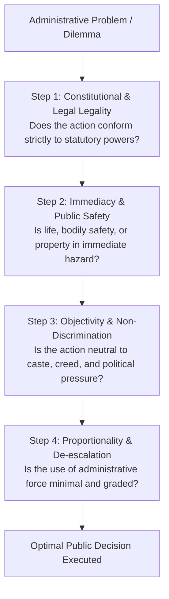

# Decision Making and Problem Solving (ನಿರ್ಧಾರ ತೆಗೆದುಕೊಳ್ಳುವಿಕೆ ಮತ್ತು ಸಮಸ್ಯೆ ಪರಿಹಾರ)

> [!exam-focus]
> **Exam Weightage & Testing Patterns**: Featured in Prelims Paper 2 Section 3 (4 to 6 Situational Judgement Questions, 8 to 12 Marks).
> - **KPSC Exam Rule**: In KPSC KAS decision making questions, questions present practical administrative scenarios testing legal propriety, public interest, communal neutrality, and procedural discipline. Unlike typical academic questions, there is often no negative marking for genuine decision-making questions, or options are graded (best option 2 marks, second-best 1 mark), though in standard Prelims 1/4th negative marking applies unless specifically notified.
> - **Golden Elimination Rule**: Immediately eliminate choices that involve: (a) abdication of duty / passing responsibility to superiors without taking initial lawful steps; (b) taking the law into one's own hands or using unlawful force; (c) bowing to illegal political or communal pressure; (d) hasty actions that inflame communal or public riots.

---

## 1. The Administrative Decision Matrix

The flowchart above presents the 4-step decision hierarchy an administrator must navigate when responding to situational crises and administrative dilemmas.

### 1.1 Core Principles Governing Situational Decisions
1. **Rule of Law (ಕಾನೂನಿನ ಆಳ್ವಿಕೆ)**: Administrative discretion cannot exceed statutory limits. An officer must act strictly within the powers delegated under the CrPC/BNSS, Karnataka Police Act, Land Revenue Act, or Disaster Management Act.
2. **Proportionality (ಸಮಾನ ಪ್ರಮಾಣತೆ)**: Any coercive or punitive administrative measure must be strictly proportionate to the scale of the threat. Use dialogue and non-lethal dispersal before resorting to severe measures.
3. **Impartiality & Secular Neutrality (ತಟಸ್ಥತೆ)**: Decisions during communal friction, festival processions, or caste tensions must be completely even-handed. Lawful permissions must be respected, and unlawful acts sanctioned regardless of identity.
4. **Accountability & Written Documentation**: Critical instructions must be recorded in writing with official reasons documented, keeping superiors informed via official sit-rep (situation report) communications.

---

## 2. Common Administrative Scenario Archetypes

### 2.1 Communal Unrest & Public Order
- **Scenario**: A festival procession attempts to deviate from its legally permitted route and pass through a sensitive area, creating immediate risk of communal violence.
- **Appropriate Action**:
  - Immediately stop the unauthorized diversion using adequate police bandobast.
  - Engage community leaders and organizers in direct dialogue to insist on the approved route.
  - Impose prohibitory orders under Section 144 CrPC / Sec 163 BNSS if violence threatens to erupt.
  - Avoid unilateral excessive force until non-violent dispersal and tear gas/water cannons have failed.

### 2.2 Natural Disasters & Evacuation
- **Scenario**: A major landslide warning or flood crest alert is issued for a river basin. Villagers refuse to evacuate their ancestral homes and livestock.
- **Appropriate Action**:
  - Deploy local revenue officials, Anganwadi workers, and Panchayat members to explain the immediate risk.
  - Mobilize rescue relief shelters with food, clean water, and livestock holding areas.
  - Enforce mandatory evacuation under the Disaster Management Act, 2005 if lives are in imminent peril.

### 2.3 Political Pressure vs Statutory Duty
- **Scenario**: An influential local politician demands that the Tahsildar stop an anti-encroachment drive on government lake land (Gomal / Tank bed land) that affects his supporters.
- **Appropriate Action**:
  - Politely but firmly decline to halt the lawful eviction drive.
  - Ensure all due process steps (notice under Section 192A of Karnataka Land Revenue Act, survey sketches, hearing opportunities) have been scrupulously documented.
  - Inform the Deputy Commissioner (DC) in writing about the situation and request additional security if interference is anticipated.

---

## Likely Questions & PYQs

### Model Question 1 (Decision Making Scenario)
**Scenario**: You are the Assistant Commissioner (Sub-Divisional Magistrate). A chemical factory in your jurisdiction has suffered a hazardous gas leak. Local villagers are panicking and starting to block highways, while factory management claims the leak is minor and under control.
What is your immediate sequence of actions?
A) Order an immediate lathi charge on the highway protestors to clear transit corridors.
B) Accept factory management's assurance and advise citizens through social media to remain indoors.
C) Immediately rush disaster response teams, verify leak toxicity with technical experts, seal the facility perimeter, establish safe evacuation shelters for downwind residents, and address citizens through official public address channels.
D) Wait for detailed written guidance from the State Disaster Management Authority before intervening.
*Answer*: **C**
*Explanation*: Option C takes proactive charge of public safety, deploys technical assessment, establishes containment and relief, and counters rumors with official communication. Options A, B, and D represent excessive force, naive passivity, and administrative abdication respectively.

### Model Question 2 (Administrative Dilemma)
**Scenario**: As an Executive Officer of a Taluk Panchayat, you discover that a Gram Panchayat Secretary has diverted MGNREGA funds to clear pending water bills of influential village leaders. The Secretary claims he was verbally ordered to do so by the Panchayat President.
What should you do?
A) Overlook the issue since the money was used for public water supply.
B) Verbally reprimand the Secretary and order him to recover the funds privately.
C) Issue a formal show-cause notice to the Secretary, institute a time-bound financial audit, recover the misallocated funds, and report the irregularity to the Chief Executive Officer (CEO) of the Zilla Panchayat for statutory disciplinary action.
D) Immediately file a criminal case against the Panchayat President without conducting any preliminary inquiry.
*Answer*: **C**
*Explanation*: Administrative procedure requires following due process: issuance of show-cause notice, objective auditing of accounts, fund recovery, and reporting through official hierarchy (CEO ZP) for statutory action.

---

> [!summary]
> **Key Revision Points**:
> - Priority order: Legality -> Human Life & Safety -> Neutrality -> Proportionality.
> - Never pass the buck or abdicate lawful authority.
> - Due process and documentation must precede punitive action.
> - In crisis management, combine de-escalation dialogue with firm enforcement of statutory mandates.
