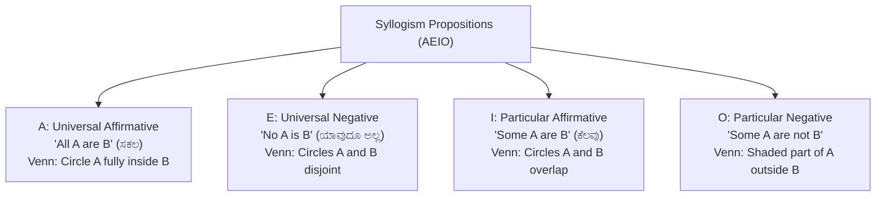

# Logical and Analytical Reasoning (ತಾರ್ಕಿಕ ಮತ್ತು ವಿಶ್ಲೇಷಣಾತ್ಮಕ ಸಾಮರ್ಥ್ಯ)

> [!exam-focus]
> **Exam Weightage & Testing Patterns**: Carries 8 to 10 MCQs (16 to 20 Marks) in Prelims Paper 2 Section 3.
> - **Prelims Traps**: Violating Venn diagram rules in Syllogisms (confusing 'Some' with 'Some not', or missing complementary pairs for 'Either-Or'); sign reversal in coded inequalities; mixing left/right orientations in inward vs outward facing circular seating arrangements.
> - **High-Yield Sub-topics**: Syllogisms (ನ್ಯಾಯವಾಕ್ಯಗಳು), Blood Relations (ರಕ್ತ ಸಂಬಂಧಗಳು), Direction Sense Test (ದಿಕ್ಕುಗಳ ಜ್ಞಾನ), Seating Arrangements, Coding-Decoding (ಸಂಕೇತೀಕರಣ), Statement-Assumptions & Statement-Conclusions.

---

## 1. Syllogistic Deduction & Venn Diagrams

The flowchart above outlines the 4 standard categorical propositions (AEIO square of opposition) used to solve syllogisms via Venn diagrams.

### 1.1 Golden Rules of Syllogisms
1. If both premises are **Particular** (Some + Some), no definite universal conclusion follows.
2. If both premises are **Negative** (No + No), no definite relationship follows.
3. If one premise is **Negative**, the valid conclusion must be **Negative**.
4. If one premise is **Particular**, the valid conclusion must be **Particular**.
5. **Complementary Pairs for "Either-Or"**:
   - Condition 1: Both conclusions have the same Subject and Predicate.
   - Condition 2: Both conclusions are independently indeterminate/false in the basic diagram.
   - Condition 3: One is affirmative and the other is negative (Pair 1: *Some* + *No*; Pair 2: *All* + *Some Not*). Note: *All* + *No* is **never** an Either-Or pair.

---

## 2. Core Reasoning Modules

### 2.1 Coding - Decoding (ಸಂಕೇತೀಕರಣ ಮತ್ತು ವಿಸಂಕೇತೀಕರಣ)
- **Alphabet Position Mapping**: Memorize alphabet ranks 1 to 26 forwards and backwards using mnemonic:
  - **EJOTY**: E=5, J=10, O=15, T=20, Y=25.
  - **Reverse Alphabet Pairs (Sum = 27)**: A-Z (AZad), B-Y (BoY), C-X (CruX), D-W (Dew), E-V (EVen), F-U (FUll), G-T (GT road), H-S (High School), I-R (Indian Railway), J-Q (Jungle Queen), K-P (Kurta Pajama), L-O (LOve), M-N (MaN).

### 2.2 Blood Relations (ರಕ್ತ ಸಂಬಂಧಗಳು)
- **Standard Diagrammatic Conventions**:
  - Male: Square `[M]` or `+`.
  - Female: Circle `(F)` or `-`.
  - Married Couple: Double horizontal line `<=>`.
  - Siblings: Single horizontal line `---`.
  - Generation Gap: Vertical line `|`.

### 2.3 Direction Sense Test (ದಿಕ್ಕುಗಳ ಪರೀಕ್ಷೆ)
- Standard 8-directional compass: North (ಉತ್ತರ), South (ದಕ್ಷಿಣ), East (ಪೂರ್ವ), West (ಪಶ್ಚಿಮ), North-East (ಈಶಾನ್ಯ), South-East (ಆಗ್ನೇಯ), South-West (ನೈಋತ್ಯ), North-West (ವಾಯವ್ಯ).
- **Pythagoras Theorem**: For shortest displacement across right angles:
  $$	ext{Displacement} = \sqrt{(\Delta x)^2 + (\Delta y)^2}$$
- **Shadow Direction at Sunrise vs Sunset**:
  - *At Sunrise (Sun in East)*: Shadow of all objects falls towards the **West**.
  - *At Sunset (Sun in West)*: Shadow of all objects falls towards the **East**.

### 2.4 Seating Arrangements (ಆಸನ ವ್ಯವಸ್ಥೆ)
- **Linear Row**: Facing North (Left = your left, Right = your right); Facing South (Left = your right, Right = your left).
- **Circular Table**:
  - *Facing Inward (Center)*: Clockwise movement = Right to Left (Moving to the **Left** of a person); Counter-Clockwise = Moving to the **Right**.
  - *Facing Outward*: Clockwise = Moving to the **Right**; Counter-Clockwise = Moving to the **Left**.

---

## 3. Critical Analytical Reasoning

1. **Statement and Assumptions (ಹೇಳಿಕೆ ಮತ್ತು ಊಹೆಗಳು)**:
   - An assumption is an unstated foundation that the speaker took for granted when framing the statement.
   - An assumption is valid if it logically underpins why the statement was made.
   - Do not accept assumptions that generalize beyond the statement's domain.
2. **Statement and Courses of Action (ಕ್ರಮಗಳು)**:
   - A valid course of action must be a realistic, practical, and proportionate remedy that solves or reduces the problem without introducing a worse crisis.

---

## Likely Questions & PYQs

### Model Question 1 (Syllogisms)
**Statements**:
1. All rivers are water bodies.
2. Some water bodies are lakes.
**Conclusions**:
I. Some rivers are lakes.
II. No river is a lake.
Which conclusion follows?
A) Only I follows
B) Only II follows
C) Either I or II follows
D) Neither I nor II follows
*Answer*: **C**
*Explanation*: The basic diagram shows rivers inside water bodies, and lakes intersecting water bodies without touching rivers. In this diagram, neither I nor II is definitely true. However, a lake could intersect rivers in an alternative diagram. Since both statements have the same subject and predicate (rivers, lakes), both are individually uncertain, and they form a complementary pair ("Some" and "No"), the correct response is **Either I or II follows**.

### Model Question 2 (Direction Sense)
**Q**: An investigator walks 12 km North from the Taluk office, turns right and walks 5 km East, then turns right and walks 12 km South. How far and in which direction is the investigator from the starting point?
A) 5 km East
B) 10 km North
C) 5 km West
D) 13 km North-East
*Answer*: **A**
*Explanation*: The northward displacement of 12 km is neutralized by the southward displacement of 12 km ($12 - 12 = 0$). The only net displacement is 5 km due East from the starting point.

---

> [!summary]
> **Key Revision Points**:
> - Syllogism: Either-Or applies only to *Some + No* or *All + Some Not*.
> - Reverse alphabet mapping always sums to 27.
> - Inward circular seating: Clockwise = Left, Counter-Clockwise = Right.
> - At sunrise, shadows fall strictly West; at sunset, strictly East.
