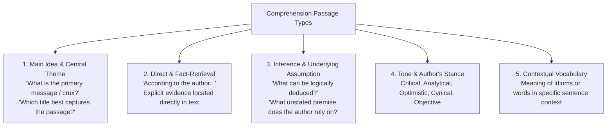

# Reading Comprehension and Passage Analysis (ಗ್ರಹಣ ಶಕ್ತಿ ಮತ್ತು ಗದ್ಯ ವಿಶ್ಲೇಷಣೆ)

> [!exam-focus]
> **Exam Weightage & Testing Patterns**: In Prelims Paper 2 Section 3 (General Mental Ability), Comprehension typically carries 5 to 8 MCQs (10 to 16 Marks). Passages are provided in both English and Kannada.
> - **Prelims Traps**: Choosing answers that reflect external general knowledge rather than statements supported strictly by the text; falling for extreme qualifiers (*always*, *never*, *only*, *all*); misinterpreting tone/inference questions.
> - **KAS-Specific Nuance**: KPSC translates passages from English to Kannada (or vice-versa). In case of translational ambiguity in Kannada, the English text is standard, but candidates must verify terms carefully.

---

## 1. Core Comprehension Question Archetypes

The diagram above details the 5 foundational question categories appearing in KPSC General Mental Ability comprehension sections.

### 1.1 Systematic 4-Step Passage Solving Strategy
1. **Skim Question Stems First (30 Seconds)**: Read only the question stems (not the options) before diving into the passage. This flags keywords, dates, names, or theme concepts to look for during reading.
2. **Active Analytical Reading (2 Minutes)**:
   - Identify the **Topic Sentence** (usually in paragraph 1).
   - Track transition words signaling logical shifts: *However, Despite, Whereas, On the contrary, Furthermore, Consequently*.
   - Mark concluding statements summarizing the author's viewpoint.
3. **Paraphrase the Crux**: Formulate a one-sentence mental summary of the author's central contention before evaluating options.
4. **Eliminate Aggressively**:
   - Discard options that introduce outside concepts not present in the text.
   - Discard options containing absolute words (*solely, invariably, impossible, everyone*) unless the author explicitly uses them.
   - Beware of "Half-Right, Half-Wrong" distractors.

---

## 2. Bilingual Passage Mastery (ಕನ್ನಡ ಮತ್ತು ಇಂಗ್ಲಿಷ್ ಗದ್ಯ ಗ್ರಹಣ)

In KPSC examinations, passages often address socio-economic development, Karnataka history, environmental conservation, or philosophical themes:
- **Navigating Complex Kannada Prose**:
  - Focus on case markers (ವಿಭಕ್ತಿ ಪ್ರತ್ಯಯಗಳು) and verb conjugations to distinguish the subject (ಕರ್ತೃ), object (ಕರ್ಮ), and action (ಕ್ರಿಯಾಪದ).
  - Watch for formal sandhi/compound formations (ಸಮಾಸಗಳು) frequently used in formal administrative or literary Kannada.
- **Cross-Checking Between Versions**: When an option in Kannada seems confusing or grammatically convoluted, reading the corresponding English sentence clarifies the syntactic intent immediately.

---

## Likely Questions & PYQs

### Practice Passage (KPSC Prelims Model)
*Passage*:
"Sustainable economic progress in agrarian states like Karnataka cannot rely solely on urban-centric service growth. While the capital city Bengaluru generates disproportionate revenues, rural productivity remains constrained by rainfed vulnerability and fragmented landholdings. Without decentralized industrial corridors that link secondary agricultural processing with rural enterprise, regional imbalances will continue to widen, driving unsustainable distress migration to urban centers."

#### Question 1 (Crux / Main Idea)
**Q**: Which of the following best reflects the most logical and critical inference from the passage?
A) Service sector growth in Bengaluru must be curtailed to protect the rural economy.
B) Broad-based economic resilience requires integrating rural agro-processing with regional industrial dispersion.
C) Distress migration can only be prevented by providing guaranteed agricultural subsidies.
D) Urbanization is intrinsically detrimental to sustainable economic development.
*Answer*: **B**
*Explanation*: The passage argues that relying solely on urban-centric growth creates imbalance and that decentralized industrial corridors linking agro-processing with rural enterprise are essential to address regional disparities. Option B captures this comprehensively without extreme distortions.

#### Question 2 (Fact & Inference)
**Q**: According to the author, what is a primary structural constraint affecting rural economic productivity?
A) Lack of telecommunications connectivity
B) Excessive concentration of manufacturing in coastal areas
C) Reliance on rainfed cultivation and fragmented holdings
D) Total absence of state developmental funding
*Answer*: **C**
*Explanation*: The passage explicitly states: "rural productivity remains constrained by rainfed vulnerability and fragmented landholdings."

---

> [!summary]
> **Key Revision Points**:
> - Read question stems before reading the text.
> - Never import outside knowledge; the text is the sole universe of truth.
> - Eliminate extreme options (*all, none, never, only*).
> - Cross-reference English and Kannada versions if translational ambiguity arises.
