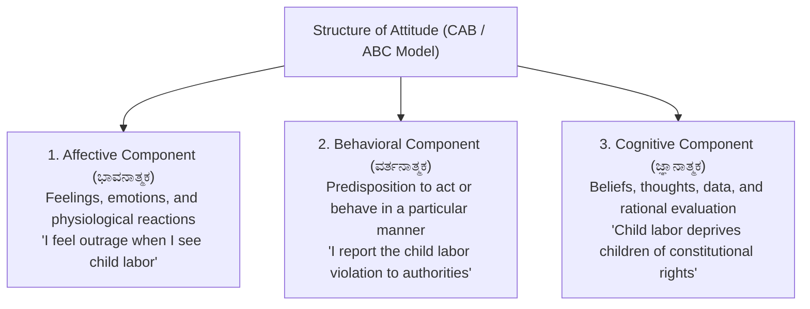
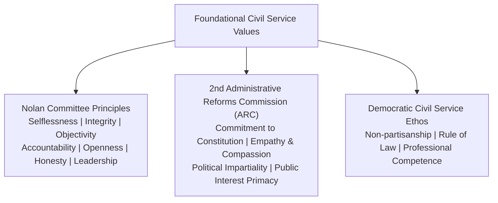

# Attitude and Foundational Civil Service Values (ಮನೋಭಾವ ಮತ್ತು ನಾಗರಿಕ ಸೇವೆಯ ಮೂಲಭೂತ ಮೌಲ್ಯಗಳು)

> [!exam-focus]
> **Exam Weightage & Testing Patterns**: Central pillar in Mains GS-4 Section 2 (Attitude, Aptitude & Values: 30 to 45 Marks).
> - **Core Theoretical Constructs**: ABC Model of Attitude (Affective, Behavioral, Cognitive); Functions of Attitude (Katz); Social Influence & Persuasion methods (Cialdini).
> - **Foundational Civil Service Values**: Nolan Committee's 7 Principles of Public Life; 2nd ARC recommended ethical code; Impartiality, Non-partisanship, Objectivity, Empathy and Compassion towards weaker sections.

---

## 1. Structure, Content and Functions of Attitude

The diagram above details the Tripartite (ABC) Model of Attitude, illustrating how emotions, beliefs, and behavioral tendencies synthesize into human attitude.

### 1.1 Psychological Functions of Attitude (Daniel Katz)
1. **Utilitarian / Instrumental Function**: Directing behavior towards rewards and away from punishment.
2. **Ego-Defensive Function**: Protecting self-esteem and justifying personal prejudices or failures.
3. **Value-Expressive Function**: Allowing individuals to project and manifest their core central values and self-identity.
4. **Knowledge Function**: Providing a simplified cognitive schema to organize and interpret complex external environments.

### 1.2 Social Influence and Persuasion (ಸಾಮಾಜಿಕ ಪ್ರಭಾವ ಮತ್ತು ಮನವೊಲಿಕೆ)
Administrative campaigns (e.g. Swachh Bharat toilet usage, pulse polio vaccination, girl child education) rely on persuasion rather than coercion:
- **Source Credibility**: Expertise, trustworthiness, and likability of the communicator (e.g., local religious leaders endorsing vaccination).
- **Message Content**: Clear, emotionally resonant, two-sided messaging providing actionable alternatives.
- **Audience Receptivity**: Tailoring messages to local cultural idioms, languages (Kannada folk arts like *Yakshagana*, *Harikatha*), and demographic segments.

---

## 2. Foundational Values for Civil Services

The diagram above outlines the universal ethical framework governing public administration, anchored by the Nolan Principles and the 2nd ARC recommendations.

### 2.1 The Nolan Committee's Seven Principles of Public Life (1995)
1. **Selflessness (ನಿಸ್ವಾರ್ಥತೆ)**: Holders of public office should act solely in terms of the public interest. They should not do so in order to gain financial or other material benefits for themselves, their family or friends.
2. **Integrity (ಸಮಗ್ರತೆ / ನಿಷ್ಠೆ)**: Holders of public office must avoid placing themselves under any obligation to people or organisations that might try inappropriately to influence them in their work.
3. **Objectivity (ವಸ್ತುನಿಷ್ಠತೆ)**: Holders of public office must act and take decisions impartially, fairly and on merit, using the best evidence and without discrimination.
4. **Accountability (ಹೊಣೆಗಾರಿಕೆ)**: Holders of public office are accountable to the public for their decisions and actions and must submit themselves to scrutiny.
5. **Openness (ಪಾರದರ್ಶಕತೆ)**: Holders of public office should act and take decisions in an open and transparent manner. Information should not be withheld from the public unless there are clear and lawful reasons.
6. **Honesty (ಪ್ರಾಮಾಣಿಕತೆ)**: Holders of public office should be truthful.
7. **Leadership (ನಾಯಕತ್ವ)**: Holders of public office should exhibit these principles in their own behaviour and actively promote and robustly support the principles.

### 2.2 Deep Values: Empathy, Tolerance & Compassion
- **Empathy (ಸಹಾನುಭೂತಿ)**: The cognitive and emotional ability to project oneself into the position of another person and perceive reality from their lived experience.
- **Compassion (ದಯೆ / ಕರುಣೆ)**: Active, outward manifestation of empathy accompanied by a proactive desire to alleviate the suffering of marginalized groups (SC/STs, disabled, widows, rural poor).
- **Impartiality & Non-partisanship (ತಟಸ್ಥತೆ ಮತ್ತು ಪಕ್ಷಪಾತರಾಹಿತ್ಯ)**: Acting without ideological bias, serving elected governments of differing political parties with equal loyalty, and deciding administrative cases without favoritism.

---

## Likely Questions & PYQs

### Model Question 1 (Mains GS-4 - 10 Marks)
**Q**: Distinguish between 'Empathy' and 'Compassion'. Why is compassion considered an indispensable foundational value for an administrator serving in backward rural regions of Karnataka?

### Model Question 2 (Mains GS-4 - 12.5 Marks)
**Q**: "A civil servant who possesses high intellectual competence but lacks emotional integrity is a hazard to public governance." Discuss with reference to the Nolan Committee's Seven Principles of Public Life.

---

> [!summary]
> **Key Revision Points**:
> - ABC Model of Attitude: Affective (Feelings), Behavioral (Actions), Cognitive (Beliefs).
> - Nolan Principles (7): Selflessness, Integrity, Objectivity, Accountability, Openness, Honesty, Leadership.
> - Empathy = understanding another's pain; Compassion = taking proactive action to alleviate that pain.
> - Objectivity demands decisions based on verified evidence and merit rather than personal inclination.
