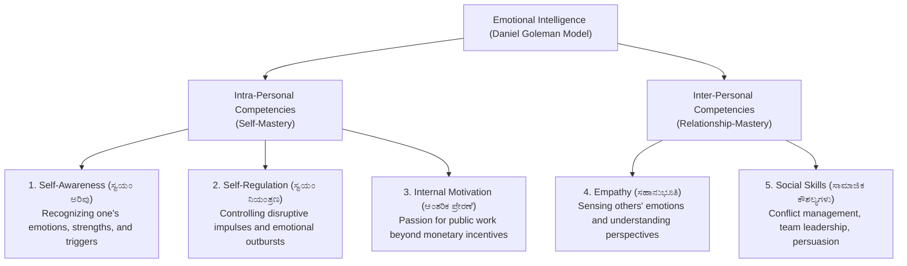
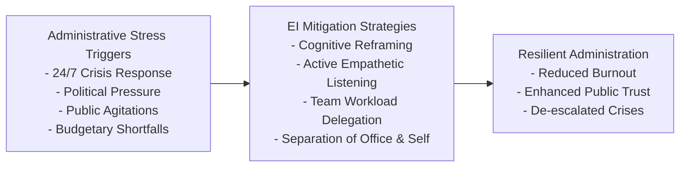

# Emotional Intelligence in Administration (ಆಡಳಿತದಲ್ಲಿ ಭಾವನಾತ್ಮಕ ಬುದ್ಧಿವಂತಿಕೆ)

> [!exam-focus]
> **Exam Weightage & Testing Patterns**: High-yield syllabus area in Mains GS-4 Section 2 (Dedicated 10 to 15-mark conceptual or application question).
> - **Core Theoretical Framework**: Daniel Goleman's 5-Domain Model of Emotional Intelligence (Self-awareness, Self-regulation, Internal motivation, Empathy, Social skills).
> - **Administrative Scenarios**: Crowd dispersal without lethal force; defusing aggressive public protests; managing high-pressure bureaucratic deadlines; maintaining departmental morale under political duress.

---

## 1. What is Emotional Intelligence (EI / EQ)?

The flowchart above outlines Daniel Goleman's Emotional Intelligence matrix divided into Intra-Personal (Self) and Inter-Personal (Social) domains.

### 1.1 IQ vs EQ in Public Administration
- **Intelligence Quotient (IQ)**: Measures analytical reasoning, numerical logic, and technical recall. Essential for clearing competitive exams and understanding administrative rules.
- **Emotional Quotient (EQ)**: Measures ability to recognize, understand, manage, and constructively harness emotions in oneself and others.
- **Administrative Axiom**: *"IQ may get you appointed to the civil services, but EQ determines whether you succeed as an effective leader and public administrator."*

---

## 2. Goleman's 5 Core Dimensions in Governance

| Dimension | Administrative Meaning | Governance Application |
|---|---|---|
| **1. Self-Awareness (ಸ್ವಯಂ ಅರಿವು)** | Understanding one's own emotional state, biases, ego, and fatigue points. | Recognizing when personal anger or stress during a heated public agitation could lead to an unlawful order. |
| **2. Self-Regulation (ಸ್ವಯಂ ನಿಯಂತ್ರಣ)** | Keeping disruptive emotions, anger, and panic in check under severe pressure. | Remaining calm and composed when provoked by aggressive protestors or hostile media grilling. |
| **3. Internal Motivation (ಆಂತರಿಕ ಪ್ರೇರಣೆ)** | Striving to serve the public interest driven by intrinsic pride, public duty, and purpose. | Sustaining dedication in difficult, remote rural postings without succumbing to apathy. |
| **4. Empathy (ಸಹಾನುಭೂತಿ)** | Understanding the unvoiced pain, fears, and struggles of citizens. | Listening patiently to aggrieved farmers or flood victims rather than issuing cold bureaucratic rejections. |
| **5. Social Skills (ಸಾಮಾಜಿಕ ಕೌಶಲ್ಯಗಳು)** | Fostering inter-departmental cooperation, negotiation, and de-escalation. | Negotiating peacefully with striking trade unions or protesting farmer organizations to resolve road blockades. |

---

## 3. Administrative Stress & Conflict Management

The diagram above demonstrates how applying Emotional Intelligence mitigates bureaucratic stress and transforms conflict into constructive public solutions.

### 3.1 Crowd Control & Agitation De-escalation
- **Empathetic Engagement**: Acknowledging the emotional grievance of the crowd before quoting statutory laws. People who feel heard are far less likely to turn violent.
- **Non-Verbal De-escalation**: Maintaining relaxed body posture, avoiding offensive physical gestures, and demonstrating an open willingness to receive a delegation for formal dialogue.

---

## Likely Questions & PYQs

### Model Question 1 (Mains GS-4 - 10 Marks)
**Q**: What is Emotional Intelligence? How does emotional intelligence assist a District Collector / Deputy Commissioner in diffusing a communally charged public demonstration?

### Model Question 2 (Mains GS-4 - 10 Marks)
**Q**: "Bureaucrats often suffer from emotional burnout due to conflicting political pressures and public expectations." Suggest practical coping strategies rooted in emotional self-regulation to maintain mental well-being in civil services.

---

> [!summary]
> **Key Revision Points**:
> - Daniel Goleman's 5 pillars: Self-awareness, Self-regulation, Internal motivation, Empathy, Social skills.
> - High EQ transforms bureaucrats from cold rule-enforcers into empathetic leaders.
> - In public unrest, empathetic listening defuses mob anger far better than immediate brute force.
