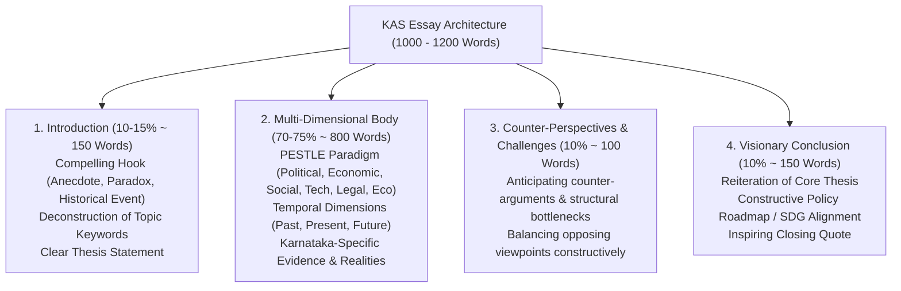
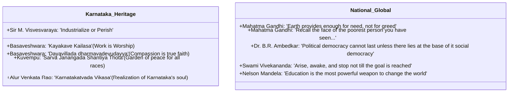

# KPSC KAS Mains Essay: Comprehensive Frameworks & Scoring Strategies (ಮುಖ್ಯ ಪರೀಕ್ಷೆಯ ಪ್ರಬಂಧ: ಸಮಗ್ರ ಚೌಕಟ್ಟುಗಳು ಮತ್ತು ಅಂಕಗಳಿಸುವ ತಂತ್ರಗಳು)

> [!exam-focus]
> **Exam Weightage & Testing Rules**: Mains Paper 1 (Compulsory Merit Paper, 250 Marks, 3 Hours).
> - **Two Sections (125 Marks Each)**:
>   - *Section 1*: Essay on National or International issues (ರಾಷ್ಟ್ರೀಯ ಅಥವಾ ಅಂತರರಾಷ್ಟ್ರೀಯ ವಿಷಯಗಳು).
>   - *Section 2*: Essay on State of Karnataka or Regional issues (ಕರ್ನಾಟಕ ರಾಜ್ಯ ಅಥವಾ ಪ್ರಾದೇಶಿಕ ವಿಷಯಗಳು).
> - **Word Count**: Approximately 1,000 to 1,200 words per essay.
> - **Scoring Criteria**: Keeping closely to the subject; orderly, concise, and effective expression; originality of thought; balanced arguments with constructive solutions.

---

## 1. The Anatomy of a High-Scoring KAS Essay

The flowchart above outlines the structural proportioning required to craft a balanced, coherent, and competitive 125-mark essay.

---

## 2. Structural Brainstorming Frameworks

### 2.1 The PESTLE Multi-Dimensional Matrix
When brainstorming an essay topic, systematically unpack arguments across 7 dimensions:
1. **Political & Administrative**: Democratic accountability, federalism, decentralized Panchayati Raj, electoral transparency, executive capacity.
2. **Economic & Fiscal**: Growth vs equity, fiscal sustainability, resource allocation, employment creation, rural-urban disparities, industrial clusters.
3. **Social & Cultural**: Gender justice, caste dynamics, human capital (education/health), cultural heritage, inclusive empowerment of vulnerable groups.
4. **Technological & Scientific**: Digital divide, artificial intelligence, biotechnology, e-governance (Sakala/Bhoomi), automation impact on labor.
5. **Legal & Constitutional**: Constitutional morality, fundamental rights, judicial precedents, statutory safeguards, human rights.
6. **Environmental & Ecological**: Climate resilience, biodiversity loss, Western Ghats preservation, water security, pollution mitigation.
7. **Ethical & Philosophical**: Conscience, justice, human dignity, Gandhian trusteeship, Sharana ideals (*Kayakave Kailasa*).

### 2.2 The Concentric Sphere Framework (Micro to Macro)
- **Individual** $	o$ **Family / Kinship** $	o$ **Community / Civil Society** $	o$ **State / Karnataka** $	o$ **Nation / India** $	o$ **Global Humanity**.

---

## 3. Curated Quote Bank for KAS Essays

The class diagram above organizes high-impact quotations from Karnataka reformers and global leaders to elevate essay introductions and conclusions.

---

## 4. Model Essay Outlines

### Model 1: Section 1 (National/International Theme)
**Topic**: *"Digital Governance: Bridging the Divide or Deepening Inequalities?"*
1. **Introduction**: Anecdote of a rural citizen accessing land records via digital DBT vs an elderly widow denied ration due to biometric mismatch. Define digital governance as a double-edged sword.
2. **The Bridging Dimensions**: Elimination of middlemen, transparency (DBT saving crores), democratization of services (UPI, Digilocker, CoWIN).
3. **The Deepening Divides**: Infrastructure poverty (bandwidth in rural belts), gender digital gap, digital literacy deficits, algorithmic bias and surveillance risks.
4. **Institutional Safeguards**: Data Protection Act, offline grievance fallbacks, community CSC centers, vernacular digital interfaces.
5. **Conclusion**: Gandhi's talisman applied to technology: Digital tools must serve human dignity rather than exclude the illiterate.

### Model 2: Section 2 (State of Karnataka Theme)
**Topic**: *"Regional Imbalances in Karnataka: Can Policy Bridge the Divide Between Bengaluru and Kalyana Karnataka?"*
1. **Introduction**: Contrast the glittering glass towers of Bengaluru's Silicon Valley with the drought-hit landscape of Yadgir and Raichur. Quote D.M. Nanjundappa Committee Report (2002).
2. **Historical Roots of Imbalance**: Disparate administrative legacies (Princely Mysore development vs Hyderabad Nizam neglect vs Bombay Karnataka integration).
3. **Socio-Economic Fault Lines**: Education and healthcare deficits, agricultural rainfed vulnerability, migration outward from Kalyana Karnataka.
4. **Policy Interventions & Progress**:
   - Article 371J constitutional amendment (reservation in employment and education).
   - KKRDB (Kalyana Karnataka Region Development Board) annual fund allocations (>Rs. 5,000 Crore).
   - 'Beyond Bengaluru' tech and industrial corridors (Hubballi-Dharwad, Kalaburagi).
5. **Challenges & Bottlenecks**: Fund utilization delays, human resource vacancy rates in schools/hospitals in northern districts, infrastructure deficits.
6. **Conclusion**: Evoke Kuvempu's vision of *"Sarva Janangada Shantiya Thota"*—a prosperous Karnataka is indivisible; sustainable state growth requires elevating the last citizen of Kalyana Karnataka.

---

> [!summary]
> **Key Revision Points**:
> - Two essays: 1 National/International + 1 Karnataka Regional (125 Marks each, 250 Marks total).
> - Target length: 1,000-1,200 words each.
> - Deploy PESTLE structure for exhaustive multi-dimensional coverage.
> - Anchor regional essay in Karnataka data: Article 371J, Nanjundappa Committee, KKRDB, Beyond Bengaluru.
> - Integrate Kannada cultural quotes (Basaveshwara, Kuvempu, Visvesvaraya) for distinctive regional authenticity.
