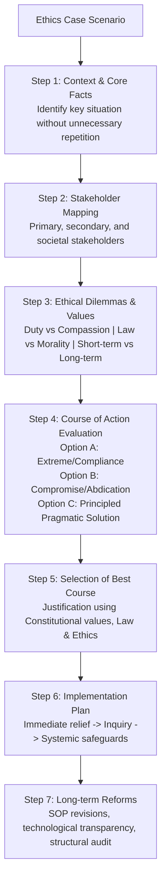

# Ethics Case Studies: Analytical Framework & Solved Scenarios (ನೈತಿಕ ಪ್ರಕರಣ ಅಧ್ಯಯನಗಳು: ವಿಶ್ಲೇಷಣಾತ್ಮಕ ಚೌಕಟ್ಟು ಮತ್ತು ಪರಿಹರಿಸಿದ ಮಾದರಿಗಳು)

> [!exam-focus]
> **Exam Weightage & Testing Patterns**: Constitutes Section 3 of Mains Paper 5 (GS-4: 50 to 75 Marks across 4-6 detailed case scenarios).
> - **Core Requirement**: A structured, balanced, and principled response. Never offer purely emotional or reckless administrative solutions. Balance legal procedure, constitutional morality, humanitarian compassion, and practical feasibility.
> - **Karnataka Contextual Scenarios**: Illegal sand/granite mining pressure; eviction of encroachers from temple/lake lands; communal tensions during religious yatras; kickbacks in irrigation/PWD tenders; conflict between MLA pressure and statutory tender rules.

---

## 1. The 7-Step Case Study Solution Matrix

The diagram above details the standard 7-step analytical framework recommended for securing top marks in KPSC GS-4 ethics case studies.

---

## 2. Solved Karnataka Case Study 1: Illegal Mining Pressure vs Administrative Duty

### The Scenario:
You are posted as the Assistant Commissioner (Sub-Divisional Magistrate) in a mineral-rich district of Karnataka. During a surprise inspection, your team seizes 15 overloaded trucks transporting illegally mined sand from a river basin lacking environmental clearance. The trucks belong to a close relative of an influential local Cabinet Minister. Within hours, the Minister calls you, claiming that stopping the sand will paralyze local housing projects for the poor, and "strongly advises" you to release the vehicles with a token fine, threatening punitive transfer to a remote, non-executive post if you refuse. The local police inspector seems hesitant to register an FIR without "orders from above."

### Step-by-Step Ethical Solution:

#### 1. Stakeholders Involved:
- **Assistant Commissioner (Self)**: Professional integrity, legal duty, personal career risk.
- **Cabinet Minister & Kin**: Political influence, commercial interest, abuse of power.
- **Local Ecology & River Basin**: Environmental damage, groundwater depletion, erosion.
- **General Public / Local Citizens**: Right to fair governance, environmental protection.
- **Frontline Police & Revenue Staff**: Institutional morale, adherence to rule of law.

#### 2. Ethical Dilemmas:
- **Rule of Law vs Political Expediency**: Enforcing statutory mining regulations versus submitting to political coercion.
- **Professional Duty vs Personal Career Security**: Fear of punitive transfer versus safeguarding public natural resources.
- **Short-term Local Construction Needs vs Long-term Environmental Destruction**: Unregulated sand extraction causing irreversible riverbed collapse.

#### 3. Evaluation of Possible Options:
- **Option 1: Yield to the Minister's demand and release the trucks with a nominal penalty.**
  - *Merits*: Avoids confrontation; protects personal career from immediate punitive transfer.
  - *Demerits*: Gross violation of the Karnataka Minor Mineral Concession Rules and MMDR Act; destroys personal integrity and demoralizes subordinate officers; promotes environmental destruction.
- **Option 2: Immediately leak the Minister's phone recording to the press and file a media complaint.**
  - *Merits*: Gains public sympathy and acts as a deterrent.
  - *Demerits*: Violates Civil Services Conduct Rules; sensationalizes administrative action without exhausting institutional due process.
- **Option 3: Politely refuse to yield, scrupulously document all seized evidence, register formal FIRs under the MMDR Act, and officially inform the Deputy Commissioner.**
  - *Merits*: Upholds statutory duty and rule of law; protects natural ecology; sets an incorruptible precedent.
  - *Demerits*: Risk of political hostility or transfer.

#### 4. Chosen Course of Action & Execution Plan:
1. **Polite but Uncompromising Professional Stance**: Inform the Minister respectfully that the seizure was conducted under statutory environmental laws and must proceed strictly in accordance with legal procedures.
2. **Immediate Evidence Securing**: Ensure all 15 trucks are impounded, GPS logs and weighing slips recorded, video documentation completed, and custody transferred to the Police Station under formal seizure panchnama.
3. **Filing of FIR**: Direct the Police Inspector in writing under Section 21 of the MMDR Act and relevant sections of the BNS/IPC.
4. **Institutional Reporting**: Submit a comprehensive factual report immediately to the Deputy Commissioner (DC) and District Mining Task Force.
5. **Accepting Administrative Outcomes**: Face transfer with dignity, knowing that transfers are part of civil service life, but professional integrity once compromised cannot be restored.

#### 5. Long-term Systemic Reforms:
- Mandate digital e-permits with QR-code tracking for every mineral truck.
- Implement drone surveillance along sensitive river basins.
- Establish dedicated mining checkposts equipped with automatic weighbridges and CCTV cameras connected to the DC control room.

---

## 3. Solved Karnataka Case Study 2: Public Welfare vs Legal Encroachment

### The Scenario:
As a Tahsildar, you have received orders from the High Court of Karnataka to remove all encroachments on a major lake bed (*Kere Angala*) in your taluk within two weeks. A prominent builder has encroached on 10 acres for a commercial layout, while adjacent to it, 80 destitute families belonging to nomadic tribes have been living in temporary huts on 1 acre of the lake buffer for over 15 years without title deeds. Demolishing the huts during monsoon will leave infants and elderly people homeless.

### Step-by-Step Ethical Solution:

#### 1. Stakeholders:
- Destitute tribal families (Vulnerable, homeless, lack political voice).
- Commercial builder (Wilful, wealthy encroacher).
- Lake ecosystem and urban hydrology (Flood mitigation, groundwater recharge).
- Judiciary / High Court (Enforcing environmental compliance).
- Tahsildar (Balancing legal duty with humanitarian compassion).

#### 2. Ethical Dilemmas:
- **Strict Legality vs Compassionate Justice**: Letter of the law vs spirit of human welfare.
- **Equality before Law**: Treating asymmetric encroachers (commercial mafia vs survival shelter) equitably.

#### 3. Course of Action:
1. **Differentiated and Prioritized Enforcement**:
   - Immediately execute demolition on the 10-acre commercial builder encroachment. Seize earthmovers and seal structures. This demonstrates unyielding administrative resolve against powerful commercial violators.
2. **Humane and Lawful Relief for Vulnerable Families**:
   - Do not render families destitute under harsh monsoon rain.
   - Coordinate with the Social Welfare Department, Revenue Department, and Taluk Panchayat to identify alternative government revenue land or vacant houses under the Ambedkar / Ashraya Housing Scheme.
   - Establish temporary relief transit sheds with basic food, sanitation, and drinking water.
3. **Compliance with Judicial Mandate**:
   - Submit an interim compliance affidavit to the High Court reporting: (a) 100% demolition of commercial builder encroachment; (b) ongoing systematic rehabilitation and voluntary relocation of 80 destitute families within a short, requested extension of 3 weeks.
   - Courts consistently view compassionate, planned rehabilitation favorably when combined with decisive action against commercial encroachers.

---

> [!summary]
> **Key Revision Points**:
> - Never present reckless or purely emotional solutions; anchor answers in law, constitutional morality, and practicality.
> - Evaluate at least 3 distinct options with balanced merits and demerits.
> - Provide immediate tactical steps followed by systemic long-term governance reforms.
> - Courage, objectivity, and empathy are the core values tested in GS-4 case studies.
