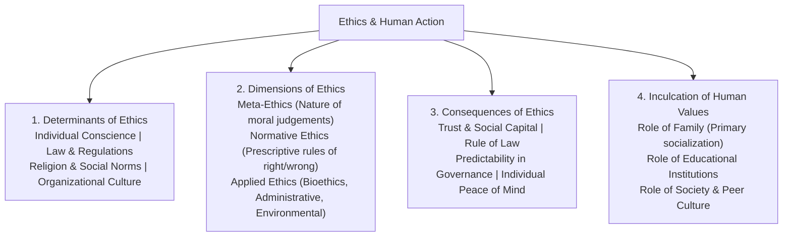
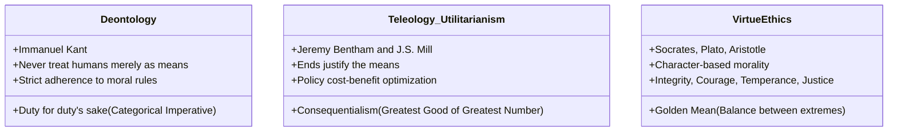

# Ethics and Human Interface: Essence, Determinants and Values (ನೀತಿಶಾಸ್ತ್ರ ಮತ್ತು ಮಾನವ ಸಂಬಂಧಗಳು: ಮೂಲತತ್ವ, ನಿರ್ಧಾರಕಗಳು ಮತ್ತು ಮೌಲ್ಯಗಳು)

> [!exam-focus]
> **Exam Weightage & Testing Patterns**: Foundational theoretical pillar of Mains Paper 5 (GS-4 Section 1: 35 to 50 Marks).
> - **Core Theoretical Dilemmas**: Deontological Ethics (Kant) vs Teleological / Utilitarian Ethics (Bentham & Mill); Virtue Ethics (Aristotle); Relativism vs Absolutism.
> - **Karnataka Cultural Synthesis**: Integrating Sharana ethics (ಕಾಯಕ - ಕಾಯಕವೇ ಕೈಲಾಸ, ದಾಸೋಹ - ನಿಸ್ವಾರ್ಥ ಸೇವೆ) into modern administrative conduct; evaluating how family, peer groups, and schooling shape ethical values.

---

## 1. The Essence of Ethics

The diagram above details the operational framework of Ethics and Human Interface, demonstrating how societal institutions and normative frameworks govern moral conduct.

### 1.1 Definition & Distinction: Ethics vs Morality vs Law
- **Ethics (ನೀತಿಶಾಸ್ತ್ರ)**: Systematic branch of philosophy governing standard rules of conduct recognized by an external professional, institutional, or social group (e.g. medical ethics, civil service code).
- **Morality (ನೈತಿಕತೆ)**: Personal convictions and inner moral compass of an individual concerning right and wrong, formed through upbringing and personal conscience.
- **Law vs Ethics**:
  - Law is externally enforced with penal sanctions; ethics is self-regulated through moral conviction.
  - An act can be **legal but unethical** (e.g., evicting destitute slum dwellers without rehabilitation during heavy monsoon).
  - An act can be **ethical but technically illegal** (e.g., whistleblowing against classified corruption).

---

## 2. Normative Ethical Frameworks

The class diagram above presents the three dominant normative ethical paradigms applied to public policy decision-making and administrative case studies.

### 2.1 Comparative Analysis of Ethical Traditions:
1. **Deontology (ಕರ್ತವ್ಯಶಾಸ್ತ್ರ - Immanuel Kant)**:
   - Actions are morally right or wrong in themselves, irrespective of consequences.
   - **Categorical Imperative (ವರ್ಗೀಕೃತ ಆಜ್ಞೆ)**: Act only according to that maxim whereby you can at the same time will that it should become a universal law.
   - **Formula of Humanity**: Never treat individuals solely as a means to an end, but always as ends in themselves.
2. **Teleology / Consequentialism (ಫಲಿತಾಂಶಶಾಸ್ತ್ರ - Bentham & Mill)**:
   - The morality of an action is judged exclusively by its outcome.
   - **Utilitarianism (ಉಪಯುಕ್ತತಾವಾದ)**: "The greatest happiness of the greatest number" (*Sarva-jana sukhino bhavantu*).
   - *Administrative Utility*: Guiding public infrastructure projects, budget allocation, and welfare distribution.
   - *Limitation*: Can tyrannize vulnerable minority rights if unconstrained by constitutional safeguards.
3. **Virtue Ethics (ಸದ್ಗುಣ ನೀತಿಶಾಸ್ತ್ರ - Aristotle)**:
   - Emphasizes the moral character of the agent rather than explicit rules or consequences.
   - **The Golden Mean (ಮಧ್ಯಮ ಮಾರ್ಗ)**: Virtue lies at the golden midpoint between two vicious extremes of excess and deficiency (e.g., *Courage* is the mean between cowardice and rash recklessness).

---

## 3. Human Values and Socializing Agencies

### 3.1 Role of Family (ಕುಟುಂಬದ ಪಾತ್ರ)
- First and most influential agent of primary socialization.
- Inculcates emotional security, honesty, empathy, respect for elders, and basic fairness through parental modeling and reinforcement.

### 3.2 Role of Educational Institutions (ಶಿಕ್ಷಣ ಸಂಸ್ಥೆಗಳ ಪಾತ್ರ)
- Formal secondary socialization agency transitioning the child from the kinship circle to the wider civic world.
- Nurtures scientific temper, constitutional patriotism, team spirit, critical inquiry, and gender sensitivity.

### 3.3 Role of Society (ಸಮಾಜದ ಪಾತ್ರ)
- Enforces informal social control through peer expectations, cultural ceremonies, community traditions, and civic accountability.

---

## Likely Questions & PYQs

### Model Question 1 (Mains GS-4 - 10 Marks)
**Q**: "An action may be legally permissible but ethically indefensible." Illustrate this statement with suitable examples from public administration.

### Model Question 2 (Mains GS-4 - 12.5 Marks)
**Q**: Examine how the philosophical concept of 'Categorical Imperative' propounded by Immanuel Kant can guide a civil servant facing a conflict between public duty and humanitarian compassion.

---

> [!summary]
> **Key Revision Points**:
> - Deontology (Kant): Duty-based, universalizability, humans as ends.
> - Utilitarianism (Mill): Consequence-based, greatest happiness of greatest number.
> - Virtue Ethics (Aristotle): Character-based, Golden Mean.
> - Law provides the minimum floor of morality; ethics demands the highest ceiling of human conduct.
