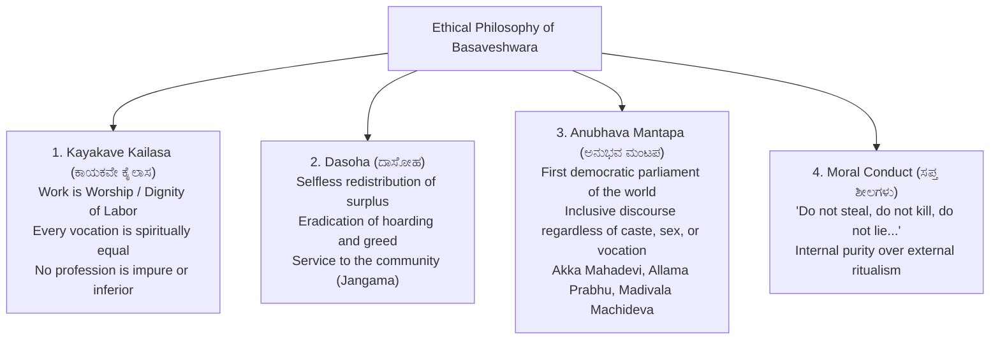
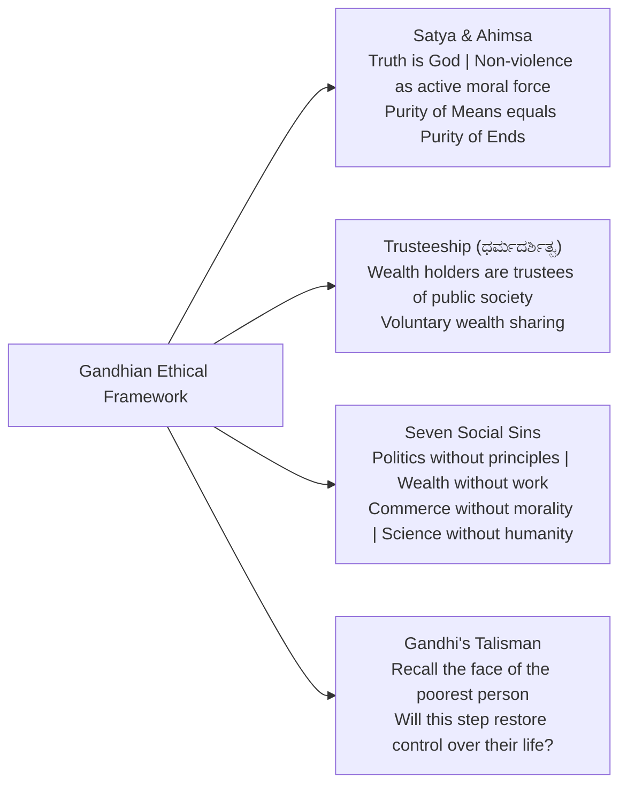
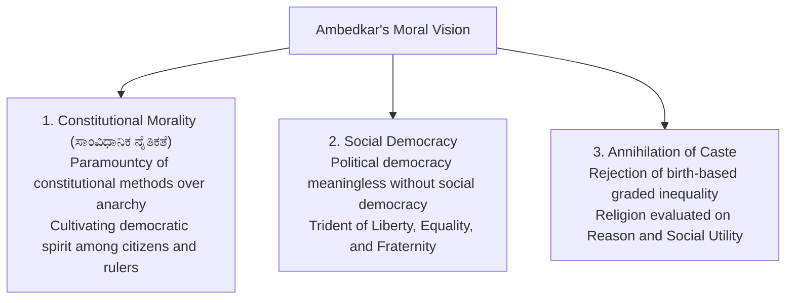

# Great Reformers, Moral Thinkers and Philosophers (ಮಹಾನ್ ಸುಧಾರಕರು, ನೈತಿಕ ಚಿಂತಕರು ಮತ್ತು ತತ್ವಜ್ಞಾನಿಗಳು)

> [!exam-focus]
> **Exam Weightage & Testing Patterns**: High-scoring section in Mains GS-4 Section 1 (mandatory questions testing moral philosophy of Indian, Karnataka, and Western thinkers).
> - **Karnataka Core**: **Basaveshwara (ಬಸವೇಶ್ವರ)** and the 12th-century Sharana Movement; **Kanakadasa (ಕನಕದಾಸ)** and **Purandaradasa (ಪುರಂದರದಾಸ)**; **Shishunala Sharifa (ಶಿಶುನಾಳ ಶರೀಫ)**.
> - **National Core**: **Mahatma Gandhi** (Satyagraha, Ahimsa, Trusteeship, Seven Social Sins, Talisman); **Dr. B. R. Ambedkar** (Constitutional Morality, Annihilation of Caste, Liberty-Equality-Fraternity); **Swami Vivekananda** (Practical Vedanta, Youth empowerment).
> - **Western Core**: Socrates (Examined life), Plato (Justice in Republic), Aristotle (Golden Mean), John Rawls (Veil of Ignorance, Distributive Justice).

---

## 1. Basaveshwara & The Sharana Movement (ಬಸವೇಶ್ವರ ಮತ್ತು ಶರಣ ಚಳವಳಿ)

The diagram above details the four ethical pillars of Basaveshwara's 12th-century social and spiritual revolution at Kalyana.

### 1.1 The Seven Moral Precepts (ಸಪ್ತ ಸೂತ್ರಗಳು - ವಚನ):
Basaveshwara encapsulated universal human morality in his celebrated Vachana:
> *"ಕಳಬೇಡ, ಕೊಲಬೇಡ, ಹುಸಿಯ ನುಡಿಯಲು ಬೇಡ,*
> *ಮುನಿಯಬೇಡ, ಅನ್ಯರಿಗೆ ಅಸಹ್ಯಪಡಬೇಡ,*
> *ತನ್ನ ಬಣ್ಣಿಸಬೇಡ, ಇದಿರ ಹಳಿಯಲು ಬೇಡ.*
> *ಇದೇ ಅಂತರಂಗಶುದ್ಧಿ, ಇದೇ ಬಹಿರಂಗಶುದ್ಧಿ,*
> *ಇದೇ ನಮ್ಮ ಕೂಡಲಸಂಗಮದೇವರನೊಲಿಸುವ ಪರಿ."*
- **Translation**: "Do not steal, do not kill, do not lie, do not be angry, do not feel revulsion towards others, do not flatter yourself, do not revile others. This is inner purity, this is outer purity, this is the way to win our Kudalasangama Deva."

### 1.2 Administrative Relevance of Sharana Ethics:
- **Dignity of Labor (*Kayakave Kailasa*)**: Dismantled the ritual feudal hierarchy of labor, treating sanitation work and scholarship with identical moral dignity.
- **Participatory Governance (*Anubhava Mantapa*)**: Precursor to deliberative democracy, encouraging dissent and voice from oppressed dalit and women vachanakaras.
- **Compassion for All Living Beings (*Daya*)**: *"ದಯವಿಲ್ಲದ ಧರ್ಮವದೇವುದಯ್ಯಾ?"* (What religion is it without compassion?).

---

## 2. Mahatma Gandhi: Moral Leadership & Public Stewardship

The diagram above highlights Gandhi's integrated moral universe, bridging personal virtue with political struggle and economic stewardship.

### 2.1 The Seven Social Sins (Young India, 1925):
1. **Politics without Principles** (ಸಿದ್ಧಾಂತವಿಲ್ಲದ ರಾಜಕಾರಣ).
2. **Wealth without Work** (ಶ್ರಮವಿಲ್ಲದ ಸಂಪತ್ತು).
3. **Commerce without Morality** (ನೈತಿಕತೆಯಿಲ್ಲದ ವ್ಯಾಪಾರ).
4. **Education without Character** (ಚಾರಿತ್ರ್ಯವಿಲ್ಲದ ಶಿಕ್ಷಣ).
5. **Pleasure without Conscience** (ವಿವೇಕವಿಲ್ಲದ ಭೋಗ).
6. **Science without Humanity** (ಮಾನವೀಯತೆಯಿಲ್ಲದ ವಿಜ್ಞಾನ).
7. **Worship without Sacrifice** (ತ್ಯಾಗವಿಲ್ಲದ ಆರಾಧನೆ).

---

## 3. Dr. B. R. Ambedkar: Constitutional Morality & Social Justice

The diagram above illustrates Dr. B.R. Ambedkar's framework of Constitutional Morality and Social Justice as the moral bedrock of the Republic.

### 3.1 Key Contributions to Ethical Governance:
- **Constitutional Morality**: A commitment to constitutional values (dignity, rule of law, due process) above majoritarian whims or sectarian loyalty.
- **Fraternity (ಭ್ರಾತೃತ್ವ)**: Defined as a sense of common brotherhood of all Indians; without fraternity, equality and liberty cannot exist together.
- **Empowerment Mantra**: *"Educate, Agitate, Organize"* (ಶಿಕ್ಷಣ ಪಡೆಯಿರಿ, ಸಂಘಟಿತರಾಗಿ, ಹೋರಾಡಿ).

---

## 4. Western Moral Thinkers: John Rawls & Immanuel Kant

### 4.1 John Rawls: A Theory of Justice (1971)
- **The Original Position & Veil of Ignorance (ಅಜ್ಞಾನದ ಪರದೆ)**:
  - Rational individuals design society's rules from behind a "veil of ignorance", unaware of their own caste, class, gender, intelligence, or wealth in the future society.
  - Under such uncertainty, individuals will rationally choose a fair system that maximizes the welfare of the least advantaged (**Maximin Rule**).
- **Two Principles of Justice**:
  1. *Equal Liberty Principle*: Each person has an equal right to the most extensive basic liberties.
  2. *Difference Principle*: Social and economic inequalities are permissible only if they are:
     - To the greatest benefit of the **least-advantaged members of society**.
     - Attached to offices and positions open to all under **fair equality of opportunity**.

---

## Likely Questions & PYQs

### Model Question 1 (Mains GS-4 - 10 Marks)
**Q**: Discuss the ethical significance of the concept of 'Kayakave Kailasa' propounded by Lord Basaveshwara. How is this philosophy relevant to modern civil services in fostering a work culture of integrity?

### Model Question 2 (Mains GS-4 - 12.5 Marks)
**Q**: Explain John Rawls' 'Veil of Ignorance' concept. How can an administrator apply the 'Difference Principle' while formulating welfare allocation policies in backward taluks of Karnataka?

---

> [!summary]
> **Key Revision Points**:
> - Basaveshwara: *Kayakave Kailasa* (dignity of labor), *Dasoha* (selfless service), *Anubhava Mantapa* (deliberative equality).
> - Gandhi: Seven Social Sins, Talisman (poorest person as benchmark), Trusteeship.
> - Ambedkar: Constitutional Morality, Social Democracy, Liberty-Equality-Fraternity.
> - Rawls: Veil of Ignorance, Maximin principle, Difference Principle (benefiting the least-advantaged).
