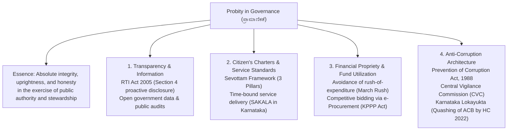
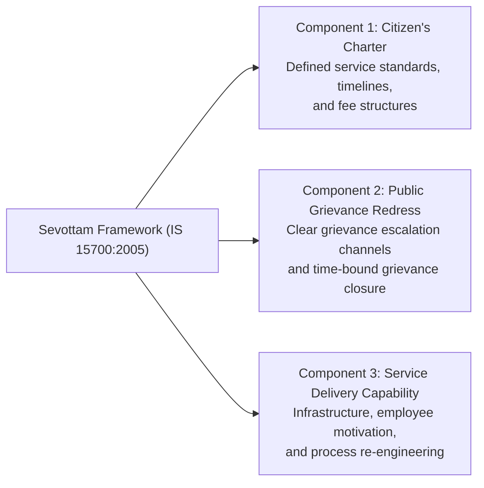

# Probity in Governance, Transparency and Anti-Corruption (ಆಡಳಿತದಲ್ಲಿ ಪ್ರಾಮಾಣಿಕತೆ, ಪಾರದರ್ಶಕತೆ ಮತ್ತು ಭ್ರಷ್ಟಾಚಾರ ನಿಗ್ರಹ)

> [!exam-focus]
> **Exam Weightage & Testing Patterns**: High-frequency syllabus area in Mains GS-4 Section 3 (30 to 40 Marks).
> - **Core Conceptual Themes**: Philosophical basis of governance and probity; Transparency and Right to Information (RTI Act 2005); Citizen's Charters and Sevottam model; Work culture and quality of service delivery; Utilization of public funds and financial propriety; Anti-corruption mechanisms (Prevention of Corruption Act, CVC, Lokayukta).
> - **Karnataka Specifics**: Karnataka Lokayukta Act, 1984; Karnataka Guarantee of Services to Citizens Act (SAKALA, 2011); KPPP Act (Karnataka Public Procurement Transparency Act, 1999) enforcing e-procurement.

---

## 1. Probity in Governance: Philosophical Foundation

The flowchart above maps the institutional mechanisms that uphold probity and accountability in public administration.

### 1.1 What is Probity?
- Probity is not merely the absence of corruption; it is the **active presence of procedural honesty, moral uprightness, and unwavering commitment to the public trust**.
- It demands that public officials manage public resources with the same prudence, frugality, and vigilance that a person of ordinary prudence would exercise in managing their own personal funds.

---

## 2. Transparency & Information Sharing

### 2.1 The Right to Information (RTI) Act, 2005
- **Constitutional Root**: Flows from Freedom of Speech and Expression under **Article 19(1)(a)**.
- **Section 4(1)(b) Proactive Disclosure**: Mandates all public authorities to proactively publish details of organization, powers, functions, norms, and subsidy allocations online, minimizing the need for filing RTI applications.
- **Section 8 Exemptions**: Narrowly protects national sovereignty, strategic defense secrets, trade secrets, and personal privacy lacking public interest.
- **Whistleblower Protection**: Whistle Blowers Protection Act, 2014 designed to protect public servants reporting corruption and willful misuse of discretion.

---

## 3. Citizen's Charters & The Sevottam Model

The diagram above details the Bureau of Indian Standards (BIS) accredited Sevottam Model for benchmarked public service delivery.

### 3.1 Citizen's Charter Implementation Deficits
- Often formulated top-down without consulting frontline delivery personnel or citizens.
- Vague service standards without enforceable compensation mechanisms for delays.
- Lack of widespread public awareness, especially in regional languages.

### 3.2 Karnataka's SAKALA Mission: A Statutory Milestone
- **Karnataka Guarantee of Services to Citizens Act, 2011 (SAKALA)**:
  - Transformed Citizen's Charter commitments into **enforceable statutory rights**.
  - Covers hundreds of services across departments (Revenue, Police, Transport, Commercial Taxes, Municipal).
  - Every application receives a unique **15-digit Guarantee of Services to Citizens (GSC) number**.
  - Mandates compensatory default penalty: Defaulting designated public servant is fined **Rs. 20 per day of delay** (up to Rs. 500), which is compensated directly to the applicant and deducted from the officer's salary.

---

## 4. Financial Propriety and Public Fund Utilization

### 4.1 Principles of Financial Propriety (General Financial Rules - GFR)
1. **Rule of Ordinary Prudence**: Public servants must exercise the same vigilance and care in respect of public expenditure as a person of ordinary prudence would exercise in respect of their own money.
2. **Strict Public Purpose**: Expenditure must not be sanctioned for the personal benefit of the sanctioning authority or any particular individual/community unless established by law.
3. **Budgetary Discipline**: Expenditure must not exceed sanctioned allocations. Discouraging the **"March Rush" (ಮಾರ್ಚ್ ರಶ್)**—unplanned dumping of state funds in the final month of the fiscal year to avoid lapse of budget grants.
4. **Transparent Procurement**: The **Karnataka Transparency in Public Procurements Act, 1999 (KPPP Act)** mandates mandatory e-procurement through unified tenders for all government works and goods above threshold limits, prohibiting arbitrary award of contracts.

---

## Likely Questions & PYQs

### Model Question 1 (Mains GS-4 - 10 Marks)
**Q**: What is meant by 'Probity in Governance'? How does the Karnataka Guarantee of Services to Citizens Act (SAKALA) enforce administrative accountability in public service delivery?

### Model Question 2 (Mains GS-4 - 12.5 Marks)
**Q**: "The 'March Rush' in government expenditure violates fundamental canons of financial propriety." Analyze the administrative causes behind this phenomenon and suggest institutional reforms to ensure smooth, outcome-oriented expenditure through the fiscal year.

---

> [!summary]
> **Key Revision Points**:
> - Probity is active uprightness and prudent stewardship of public authority.
> - Section 4 of RTI Act mandates *suo motu* proactive disclosure.
> - Sevottam model has 3 pillars: Citizen's Charter, Grievance Redress, and Service Capability.
> - Karnataka's SAKALA Act (2011) provides statutory guarantee of public services with financial default penalties (Rs. 20/day) against delaying officials.
> - KPPP Act 1999 mandates transparent e-procurement for state works.
