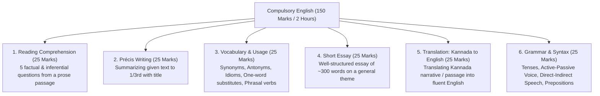

# Compulsory Qualifying English Paper (ಕಡ್ಡಾಯ ಇಂಗ್ಲಿಷ್ ಪರೀಕ್ಷೆ - ಎಸ್.ಎಸ್.ಎಲ್.ಸಿ ಮಟ್ಟ)

> [!exam-focus]
> **Exam Weightage & Testing Rules**: Mandatory qualifying paper in Mains Written Examination.
> - **Total Marks**: 150 Marks | **Duration**: 2 Hours.
> - **Qualifying Cut-off**: Strictly **35% (52.5 Marks out of 150)**. Marks do not count for merit ranking, but clearing it is an absolute prerequisite for GS paper evaluation.
> - **Standard of Paper**: SSLC Standard English (Class 10).
> - **Key Traps**: Common grammatical errors in Subject-Verb Agreement, misuse of tenses, spelling and punctuation errors, exceeding word limits in Précis writing.

---

## 1. Paper Structure & Blueprint

The diagram above details the standard 6-section composition of the KPSC Compulsory English Examination.

---

## 2. Core Grammar Rules & Error Spotting

### 2.1 Subject - Verb Agreement (The Golden Rules)
1. **Rule of Singular Subjects with Conjunctions**: When two singular nouns are joined by *as well as, along with, together with, in addition to*, the verb agrees with the **first subject**.
   - *Incorrect*: The Deputy Commissioner, along with his officers, were present.
   - *Correct*: The Deputy Commissioner, along with his officers, **was** present.
2. **Either...Or / Neither...Nor**: The verb agrees with the **nearer subject**.
   - *Correct*: Neither the minister nor the directors **were** available.
   - *Correct*: Neither the directors nor the minister **was** available.
3. **Collective Nouns**: Take a singular verb when considered as a single collective unit, but plural when individual members act separately.
   - *The committee has submitted its report.*
   - *The committee are divided in their opinions.*

### 2.2 Active and Passive Voice Transformations
- Present Continuous:
  - *Active*: The government is constructing a new reservoir.
  - *Passive*: A new reservoir **is being constructed** by the government.
- Past Perfect:
  - *Active*: The vigilance team had seized the illicit documents.
  - *Passive*: The illicit documents **had been seized** by the vigilance team.
- Modal Verbs:
  - *Active*: The administration must protect public wetlands.
  - *Passive*: Public wetlands **must be protected** by the administration.

### 2.3 Direct and Indirect Speech
- Reporting verb in Past Tense changes the reported speech tense:
  - Simple Present $	o$ Simple Past (*"I work hard" $	o$ he worked hard*).
  - Present Continuous $	o$ Past Continuous (*"I am reviewing" $	o$ he was reviewing*).
  - Simple Past $	o$ Past Perfect (*"I saw the incident" $	o$ he had seen the incident*).
  - Universal truths remain in Present Tense: *The teacher said, "The earth revolves around the sun." $	o$ The teacher said that the earth revolves around the sun.*

---

## 3. High-Yield Vocabulary, Idioms and One-Word Substitutes

### 3.1 Idioms & Phrases
- **At the eleventh hour**: At the last possible moment.
- **Burn the midnight oil**: Work or study late into the night.
- **A blessing in disguise**: Something that seems bad initially but results in something good.
- **Through thick and thin**: Under all conditions, no matter how difficult.
- **Leave no stone unturned**: Make every possible effort to accomplish a goal.

### 3.2 High-Frequency One-Word Substitutes
- *One who looks at the bright side of things*: **Optimist**.
- *One who looks at the dark side of things*: **Pessimist**.
- *A person who loves mankind and makes charitable gifts*: **Philanthropist**.
- *A person who renounces a religious or political belief*: **Apostate**.
- *An official appointed to settle a dispute*: **Arbitrator**.
- *Government by the wealthy class*: **Plutocracy**.
- *Government by the officials/bureaucracy*: **Bureaucracy**.

---

## 4. Précis Writing Masterclass

### Step-by-Step Rules:
1. **Title**: Always write a clear, catchy title reflecting the central theme (carries 5 marks).
2. **Length**: Exactly **one-third (1/3rd) of original word count** ($\pm 10\%$).
   - E.g., if passage has 300 words, write between 90 and 110 words.
3. **Voice & Person**: Always write in the **Third Person** and **Past/Present Tense**, indirect speech. Never use "I", "we", or "you".
4. **No Outside Facts**: Do not insert personal opinions, commentary, or external knowledge.
5. **No Direct Quotations**: Convert all quotes and dialogues into objective summary statements.
6. **Rough Draft**: Write a draft, count words, eliminate repetitions, then write the neat final version.

---

## 5. Translation: Kannada to English (ಕನ್ನಡದಿಂದ ಇಂಗ್ಲಿಷ್‌ಗೆ ಭಾಷಾಂತರ)

### Model Translation Exercise:
*Kannada Text*:
"ಕರ್ನಾಟಕವು ಶ್ರೀಮಂತ ನೈಸರ್ಗಿಕ ಸಂಪನ್ಮೂಲಗಳನ್ನು ಹಾಗೂ ವೈವಿಧ್ಯಮಯ ಸಂಸ್ಕೃತಿಯನ್ನು ಹೊಂದಿದೆ. ನಮ್ಮ ರಾಜ್ಯದ ಪಶ್ಚಿಮ ಘಟ್ಟಗಳು ಜಾಗತಿಕ ಜೀವವೈವಿಧ್ಯ ತಾಣಗಳಾಗಿವೆ. ಪರಿಸರ ಸಂರಕ್ಷಣೆ ಮತ್ತು ಕೈಗಾರಿಕಾ ಅಭಿವೃದ್ಧಿಯ ನಡುವೆ ಸಮತೋಲನ ಸಾಧಿಸುವುದು ಇಂದಿನ ಆಡಳಿತದ ಪ್ರಮುಖ ಸವಾಲಾಗಿದೆ."

*Standard English Translation*:
"Karnataka possesses abundant natural resources and a rich, diverse culture. The Western Ghats of our state are globally recognized biodiversity hotspots. Achieving a balance between environmental conservation and industrial development represents a paramount challenge for contemporary governance."

---

> [!summary]
> **Key Revision Points**:
> - Qualifying mark: 35% (52.5/150).
> - Précis: Must have a title, exactly 1/3rd word count, written in third person.
> - Subject-verb agreement: 'as well as' agrees with 1st subject; 'neither...nor' agrees with nearer subject.
> - In translation, maintain English Subject-Verb-Object (SVO) order.
