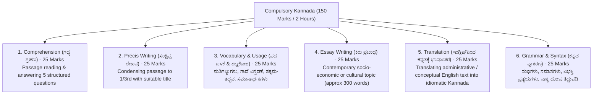

# Compulsory Qualifying Kannada Paper (ಕಡ್ಡಾಯ ಕನ್ನಡ ಪರೀಕ್ಷೆ - ಎಸ್.ಎಸ್.ಎಲ್.ಸಿ ಪ್ರಥಮ ಭಾಷಾ ಮಟ್ಟ)

> [!exam-focus]
> **Exam Weightage & Testing Rules**: Mandatory qualifying paper in Mains Written Examination.
> - **Total Marks**: 150 Marks | **Duration**: 2 Hours.
> - **Qualifying Cut-off**: Strictly **35% (52.5 Marks out of 150)**. Marks do not count for merit ranking, but if a candidate fails to score 35% here, their compulsory GS papers are **not evaluated**.
> - **Standard of Paper**: SSLC First Language Kannada (ಎಸ್.ಎಸ್.ಎಲ್.ಸಿ ಪ್ರಥಮ ಭಾಷಾ ಕನ್ನಡ ಮಟ್ಟ).
> - **Key Trap**: Overconfidence leading to inadequate practice; poor handwriting or orthographic spelling errors (ಕಾಗುಣಿತ ದೋಷಗಳು, ಮಹಾಪ್ರಾಣ-ಅಲ್ಪಪ್ರಾಣ ದೋಷಗಳು, ಒತ್ತು-ಅಕ್ಷರ ತಪ್ಪುಗಳು) causing loss of easy marks.

---

## 1. Paper Pattern & Mark Distribution

The flowchart above outlines the 6 constituent components of the KPSC Compulsory Qualifying Kannada examination, each carrying 25 marks.

---

## 2. Core Kannada Grammar Essentials (ವ್ಯಾಕರಣಾಂಶಗಳು)

### 2.1 Sandhi (ಸಂಧಿಗಳು)
- **ಕನ್ನಡ ಸಂಧಿಗಳು (ಸ್ವರ ಸಂಧಿ & ವ್ಯಂಜನ ಸಂಧಿ)**:
  1. *ಲೋಪ ಸಂಧಿ (Lopa Sandhi)*: ಸ್ವರದ ಮುಂದೆ ಸ್ವರವು ಬಂದು ಸಂಧಿಯಾದಾಗ ಪೂರ್ವಪದದ ಕೊನೆಯಲ್ಲಿರುವ ಸ್ವರವು ಅರ್ಥವು ಕೆಡದಿದ್ದರೆ ಮಾತ್ರ ಬಿಟ್ಟುಹೋಗುವುದು (ಉದಾ: ಮಾತು + ಇಲ್ಲ = ಮಾತಿಲ್ಲ; ಊರು + ಊರು = ಊರೂರು).
  2. *ಆಗಮ ಸಂಧಿ (Aagama Sandhi)*: ಸ್ವರದ ಮುಂದೆ ಸ್ವರವು ಬಂದಾಗ 'ಯ' ಅಥವಾ 'ವ' ಕಾರವು ಹೊಸದಾಗಿ ಬಂದು ಸೇರುವುದು (ಉದಾ: ಮನೆ + ಅನ್ನು = ಮನೆಯನ್ನು ['ಯ' ಕಾರಾಗಮ]; ಗುರು + ಅನ್ನು = ಗುರುವನ್ನು ['ವ' ಕಾರಾಗಮ]).
  3. *ಆದೇಶ ಸಂಧಿ (Aadesha Sandhi)*: ಉತ್ತರಪದದ ಆದಿಯಲ್ಲಿರುವ ಕ, ತ, ಪ ಗಳಿಗೆ ಕ್ರಮವಾಗಿ ಗ, ದ, ಬ ಗಳು ಬರುವುದು (ಉದಾ: ಕಣ್ + ಪನಿ = ಕಣ್ಣನಿ; ಮಳೆ + ಕಾಲ = ಮಳೆಗಾಲ; ಬೆಟ್ಟ + ತಾವರೆ = ಬೆಟ್ಟದಾವರೆ).
- **ಸಂಸ್ಕೃತ ಸಂಧಿಗಳು**:
  - *ಸವರ್ಣದೀರ್ಘ ಸಂಧಿ*: ದೇವ + ಆಲಯ = ದೇವಾಲಯ; ಕವಿ + ಈಶ್ವರ = ಕವೀಶ್ವರ.
  - *ಗುಣ ಸಂಧಿ*: ಮಹಾ + ಈಶ = ಮಹೇಶ; ಸೂರ್ಯ + ಉದಯ = ಸೂರ್ಯೋದಯ.
  - *ವೃದ್ಧಿ ಸಂಧಿ*: ಏಕ + ಏಕ = ಏಕೈಕ; ಜಲ + ಓಘ = ಜಲೌಘ.

### 2.2 Samasa (ಸಮಾಸಗಳು)
- **ತತ್ಪುರುಷ ಸಮಾಸ**: ಉತ್ತರಪದದ ಅರ್ಥ ಪ್ರಧಾನವಾಗಿರುವ ಸಮಾಸ (ಉದಾ: ಮರದ ಕಾಲು = ಮರಗಾಲು; ಹಣೆಗಣ್ಣ).
- **ಕರ್ಮಧಾರಯ ಸಮಾಸ**: ವಿಶೇಷಣ-ವಿಶೇಷ್ಯ ಸಂಬಂಧವುಳ್ಳದ್ದು (ಉದಾ: ಹಿರಿದಾದ ಜೇನು = ಹೆಜ್ಜೇನು; ಕೆಂಪಾದ ಕಮಲ = ಕೆಂದಾವರೆ).
- **ದ್ವಂದ್ವ ಸಮಾಸ**: ಎರಡೂ ಪದಗಳ ಅರ್ಥ ಪ್ರಧಾನವಾಗಿರುವ ಸಮಾಸ (ಉದಾ: ಗಿಡವೂ ಮರವೂ ಬಳ್ಳಿಯೂ = ಗಿಡಮರಬಳ್ಳಿಗಳು).
- **ದ್ವಿಗು ಸಮಾಸ**: ಪೂರ್ವಪದವು ಸಂಖ್ಯಾ ವಾಚಕವಾಗಿರುವ ಸಮಾಸ (ಉದಾ: ಮೂರು ಕಣ್ಣು = ಮುಕ್ಕಣ್ಣ; ನಾಲ್ಕು ದಿಕ್ಕು = ನಾಲ್ದೆಸೆ).
- **ಬಹು Metaphor / ಬಹುವ್ರೀಹಿ ಸಮಾಸ**: ಅನ್ಯಪದದ ಅರ್ಥ ಪ್ರಧಾನವಾಗಿರುವ ಸಮಾಸ (ಉದಾ: ಚಕ್ರವು ಪಾಣಿಯಲ್ಲಿ ಯಾವುದಕ್ಕೋ ಅವನು = ಚಕ್ರಪಾಣಿ [ವಿಷ್ಣು]).

### 2.3 Tatsama - Tadbhava (ತತ್ಸಮ - ತದ್ಭವ ಪಟ್ಟಿ)
| ಸಂಸ್ಕೃತ ಮೂಲ (ತತ್ಸಮ) | ಕನ್ನಡ ರೂಪ (ತದ್ಭವ) | ಸಂಸ್ಕೃತ ಮೂಲ (ತತ್ಸಮ) | ಕನ್ನಡ ರೂಪ (ತದ್ಭವ) |
|---|---|---|---|
| ಆಶ್ಚರ್ಯ | ಅಚ್ಚರಿ | ಯುದ್ಧ | ಜುದ್ಧ |
| ಕಾರ್ಯ | ಕಜ್ಜ | ಲಕ್ಷ್ಮೀ | ಲಕ್ಕಿ |
| ಕಾವ್ಯ | ಕಬ್ಬ | ಪಕ್ಷಿ | ಹಕ್ಕಿ |
| ಶೃಂಗಾರ | ಸಿಂಗಾರ | ವರ್ಷ | ವರುಷ |
| ಮುಖ | ಮೊಗ | ರತ್ನ | ರನ್ನ |
| ಭಕ್ತಿ | ಬಕುತಿ | ಸ್ಥಾನ | ತಾಣ |
| ಸ್ತನ | ಮೊಲೆ | ರಾಜ | ರಾಯ |
| ಯಜ್ಞ | ಜನ್ನ | ಪಾದ | ಹಾದಿ |

---

## 3. High-Yield Vocabulary: Proverbs & Idioms

### 3.1 Nudigattugalu (ನುಡಿಗಟ್ಟುಗಳು - Idioms & Usages)
- **ಕೈಕೊಡು (Kaikodu)**: ಮೋಸ ಮಾಡು ಅಥವಾ ಕೈಚೆಲ್ಲು (ಉದಾ: ಸಂಕಷ್ಟದ ಸಮಯದಲ್ಲಿ ಆಪ್ತ ಮಿತ್ರನೇ ಕೈಕೊಟ್ಟನು).
- **ಕಣ್ಣಿಡು (Kannidu)**: ಗಮನಿಸು ಅಥವಾ ಆಸೆಪಡು (ಉದಾ: ಅಧಿಕಾರಿಗಳು ಅಕ್ರಮ ಗಣಿಗಾರಿಕೆಯ ಮೇಲೆ ತೀವ್ರ ಕಣ್ಣಿಟ್ಟಿದ್ದಾರೆ).
- **ತಲೆಯೆತ್ತು (Taleyettu)**: ಸ್ವಾಭಿಮಾನದಿಂದ ಜೀವಿಸು / ಅಭಿವೃದ್ಧಿಯಾಗು (ಉದಾ: ಸ್ವಾತಂತ್ರ್ಯಾನಂತರ ಭಾರತವು ವಿಜ್ಞಾನ ಕ್ಷೇತ್ರದಲ್ಲಿ ತಲೆಯೆತ್ತಿ ನಿಂತಿದೆ).
- **ಕಿವಿಗೊಡು (Kivigodu)**: ಗಮನವಿಟ್ಟು ಆಲಿಸು (ಉದಾ: ಶಿಕ್ಷಕರ ಹಿತವಚನಕ್ಕೆ ವಿದ್ಯಾರ್ಥಿಗಳು ಕಿವಿಗೊಡಬೇಕು).

### 3.2 Gaadegalu (ಗಾದೆ ಮಾತುಗಳು - Proverbs with Expansion Framework)
- **"ಹಾಸಿಗೆ ಇದ್ದಷ್ಟು ಕಾಲು ಚಾಚು" (Stretch legs according to bed length)**:
  - *ವಿವರಣೆ*: ಒಬ್ಬ ವ್ಯಕ್ತಿಯು ತನ್ನ ಆರ್ಥಿಕ ಆದಾಯ ಮತ್ತು ಸಾಮರ್ಥ್ಯದ ಮಿತಿಯಲ್ಲಿ ಮಾತ್ರ ಖರ್ಚು ಮಾಡಬೇಕು. ಆಡಳಿತದಲ್ಲಿಯೂ ಬಜೆಟ್ ಮಿತಿಯಲ್ಲಿ ಕಾರ್ಯಯೋಜನೆ ರೂಪಿಸುವುದನ್ನು ಇದು ಬೋಧಿಸುತ್ತದೆ.
- **"ಕುಂಬಳಕಾಯಿ ಕಳ್ಳ ಎಂದರೆ ಹೆಗಲು ಮುಟ್ಟಿ ನೋಡಿಕೊಂಡ" (Guilty conscience needs no accuser)**:
  - *ವಿವರಣೆ*: ತಪ್ಪು ಮಾಡಿದ ವ್ಯಕ್ತಿಯು ಯಾರೂ ಹೆಸರಿಸದಿದ್ದರೂ ತನ್ನ ಆಂತರಿಕ ಅಪರಾಧಿ ಭಾವನೆಯಿಂದ ತಾನೇ ಬಹಿರಂಗಗೊಳ್ಳುತ್ತಾನೆ.
- **"ಉಪ್ಪಿಟ್ಟವರನ್ನು ಮುಪ್ಪಿನ ತನಕ ನೆನೆ" (Remember your benefactors till old age)**:
  - *ವಿವರಣೆ*: ಕೃತಜ್ಞತಾ ಭಾವದ ಶ್ರೇಷ್ಠತೆ; ನಮಗೆ ಉಪಕಾರ ಮಾಡಿದವರನ್ನು ಎಂದಿಗೂ ಮರೆಯಬಾರದು.

---

## 4. Translation Strategy: English to Kannada (ಇಂಗ್ಲಿಷ್‌ನಿಂದ ಕನ್ನಡಕ್ಕೆ ಭಾಷಾಂತರ)

### 4.1 Golden Rules for Translation:
1. **Never Translate Word-for-Word (ಅಕ್ಷರಶಃ ಭಾಷಾಂತರಿಸಬೇಡಿ)**: Understand the complete sentence thought, then express it in natural Kannada sentence structure: **ಕರ್ತೃ (Subject) -> ಕರ್ಮ (Object) -> ಕ್ರಿಯಾಪದ (Verb)**.
   - *English*: The Deputy Commissioner inspected the drought-affected village yesterday.
   - *Kannada*: ಜಿಲ್ಲಾಧಿಕಾರಿಗಳು ನಿನ್ನೆ ಬರಪೀಡಿತ ಗ್ರಾಮವನ್ನು ಪರಿಶೀಲಿಸಿದರು.
2. **Administrative Glossary Mapping**:
   - Gazette = ಗೆಜೆಟ್ / ರಾಜ್ಯಪತ್ರ
   - Discretionary powers = ವಿವೇಚನಾಧಿಕಾರ
   - Public Interest = ಸಾರ್ವಜನಿಕ ಹಿತಾಸಕ್ತಿ
   - Autonomous body = ಸ್ವಾಯತ್ತ ಸಂಸ್ಥೆ
   - Accountability = ಹೊಣೆಗಾರಿಕೆ
   - Redressal of grievances = ಕುಂದುಕೊರತೆಗಳ ನಿವಾರಣೆ

---

## 5. Précis Writing Strategy (ಸಂಕ್ಷಿಪ್ತ ಲೇಖನ / ಸಾರಾಂಶ ಬರಹ)

1. Read the passage twice to grasp the central thesis.
2. Count the total words (e.g. 300 words). The précis must be approximately **one-third (1/3rd) length** (approx 100 words).
3. Do not include personal examples, quotes, rhetorical flourishes, or outside commentary.
4. Provide an apt, concise title in Kannada (ಉದಾ: *"ಸ್ವಚ್ಛತೆಯ ಮಹತ್ವ"*, *"ವಿದ್ಯಾರ್ಥಿ ಮತ್ತು ಶಿಸ್ತು"*).
5. Prepare a rough draft first, refine word count, and write the fair draft cleanly.

---

> [!summary]
> **Key Revision Points**:
> - Qualifying mark: strictly 35% (52.5/150).
> - Kannada sentence structure: Subject -> Object -> Verb (SOV).
> - Précis must be 1/3rd word count with an apt title.
> - Master Tatsama-Tadbhava conversions and 10 common Kannada proverbs.
> - Avoid spelling mistakes in Mahaprana (ಖ, ಘ, ಛ, ಝ, ಠ, ಢ, ಥ, ಧ, ಫ, ಭ).
