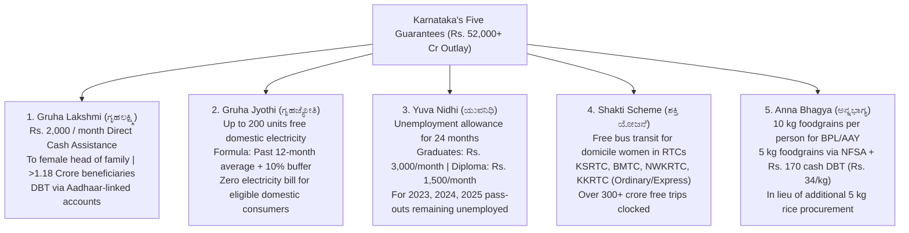
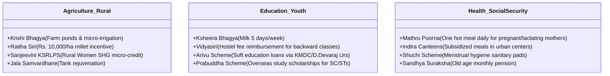

# Karnataka Flagship Schemes: The Five Guarantees & State Policies (ಕರ್ನಾಟಕದ ಪ್ರಮುಖ ಜನಕಲ್ಯಾಣ ಯೋಜನೆಗಳು: ಪಂಚ ಗ್ಯಾರಂಟಿಗಳು ಮತ್ತು ಇಲಾಖಾ ಯೋಜನೆಗಳು)

> [!exam-focus]
> **Exam Weightage & Testing Patterns**: In Prelims Paper 2 Section 1, Important State Government Programmes carry **20 to 25 MCQs (40 to 50 Marks)**. In Mains GS-3 Section 3, evaluating the economic, fiscal, and social welfare impact of the Five Guarantees is a guaranteed long-form question.
> - **Prelims Traps**: Confusing eligibility criteria: Gruha Lakshmi is for the woman identified as head of family in BPL/APL ration card, excluding female taxpayers or wives of GST/Income Tax payers; Gruha Jyothi covers average consumption + 10% buffer up to a 200-unit ceiling; Yuva Nidhi pays for a maximum period of **24 months** and lapses if the beneficiary finds employment.
> - **Fiscal Figures**: Total annual budgetary outlay for the Five Guarantees exceeds **Rs. 52,000 Crore**, constituting ~14% of the state's total budget outlay.

---

## 1. The Five Guarantees (ಪಂಚ ಖಾತರಿ ಯೋಜನೆಗಳು)

The flowchart above outlines the operational architecture, financial flows, and target beneficiaries of Karnataka's Five Guarantee schemes.

---

## 2. In-Depth Operational Breakdown of Each Guarantee

### 2.1 Gruha Lakshmi Scheme (ಗೃಹಲಕ್ಷ್ಮಿ ಯೋಜನೆ)
- **Nodal Department**: Women and Child Development Department (ಮಹಿಳಾ ಮತ್ತು ಮಕ್ಕಳ ಅಭಿವೃದ್ಧಿ ಇಲಾಖೆ).
- **Entitlement**: Unconditional cash transfer of **Rs. 2,000 per month** directly transferred via DBT into the Aadhaar-seeded bank account of the designated female head of the family.
- **Eligibility**:
  - Woman named as the 'Head of Household' (*Yajamani*) in Antyodaya, BPL, or APL ration cards.
  - **Exclusions**: The woman or her husband must NOT be an Income Tax payer or a Goods and Services Tax (GST) assessee.
- **Beneficiary Base**: Over **1.18 Crore women** across Karnataka, making it the largest gender-targeted unconditional cash transfer scheme in India.

### 2.2 Gruha Jyothi Scheme (ಗೃಹಜ್ಯೋತಿ ಯೋಜನೆ)
- **Nodal Department**: Energy Department (ಇಂಧನ ಇಲಾಖೆ) implemented through ESCOMs (BESCOM, MESCOM, CHESCOM, HESCOM, GESCOM).
- **Entitlement**: Free domestic electricity up to a maximum ceiling of **200 units per month**.
- **Entitlement Calculation**:
  - Based on the consumer's **average monthly consumption over the preceding 12 months plus a 10% buffer**.
  - If average consumption is 80 units, entitled limit is $80 + 8 = 88$ units. If the consumer uses up to 88 units, bill is **Zero**.
  - If consumption exceeds the entitled limit but remains under 200 units, the consumer pays only for the net difference.
  - If consumption exceeds 200 units in any month, the consumer pays the **full bill** for total units consumed.
- **Coverage**: Domestic household meter connections only (commercial installations excluded).

### 2.3 Yuva Nidhi Scheme (ಯುವನಿಧಿ ಯೋಜನೆ)
- **Nodal Department**: Skill Development, Entrepreneurship and Livelihood Department.
- **Entitlement**:
  - **Rs. 3,000 per month** for unemployed degree holders (Graduates).
  - **Rs. 1,500 per month** for unemployed diploma holders.
- **Duration**: Paid for a maximum tenure of **2 years (24 months)** from the date of passing, or until the candidate secures employment or becomes self-employed, whichever is earlier.
- **Eligibility**: Karnataka domicile candidates who graduated in 2022-23, 2023-24, or 2024-25 and remained unemployed after 60 days of graduation.

### 2.4 Shakti Scheme (ಶಕ್ತಿ ಯೋಜನೆ)
- **Nodal Department**: Transport Department.
- **Entitlement**: **100% fare-free bus transit** for all women (domiciled in Karnataka), female students, and transgender individuals.
- **Operational Scope**:
  - Operates across state transport undertakings: **KSRTC, BMTC, NWKRTC, KKRTC**.
  - Valid on city, ordinary, and express bus services (excludes premium luxury services such as Airavat, Rajahamsa, EV Power Plus, and interstate routes).
- **Smart Card / ID**: Free travel granted against production of government-issued photo ID establishing Karnataka domicile (Voter ID, Aadhaar).
- **Social Impact**: Over 300 crore free trips logged, significantly increasing female labor force participation, economic mobility, and temple tourism.

### 2.5 Anna Bhagya Scheme (ಅನ್ನಭಾಗ್ಯ ಯೋಜನೆ)
- **Nodal Department**: Food, Civil Supplies and Consumer Affairs Department.
- **Entitlement**: Guarantee of **10 kg foodgrains per person per month** for every member of BPL and Antyodaya Anna Yojana (AAY) families.
- **Operational Mechanism**:
  - **5 kg rice** provided free by the Union Government under the National Food Security Act (NFSA) / Pradhan Mantri Garib Kalyan Anna Yojana (PMGKAY).
  - For the additional 5 kg promised by the state government, due to procurement bottlenecks, the state deposits **cash DBT at Rs. 34 per kg (Rs. 170 per person per month)** into the bank account of the head of the BPL family.

---

## 3. Other Major State Departmental Welfare Schemes

The class structure above synthesizes Karnataka's line department welfare schemes across Agriculture, Youth Education, and Social Security.

### 3.1 Sectoral Highlights
1. **Krishi Bhagya (ಕೃಷಿ ಭಾಗ್ಯ)**:
   - Targets dryland rainfed farmers in drought-prone taluks.
   - Subsidizes construction of **Farm Ponds (*Krishi Honda*)**, polyethylene lining, diesel pump sets, and drip/sprinkler micro-irrigation systems.
2. **Raitha Siri (ರೈತ ಸಿರಿ)**:
   - Provides an incentive assistance of **Rs. 10,000 per hectare** directly to farmers cultivating minor millets (Ragi, Jowar, Bajra, Foxtail millet, Little millet) to promote nutrition and climate-resilient agriculture.
3. **Indira Canteens (ಇಂದಿರಾ ಕ್ಯಾಂಟೀನ್)**:
   - Subsidized urban food canteens established across BBMP wards and taluk headquarters serving breakfast at Rs. 5 and lunch/dinner at Rs. 10.
4. **Vidyasiri (ವಿದ್ಯಾಸಿರಿ - ಊಟ ಮತ್ತು ವಸತಿ ಯೋಜನೆ)**:
   - Monthly stipend of Rs. 1,500 transferred to post-matric students belonging to SC, ST, OBC, and minority communities who could not secure admission into government student hostels, offsetting private accommodation costs.

---

## Likely Questions & PYQs

### Model Question 1 (Prelims)
**Q**: Under the Gruha Jyothi Scheme in Karnataka, what happens if a domestic consumer with an entitled average limit of 110 units consumes 215 units in a particular billing month?
A) The consumer receives 200 units free and pays only for 15 units.
B) The consumer receives 110 units free and pays for 105 units.
C) The consumer loses the subsidy for that month and must pay the full bill for all 215 units.
D) The consumer's electricity connection is automatically downgraded.
*Answer*: **C**
*Explanation*: Under the official guidelines of Gruha Jyothi, if consumption exceeds 200 units in any month, the consumer becomes ineligible for the scheme benefit for that month and must pay the entire electricity bill for all units consumed.

### Model Question 2 (Prelims)
**Q**: Under Karnataka's Yuva Nidhi scheme, what is the monthly financial assistance provided to unemployed diploma holders, and what is the maximum duration for which it is payable?
A) Rs. 1,500 per month for up to 12 months
B) Rs. 1,500 per month for up to 24 months
C) Rs. 3,000 per month for up to 24 months
D) Rs. 2,000 per month for up to 36 months
*Answer*: **B**
*Explanation*: Unemployed diploma holders receive Rs. 1,500 per month (graduates receive Rs. 3,000 per month) for a maximum duration of 2 years (24 months) or until they find employment.

### Model Question 3 (Mains GS-3 - 15 Marks)
**Q**: "The Five Guarantee schemes of Karnataka represent an ambitious model of universal social safety nets, but pose severe fiscal consolidation dilemmas for capital expenditure." Critically evaluate this statement in light of Karnataka's Fiscal Responsibility Act (KFRA) mandates.

---

> [!summary]
> **Key Revision Points**:
> - Gruha Lakshmi: Rs. 2,000/month DBT to female head of household (non-taxpayers).
> - Gruha Jyothi: Up to 200 units free; calculated as 12-month avg + 10% buffer; exceeding 200 units incurs full payment.
> - Yuva Nidhi: Rs. 3,000 (Graduates) and Rs. 1,500 (Diploma) for max 24 months.
> - Shakti: Free RTC bus travel for Karnataka domiciled women in non-premium buses.
> - Anna Bhagya: 5 kg NFSA rice + Rs. 170 cash DBT for remaining 5 kg at Rs. 34/kg.
> - Total Five Guarantees annual outlay exceeds Rs. 52,000 Crore.

---

## 7. Recent Developments & In the News (2026 Updates)
- **Karnataka Platform-Based Gig Workers Bill 2024 / 2026**: Tabled in state assembly; mandates 1-2% welfare fee per transaction and algorithmic transparency. (See [[2026-03_March#1-karnataka-state-polity-administration--governance|March 2026 Digest]]).
- **Five Guarantees 1-Year Financial Review**: Over ₹52,000 Crore allocated in Budget 2024-25; Gruha Lakshmi disbursing ₹2,000/mo to 1.18 cr women; Shakti crossing 220 cr zero-fare trips. (See [[2026-02_February#2-karnataka-schemes-welfare-programs--budget-outlays|February 2026 Digest]]).
