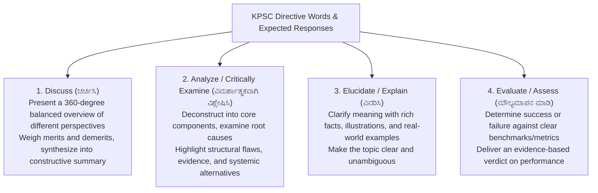
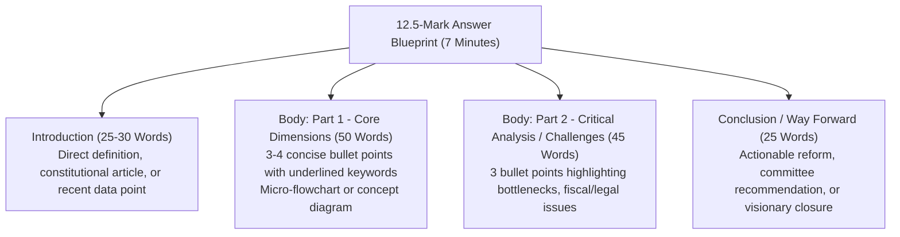
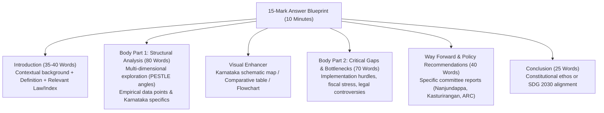

# KPSC KAS Mains Answer Writing: Structural Blueprints (ಮುಖ್ಯ ಪರೀಕ್ಷೆಯ ಉತ್ತರ ಲೇಖನ ಕಲೆ: ರಚನಾತ್ಮಕ ಚೌಕಟ್ಟುಗಳು)

> [!exam-focus]
> **Exam Weightage & Testing Rules**: Compulsory Merit Papers (GS-1 to GS-4: 250 Marks each, 3 Hours each).
> - **Standard Question Weightages**:
>   - **12.5-Mark Question**: Word limit ~150 words (2 ruled pages). Target writing time: **7 minutes**.
>   - **15-Mark Question**: Word limit ~250 words (3 ruled pages). Target writing time: **10 minutes**.
> - **Top Examiner Priorities**: Direct address of directive words (*Discuss, Analyze, Critically Evaluate, Elucidate*); structured headings and sub-headings; Karnataka-specific data, committees, and case laws; neat micro-diagrams and maps.

---

## 1. Decoding Question Directive Words

The diagram above details the exact analytical depth demanded by the standard directive keywords in KPSC Mains question papers.

---

## 2. Structural Template: 12.5-Mark Question (150 Words / 2 Pages)

The flowchart above illustrates the space and time proportioning for 12.5-mark questions.

### Execution Blueprint:
- **Introduction (3-4 lines)**: Hit the core keyword immediately. Avoid rambling introductory filler. Cite an Article, Census metric, or economic indicator.
- **Body Section 1 (6-8 lines)**: Group arguments under bold sub-headings (e.g. *Key Institutional Reforms*, *Economic Implications*).
- **Micro-Diagram / Box (2-3 square inches)**: Include a concise schematic, flowchart, or Karnataka map thumbnail showing regional locations.
- **Body Section 2 (5-6 lines)**: Present constraints, administrative deficits, or opposing arguments.
- **Conclusion (3-4 lines)**: Conclude forward-looking with a specific policy reform (e.g. Nanjundappa Committee, 2nd ARC, or SDG target).

---

## 3. Structural Template: 15-Mark Question (250 Words / 3 Pages)

The flowchart above outlines the expanded structure for 15-mark questions.

### Execution Strategy:
- **Heading Diversity**: Use at least 3 distinct sub-headings matching the parts of the question.
- **Enrich with Karnataka Anchors**: Always link general national concepts to Karnataka equivalents:
  - RTI $	o$ SAKALA (2011).
  - Decentralization $	o$ Abdul Nazir Sab Act (1983) & Ramesh Kumar Report (2015).
  - Agrarian distress $	o$ Krishi Bhagya & Raitha Siri.
  - Social justice $	o$ SCSP/TSP Act (2013) & Sadashiva Commission.
- **Visual Presentation**: High-scoring answers include clear visual elements:
  - Rough outline sketch of Karnataka indicating Malnad, Coastal, and Maidan zones.
  - 2x2 comparison tables.
  - Clean numbered bullet points.

---

## 4. Model Solved Answer (12.5 Marks)

**Question**: *"Evaluate the significance of the Karnataka Guarantee of Services to Citizens Act (SAKALA) in transforming citizen-centric administration in the state."* (12.5 Marks / 150 Words)

### Model Answer:

**Introduction**:
Enacted in 2011, the **Karnataka Guarantee of Services to Citizens Act (SAKALA - ಸಕಾಲ)** is a pioneering statutory reform providing citizens an enforceable legal right to time-bound delivery of government services, transforming administrative discretion into accountable duty.

**Key Institutional Innovations**:
1. **Statutory Guarantee & Universal Tracking**: Covers hundreds of public services across 30+ departments. Every application generates a unique 15-digit Guarantee of Services to Citizens (GSC) number for real-time tracking.
2. **Built-in Compensatory Penalty**: Introduces a default penalty of **Rs. 20 per day of delay** (up to Rs. 500), deducted directly from the defaulting official's salary and disbursed to the citizen.
3. **Appellate Hierarchy**: Two-tier statutory appeal mechanism (First and Second Appellate Authorities) ensuring prompt grievance adjudication without protracted civil litigation.

**Impact & Administrative Outcomes**:
- Achieved over **98% service delivery compliance** within statutory timelines.
- Drastically reduced petty corruption and harassment in routine revenue, municipal, and transport services.

**Challenges & Bottlenecks**:
- Frontline vacancy rates and technical server downtimes in rural taluks.
- Lack of digital literacy among marginalized rural and illiterate applicants.

**Conclusion**:
SAKALA operationalizes the 2nd ARC's *Sevottam* model. Integrating SAKALA with AI-driven automated grievance redressal and mobile doorstep delivery (*Janasevaka*) will realize true citizen-centric good governance (*Surajya*).

---

> [!summary]
> **Key Revision Points**:
> - 12.5 Marks = 150 words (2 pages) in 7 minutes.
> - 15 Marks = 250 words (3 pages) in 10 minutes.
> - Group arguments under structured subheadings; avoid dense, unbroken paragraphs.
> - Always embed Karnataka-specific institutional examples, state acts, and empirical data.
> - Conclude with actionable policy roadmaps rather than mere repetition of the introduction.
