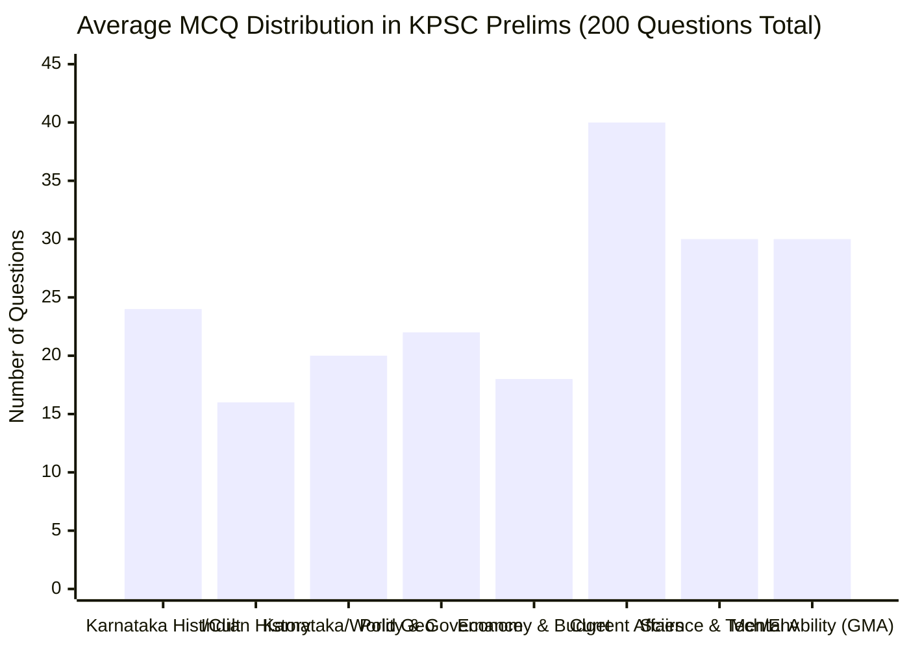
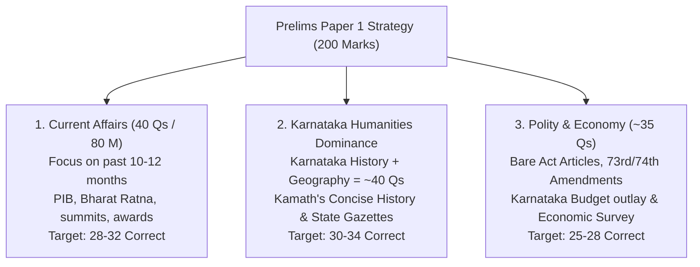
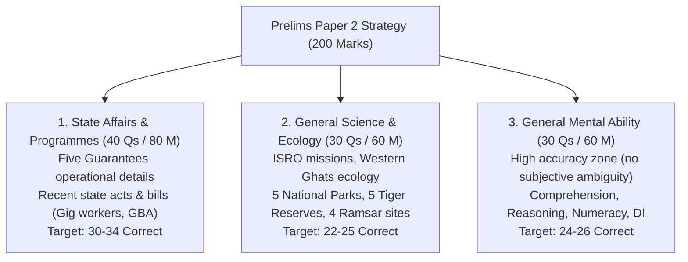
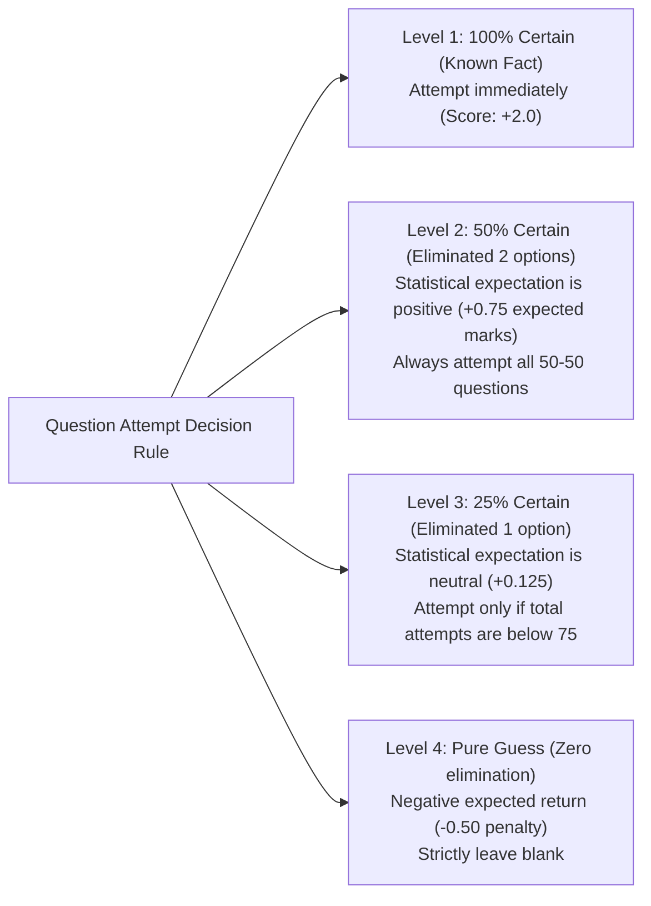

# KPSC KAS Preliminary Examination: PYQ Trend & Weightage Analysis (ಹಿಂದಿನ ವರ್ಷಗಳ ಪ್ರಶ್ನೆ ಪತ್ರಿಕೆಗಳ ಪ್ರವೃತ್ತಿ ಮತ್ತು ಅಂಕ ಹಂಚಿಕೆ ವಿಶ್ಲೇಷಣೆ)

> [!exam-focus]
> **Strategic Overview**: Comprehensive empirical analysis of question distribution, recurring themes, and difficulty trajectories across recent KPSC Gazetted Probationers Preliminary examination cycles (2014, 2015, 2017, 2020, and 2024 prelims).
> - **Total Scope**: 200 Questions / 400 Marks across Paper 1 and Paper 2.
> - **Negative Marking**: One-fourth deduction (0.5 marks deducted for 2-mark questions) makes calculated accuracy and negative risk mitigation decisive.

---

## 1. Subject-Wise Question Distribution Across Cycles

The chart above presents the average question allocation across core disciplines in the 200-question KPSC Preliminary examination.

### Detailed Subject Weightage Breakdown:
| Subject Domain | Paper & Section | Average Qs | Marks | High-Frequency Focus Areas |
|---|---|---|---|---|
| **Karnataka History & Culture** | Paper 1 - Sec 2 | **22–26** | 44–52 | Kadambas, Badami Chalukyas, Hoysalas, Vijayanagara, Kittur Chennamma, Belagavi 1924, Unification. |
| **Indian History & Movement** | Paper 1 - Sec 2 | **14–18** | 28–36 | Indus Valley, Ashoka edicts (Sannati, Maski), Mughals, 1857, Moderate/Extremist, Gandhian movements. |
| **Geography (World, India, KA)** | Paper 1 - Sec 2 | **18–22** | 36–44 | Karnataka physiography, Krishna & Cauvery disputes, Western Ghats rivers, monsoons, ocean currents. |
| **Polity & Governance** | Paper 1 - Sec 2 | **20–24** | 40–48 | Fundamental Rights, Article 371J, Panchayati Raj (Abdul Nazir Sab Act), Lokayukta, SAKALA, Writs. |
| **Economy & Karnataka Budget** | Paper 1 - Sec 2 | **16–20** | 32–40 | Karnataka Budget 2026-27, NITI Aayog, MPI, KFRA limits, Nanjundappa Committee, GST, Five Guarantees. |
| **National & Int. Current Affairs**| Paper 1 - Sec 1 | **40** | 80 | New Criminal Laws (BNS), summits (BRICS/G20/COP), Bharat Ratna, defense tests, bilateral treaties. |
| **Karnataka State Affairs & Schemes**| Paper 2 - Sec 1 | **40** | 80 | Five Guarantees, state acts (Gig Workers Bill, GBA), Ramsar sites, Sahitya Sammelana, Yettinahole. |
| **General Science, Tech & Ecology**| Paper 2 - Sec 2 | **30** | 60 | ISRO missions (Chandrayaan-3, Aditya-L1), Western Ghats ecology (Gadgil/Kasturirangan), KFD, health. |
| **General Mental Ability (GMA)** | Paper 2 - Sec 3 | **30** | 60 | SSLC comprehension, syllogisms, blood relations, directions, percentages, time-work, DI charts. |

---

## 2. Paper 1 Strategic Insights & Traps

The diagram above details the scoring structure for Paper 1, highlighting the heavy weightage of Karnataka-specific Humanities alongside National/International Current Affairs.

### High-Yield Recurring Topics in Paper 1:
1. **Aihole & Badami Inscriptions**: Ravikirti's Aihole inscription praising Pulakeshin II defeating Harsha; Virupaksha and Mallikarjuna temples at Pattadakal.
2. **Vijayanagara Dynasties**: Foreign travelers (Abdur Razzak, Domingo Paes, Fernao Nuniz, Nicolo de Conti); Battle of Talikota (1565); Nayankara military system.
3. **Karnataka Freedom Struggle**: Belagavi Congress Session (1924); Vidurashwatha firing (1938); Isur independence declaration (1942); Mailara Mahadevappa's sacrifice.
4. **Physiography & Rivers**: Highest peaks (Mullayanagiri, Kudremukh); Jog falls on Sharavathi river; Dudhsagar on Mandovi; Krishna and Cauvery water tribunals.
5. **Polity**: Special status of Kalyana Karnataka under Article 371J (inserted via 98th Constitutional Amendment); Karnataka Lokayukta Act (1984); SAKALA mission (2011).

---

## 3. Paper 2 Strategic Insights & Traps

The flowchart above outlines the tactical composition of Paper 2, showing how high performance in Karnataka Programmes and General Mental Ability secures the qualification cutoff.

### High-Yield Recurring Topics in Paper 2:
1. **The Five Guarantees**: Specific eligibility caps, exclusion criteria, monthly stipends, departments implementing Gruha Lakshmi, Gruha Jyothi, Yuva Nidhi, Shakti, and Anna Bhagya.
2. **Protected Areas of Karnataka**: Bandipur and Nagarhole tiger density; Kudremukh Gangamoola river origins; Bannerghatta butterfly park; Kali tiger reserve black panther.
3. **Western Ghats Conservation**: Madhav Gadgil (100% ESA, 3 zones) vs K. Kasturirangan (37% natural landscape as ESA); Yettinahole drinking water diversion.
4. **General Mental Ability**: Number series, syllogisms with either-or complementary pairs, circular seating, time-work LCM method, speed-distance relative motion, pie chart angle conversions.

---

## 4. Score Optimization & Negative Marking Risk Control

The decision tree above illustrates the mathematical risk-return framework for managing KPSC's 1/4th negative marking penalty during the examination.

### Summary Rule of Thumb:
- **Paper 1 Safe Target**: 75–85 attempts with 85%+ accuracy $\to$ 115–130 Marks.
- **Paper 2 Safe Target**: 80–90 attempts with 88%+ accuracy $\to$ 130–145 Marks.
- **Total Safe Merit Score**: **245–275 Marks out of 400**, ensuring safe 1:15 qualification into Mains across all categories.

---

> [!summary]
> **Key Revision Points**:
> - Karnataka-specific questions constitute ~40% of Paper 1 and ~50% of Paper 2.
> - General Mental Ability is the highest scoring, lowest variance section in Paper 2.
> - Never leave 50-50 eliminated questions unattempted; the expected value is positive (+0.75).
> - Target 160+ total attempts across both papers to absorb negative marking variances.
