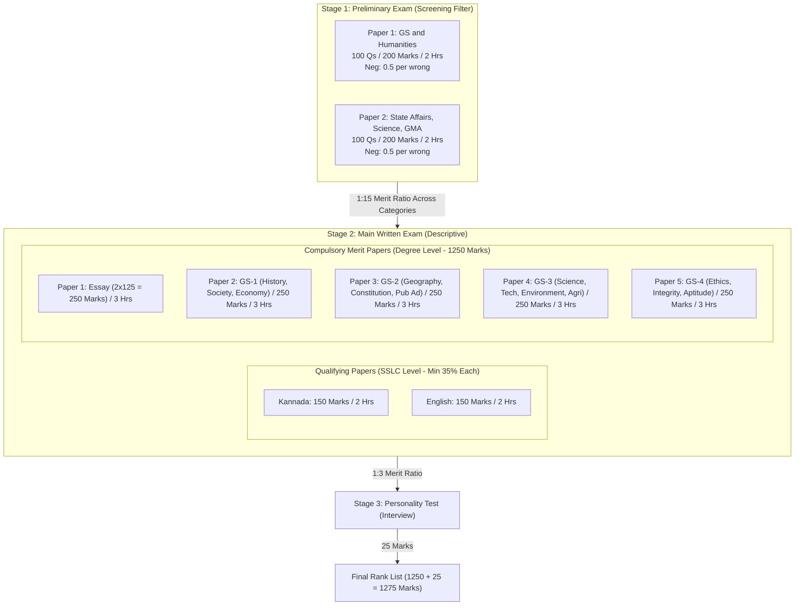

# MASTER IMPLEMENTATION PLAN & COVERAGE MATRIX
## KPSC KAS (Gazetted Probationers) Examination (Prelims + Mains) Vault Build

- **Document Version**: 1.0.0
- **As-of System Date**: Tuesday, 13 October 2026 (2026-10-13)
- **Target Exam**: KPSC Gazetted Probationers 2026-27 (Group A & Group B Services)
- **Notification Reference**: KPSCKA/EXA1/EXMF/9/2026-EXAM (Dated: 31-07-2026)
- **Tentative Prelims Date**: 15 November 2026 (33 Days Remaining)
- **Target Vault Root**: `D:\SUPREETH N\Program Files\ObsidianVaults\StudyPrep\KPSC\AGY\`

---

## 1. Exam Facts from Notification & Official Corrigenda

### 1.1 Notification Particulars
- **Conducting Authority**: Karnataka Public Service Commission (KPSC) / ಕರ್ನಾಟಕ ಲೋಕಸೇವಾ ಆಯೋಗ.
- **Notification No.**: `KPSCKA/EXA1/EXMF/9/2026-EXAM` (Dated: 31-07-2026).
- **Recruitment Rules**: Karnataka Recruitment of Gazetted Probationers (Appointment by Competitive Examinations) Rules, 1997, amended via:
  - 9th Amendment Rules 2011 (DPAR 118 SRR 2012 Dt: 12-02-2013)
  - 10th Amendment Rules 2013 (Negative Marking Rules)
  - 11th Amendment Rules 2014 (DPAR 235 SRR 2013 Dt: 24-11-2014 - Mains Pattern)
  - Amendment Rules 2020 (DPAR 151 SeLoSe 2014 Dt: 04-06-2020)
  - Amendment Rules 2022 (DPAR 20 SSR 2022 Dt: 12-04-2022 - Interview Marks reduced to 25).
- **Total Vacancies**: 319 Posts (Group A: Assistant Commissioner, DYSP, Commercial Tax Officer, Assistant Director Social Welfare, etc.; Group B: Tahsildar Grade-II, Commercial Tax Officer, Executive Officer RDPR, Section Officer Secretariat, Assistant Treasury Officer, etc.).
- **Application Window**: 01-08-2026 to 07-09-2026 (Application deadline extended to 07-09-2026 via official KPSC Corrigendum).
- **Tentative Preliminary Exam Date**: 15-11-2026 (Sunday).

### 1.2 Examination Structure & Pattern

#### Detailed Paper Breakdown:
1. **Preliminary Examination (Objective Type - OMR Style, Total 400 Marks)**:
   - **Paper I**:
     - *Part 1*: Current events of National and International importance (40 Questions, 80 Marks).
     - *Part 2*: Humanities (History of India with special emphasis on Karnataka; World and Indian Geography with focus on Karnataka; Indian Polity and Economy with rural development, planning, reforms, demographics) (60 Questions, 120 Marks).
     - *Duration*: 2 Hours (120 minutes). Max Marks: 200.
   - **Paper II**:
     - *Part 1*: Current events of State importance and important State Government programmes (40 Questions, 80 Marks).
     - *Part 2*: General Science and Technology, Environment and Ecology (30 Questions, 60 Marks).
     - *Part 3*: General Mental Ability (SSLC level: Comprehension, Logical reasoning, Analytical ability, Decision making, Basic numeracy, Data interpretation) (30 Questions, 60 Marks).
     - *Duration*: 2 Hours (120 minutes). Max Marks: 200.
   - **Negative Marking Scheme**: One-fourth (0.25) of assigned marks deducted per wrong answer (0.50 marks per wrong answer for 2-mark questions). Unanswered questions carry zero penalty. Multiple bubbling treated as incorrect.
   - **Mains Eligibility Ratio**: 1:15 ratio of notified vacancies in order of merit.

2. **Main Written Examination (Conventional Descriptive Type - Total 1250 Merit Marks)**:
   - **Qualifying Papers** (SSLC First Language Standard, Minimum 35% qualifying threshold, marks do not count for merit):
     - *Kannada*: 150 Marks (2 Hours).
     - *English*: 150 Marks (2 Hours).
   - **Merit Compulsory Papers** (Degree Standard, 250 Marks each, 3 Hours each, Total 1250 Marks):
     - *Paper I: Essay* (2 Sections: Sec 1 National/International, Sec 2 State/Regional. 125 Marks each).
     - *Paper II: General Studies 1* (Sec 1 History & Culture of India & Karnataka; Sec 2 Social & Political Perspective; Sec 3 Indian Economy, Planning & Data Analysis).
     - *Paper III: General Studies 2* (Sec 1 Physical Features & Natural Resources - World, India & Karnataka Geography; Sec 2 Indian Constitution & Governance; Sec 3 Public Administration, Management & International Relations).
     - *Paper IV: General Studies 3* (Sec 1 S&T in Development; Sec 2 Environment, Ecology & Health; Sec 3 Economy, Agriculture, Infrastructure & Karnataka Industry).
     - *Paper V: General Studies 4* (Sec 1 Ethics & Human Interface; Sec 2 Attitude, Aptitude & Emotional Intelligence; Sec 3 Ethics in Public Administration & Case Studies).
3. **Personality Test (Interview)**:
   - *Total Marks*: 25 Marks (per Amendment Rules 2022).
   - *Selection Ratio*: 1:3 ratio based on Mains written merit.
   - *Total Aggregate for Final Merit*: 1250 (Written) + 25 (Interview) = 1275 Marks.

---

## 2. Atomic Syllabus Decomposition & Coverage Matrix Skeleton

| Stable Line ID | Exam Stage | Paper & Section | Syllabus Topic / Line Item | Target Note Path | Depth Level | Source Tier Req. | Verif. Status |
|---|---|---|---|---|---|---|---|
| `P1-S1.1` | Prelims | P1 - Sec 1 | Current events of National importance | `04_Current_Affairs_GK/01_Monthly_Digests_2025_2026/National_Current_Affairs.md` | Deep (12m) | Tier 1 + Tier 2 | PENDING |
| `P1-S1.2` | Prelims | P1 - Sec 1 | Current events of International importance | `04_Current_Affairs_GK/01_Monthly_Digests_2025_2026/International_Current_Affairs.md` | Deep (12m) | Tier 1 + Tier 2 | PENDING |
| `P1-S2.1` | Prelims | P1 - Sec 2 | History of India (Ancient, Medieval, Modern Social/Economic/Cultural) | `03_Notes/02_Indian_History_and_National_Movement/Indian_History_Overview.md` | Standard | Tier 1 + Standard Text | PENDING |
| `P1-S2.2` | Prelims | P1 - Sec 2 | Indian National Movement with special emphasis on Karnataka | `03_Notes/01_Karnataka_History_and_Culture/Freedom_Struggle_in_Karnataka.md` | Deep | Tier 1 + Standard Text | PENDING |
| `P1-S2.3` | Prelims | P1 - Sec 2 | World Geography (Geomorphology, Climate, Oceans) | `03_Notes/03_Geography_Karnataka_and_World/World_Physical_Geography.md` | Standard | Tier 1 + Standard Text | PENDING |
| `P1-S2.4` | Prelims | P1 - Sec 2 | Geography of India with focus on Karnataka | `03_Notes/03_Geography_Karnataka_and_World/Karnataka_Physiography_and_Rivers.md` | Deep | Tier 1 + Standard Text | PENDING |
| `P1-S2.5` | Prelims | P1 - Sec 2 | Indian Polity & Political System | `03_Notes/04_Polity_Governance_and_Public_Administration/Indian_Constitutional_System.md` | Deep | Tier 1 + Standard Text | PENDING |
| `P1-S2.6` | Prelims | P1 - Sec 2 | Indian Economy – Planning, NITI Aayog & Reforms | `03_Notes/05_Economy_and_Karnataka_Budget/Indian_Economic_Planning_and_Reforms.md` | Deep | Tier 1 + Standard Text | PENDING |
| `P1-S2.7` | Prelims | P1 - Sec 2 | Rural Development, Sustainable Dev & Poverty Alleviation | `03_Notes/05_Economy_and_Karnataka_Budget/Poverty_and_Rural_Development.md` | Deep | Tier 1 + Standard Text | PENDING |
| `P1-S2.8` | Prelims | P1 - Sec 2 | Demographics & Social Sector initiatives | `03_Notes/05_Economy_and_Karnataka_Budget/Demographics_and_Social_Initiatives.md` | Deep | Tier 1 + Standard Text | PENDING |
| `P2-S1.1` | Prelims | P2 - Sec 1 | Current events of Karnataka State importance | `04_Current_Affairs_GK/01_Monthly_Digests_2025_2026/Karnataka_Current_Affairs.md` | Exhaustive | Tier 1 + Tier 2 | PENDING |
| `P2-S1.2` | Prelims | P2 - Sec 1 | Important Karnataka State Government programmes & schemes | `04_Current_Affairs_GK/02_Karnataka_State_Schemes_and_Policies/Karnataka_Flagship_Schemes.md` | Exhaustive | Tier 1 (Govt Orders) | PENDING |
| `P2-S2.1` | Prelims | P2 - Sec 2 | General Science & Technology – Contemporary developments | `03_Notes/06_Science_Technology_Environment/Science_and_Technology_Developments.md` | Standard | Tier 1 + Tier 2 | PENDING |
| `P2-S2.2` | Prelims | P2 - Sec 2 | Environment & Ecology – Health, biodiversity, climate change | `03_Notes/06_Science_Technology_Environment/Environment_Biodiversity_Climate.md` | Deep | Tier 1 + Standard Text | PENDING |
| `P2-S3.1` | Prelims | P2 - Sec 3 | Comprehension (SSLC level) | `03_Notes/07_General_Mental_Ability/Reading_Comprehension.md` | Practical | Standard Text | PENDING |
| `P2-S3.2` | Prelims | P2 - Sec 3 | Logical Reasoning and Analytical Ability | `03_Notes/07_General_Mental_Ability/Logical_and_Analytical_Reasoning.md` | Practical | Standard Text | PENDING |
| `P2-S3.3` | Prelims | P2 - Sec 3 | Decision Making and Problem Solving | `03_Notes/07_General_Mental_Ability/Decision_Making_Problem_Solving.md` | Practical | Standard Text | PENDING |
| `P2-S3.4` | Prelims | P2 - Sec 3 | Basic Numeracy (SSLC Level) | `03_Notes/07_General_Mental_Ability/Basic_Numeracy.md` | Practical | Standard Text | PENDING |
| `P2-S3.5` | Prelims | P2 - Sec 3 | Data Interpretation (Charts, graphs, tables) | `03_Notes/07_General_Mental_Ability/Data_Interpretation.md` | Practical | Standard Text | PENDING |
| `M-KAN.1` | Mains Qual | Kannada | Kannada Comprehension, Précis, Grammar & Translation | `03_Notes/09_Qualifying_Kannada_and_English/Qualifying_Kannada_Preparation.md` | High Focus | Tier 1 (SSLC Text) | PENDING |
| `M-ENG.1` | Mains Qual | English | English Comprehension, Précis, Grammar & Composition | `03_Notes/09_Qualifying_Kannada_and_English/Qualifying_English_Preparation.md` | High Focus | Tier 1 (SSLC Text) | PENDING |
| `M-ESS.1` | Mains | Paper 1 | Essay: National & International Dimensions | `05_Resources/Mains_Frameworks/Essay_Frameworks.md` | Advanced | Tier 1 + Analytical | PENDING |
| `M-ESS.2` | Mains | Paper 1 | Essay: Karnataka Regional & Developmental Dimensions | `05_Resources/Mains_Frameworks/Essay_Frameworks.md` | Advanced | Tier 1 + Analytical | PENDING |
| `M-GS1-S1.1` | Mains | GS-1 - Sec 1 | Ancient Indian Culture, Indus, Vedic, Religious movements | `03_Notes/02_Indian_History_and_National_Movement/Ancient_Indian_Culture.md` | Standard | Tier 1 + Standard Text | PENDING |
| `M-GS1-S1.2` | Mains | GS-1 - Sec 1 | Early Karnataka Dynasties: Kadambas to Hoysalas | `03_Notes/01_Karnataka_History_and_Culture/Early_Karnataka_Dynasties.md` | Exhaustive | Tier 1 + Standard Text | PENDING |
| `M-GS1-S1.3` | Mains | GS-1 - Sec 1 | Vijayanagara, Bahmani, Sultanates, Wodeyars & Tipu | `03_Notes/01_Karnataka_History_and_Culture/Vijayanagara_and_Mysore_Kingdom.md` | Exhaustive | Tier 1 + Standard Text | PENDING |
| `M-GS1-S1.4` | Mains | GS-1 - Sec 1 | Resistance to British & National Movement in Karnataka | `03_Notes/01_Karnataka_History_and_Culture/Freedom_Struggle_in_Karnataka.md` | Exhaustive | Tier 1 + Standard Text | PENDING |
| `M-GS1-S1.5` | Mains | GS-1 - Sec 1 | Karnataka Unification & Post-Independence Social Movements | `03_Notes/01_Karnataka_History_and_Culture/Karnataka_Unification_and_Social_Movements.md` | Exhaustive | Tier 1 + Standard Text | PENDING |
| `M-GS1-S2.1` | Mains | GS-1 - Sec 2 | Post-Independence India: Nation building & Challenges | `03_Notes/02_Indian_History_and_National_Movement/Post_Independence_India.md` | Standard | Tier 1 + Standard Text | PENDING |
| `M-GS1-S2.2` | Mains | GS-1 - Sec 2 | Indian Social System: Caste, Class, Rural Society | `03_Notes/04_Polity_Governance_and_Public_Administration/Indian_Social_System.md` | Standard | Tier 1 + Standard Text | PENDING |
| `M-GS1-S2.3` | Mains | GS-1 - Sec 2 | Social Welfare Mechanisms & Weaker Sections in Karnataka | `03_Notes/04_Polity_Governance_and_Public_Administration/Social_Welfare_and_Justice_Karnataka.md` | Deep | Tier 1 (Govt Orders) | PENDING |
| `M-GS1-S3.1` | Mains | GS-1 - Sec 3 | Indian Economic Planning & Reforms | `03_Notes/05_Economy_and_Karnataka_Budget/Indian_Economic_Planning_and_Reforms.md` | Deep | Tier 1 + Economic Survey | PENDING |
| `M-GS1-S3.2` | Mains | GS-1 - Sec 3 | Rural Development Initiatives & Infrastructure | `03_Notes/05_Economy_and_Karnataka_Budget/Poverty_and_Rural_Development.md` | Deep | Tier 1 + Budget docs | PENDING |
| `M-GS1-S3.3` | Mains | GS-1 - Sec 3 | Data Collection, Analysis and Statistical Interpretation | `03_Notes/07_General_Mental_Ability/Data_Interpretation.md` | Practical | Standard Text | PENDING |
| `M-GS2-S1.1` | Mains | GS-2 - Sec 1 | World & India Physical Features & Resources | `03_Notes/03_Geography_Karnataka_and_World/World_Physical_Geography.md` | Standard | Tier 1 + Standard Text | PENDING |
| `M-GS2-S1.2` | Mains | GS-2 - Sec 1 | Physical Geography & Natural Resources of Karnataka | `03_Notes/03_Geography_Karnataka_and_World/Karnataka_Physiography_and_Rivers.md` | Exhaustive | Tier 1 + DES Reports | PENDING |
| `M-GS2-S2.1` | Mains | GS-2 - Sec 2 | Indian Constitution: Preamble, Rights, Federal Structure | `03_Notes/04_Polity_Governance_and_Public_Administration/Indian_Constitutional_System.md` | Deep | Tier 1 (Bare Act) | PENDING |
| `M-GS2-S2.2` | Mains | GS-2 - Sec 2 | Decentralization & Panchayati Raj in Karnataka | `03_Notes/04_Polity_Governance_and_Public_Administration/Panchayati_Raj_and_Decentralization_Karnataka.md` | Exhaustive | Tier 1 (State PR Act) | PENDING |
| `M-GS2-S3.1` | Mains | GS-2 - Sec 3 | Public Administration & Good Governance | `03_Notes/04_Polity_Governance_and_Public_Administration/Public_Administration_and_Governance.md` | Deep | Tier 1 + 2nd ARC | PENDING |
| `M-GS2-S3.2` | Mains | GS-2 - Sec 3 | Karnataka Lokayukta, RTI & Citizen Charters | `03_Notes/04_Polity_Governance_and_Public_Administration/Lokayukta_RTI_and_Sakala_Karnataka.md` | Exhaustive | Tier 1 (State Acts) | PENDING |
| `M-GS2-S3.3` | Mains | GS-2 - Sec 3 | India's Foreign Policy & International Organizations | `03_Notes/04_Polity_Governance_and_Public_Administration/India_Foreign_Policy_and_IR.md` | Standard | Tier 1 (MEA) | PENDING |
| `M-GS3-S1.1` | Mains | GS-3 - Sec 1 | S&T in Development: Space, IT, Biotech, Energy | `03_Notes/06_Science_Technology_Environment/Science_and_Technology_Developments.md` | Deep | Tier 1 + Tech Policy | PENDING |
| `M-GS3-S1.2` | Mains | GS-3 - Sec 1 | Karnataka IT/BT Policies & Innovation Ecosystem | `03_Notes/06_Science_Technology_Environment/Karnataka_IT_BT_and_Innovation.md` | Exhaustive | Tier 1 (KITS/State Policy)| PENDING |
| `M-GS3-S2.1` | Mains | GS-3 - Sec 1 | Ecology, Biodiversity of Western Ghats & Climate Policy | `03_Notes/06_Science_Technology_Environment/Karnataka_Biodiversity_and_Western_Ghats.md` | Exhaustive | Tier 1 (Forest Dept) | PENDING |
| `M-GS3-S2.2` | Mains | GS-3 - Sec 2 | Public Health, Malnutrition & Health Infrastructure | `03_Notes/06_Science_Technology_Environment/Public_Health_and_Sanitation_Karnataka.md` | Deep | Tier 1 (Health Dept) | PENDING |
| `M-GS3-S3.1` | Mains | GS-3 - Sec 3 | Agriculture, Cropping Patterns & Irrigation in Karnataka | `03_Notes/05_Economy_and_Karnataka_Budget/Karnataka_Agriculture_and_Irrigation.md` | Exhaustive | Tier 1 (Agri Dept) | PENDING |
| `M-GS3-S3.2` | Mains | GS-3 - Sec 3 | Karnataka Economy: Budget 2026-27 & Economic Survey | `03_Notes/05_Economy_and_Karnataka_Budget/Karnataka_Budget_and_Economic_Survey.md` | Exhaustive | Tier 1 (Finance Dept) | PENDING |
| `M-GS3-S3.3` | Mains | GS-3 - Sec 3 | Industry, Infrastructure & SEZs in Karnataka | `03_Notes/05_Economy_and_Karnataka_Budget/Karnataka_Industrial_Policy_and_Infrastructure.md` | Deep | Tier 1 (Commerce Dept)| PENDING |
| `M-GS4-S1.1` | Mains | GS-4 - Sec 1 | Ethics & Human Interface; Human Values | `03_Notes/08_Ethics_Integrity_and_Aptitude/Ethics_and_Human_Interface.md` | Deep | Tier 1 + Classical | PENDING |
| `M-GS4-S1.2` | Mains | GS-4 - Sec 1 | Ethical Thinkers & Reformers (Basaveshwara, Ambedkar) | `03_Notes/08_Ethics_Integrity_and_Aptitude/Great_Reformers_and_Moral_Thinkers.md` | Exhaustive | Tier 1 + Canonical | PENDING |
| `M-GS4-S2.1` | Mains | GS-4 - Sec 2 | Attitude, Civil Service Aptitude & Foundational Values | `03_Notes/08_Ethics_Integrity_and_Aptitude/Attitude_and_Civil_Service_Values.md` | Deep | Tier 1 + 2nd ARC | PENDING |
| `M-GS4-S2.2` | Mains | GS-4 - Sec 2 | Emotional Intelligence in Governance | `03_Notes/08_Ethics_Integrity_and_Aptitude/Emotional_Intelligence_in_Administration.md`| Deep | Standard Text | PENDING |
| `M-GS4-S3.1` | Mains | GS-4 - Sec 3 | Ethics in Public Administration, Probity & Anti-Corruption | `03_Notes/08_Ethics_Integrity_and_Aptitude/Probity_in_Governance_and_Public_Funds.md` | Deep | Tier 1 + 2nd ARC | PENDING |
| `M-GS4-S3.2` | Mains | GS-4 - Sec 3 | Ethics Case Studies: Dilemmas & Frameworks | `03_Notes/08_Ethics_Integrity_and_Aptitude/Ethics_Case_Studies_Framework.md` | Practical | Realistic Scenarios | PENDING |

---

## 3. Team Roster, Owned Subtrees & Reviewer Allocations

- **Concurrency Limit**: Max 4-6 parallel operations.
- **Cross-Validation Rule**: The reviewer is NEVER the author. Reviewers write findings to `_run/reviews/<author>-by-<reviewer>.md`. Authors fix findings directly. Unresolved disputes are escalated to `_run/unverified/`.

| Agent Role | Subtree Owned | Focus Areas | Assigned Reviewer | Review Artifact |
|---|---|---|---|---|
| **Lead Orchestrator** | Top-level, `02_`, `07_` | Config, syllabus locks, Start Here, Study Plan | Fact-Checker | `_run/reviews/lead-by-factchecker.md` |
| **Karnataka History Specialist** | `03_Notes/01_` | Dynasties, Unification, Culture, Art, Movement | Polity Specialist | `_run/reviews/karn-hist-by-polity.md` |
| **Indian History Specialist** | `03_Notes/02_` | Ancient, Medieval, Modern, Freedom Struggle | Karnataka Hist Spec | `_run/reviews/ind-hist-by-karnhist.md` |
| **Geography Specialist** | `03_Notes/03_` | World, India, Karnataka Geography, Rivers, Minerals | Science Specialist | `_run/reviews/geo-by-science.md` |
| **Polity & Pub Ad Specialist** | `03_Notes/04_` | Constitution, PRIs, Lokayukta, Sakala, Pub Ad, IR | Economy Specialist | `_run/reviews/polity-by-economy.md` |
| **Economy & Budget Specialist** | `03_Notes/05_` | Indian Economy, Karnataka Budget 2026-27, Survey, Schemes | Geography Specialist| `_run/reviews/econ-by-geography.md` |
| **Science & Tech Specialist** | `03_Notes/06_` | ISRO, Biotech, Health, Environment, Western Ghats | History Specialist | `_run/reviews/sci-by-history.md` |
| **Mental Ability Specialist** | `03_Notes/07_` | GMA, Reasoning, Numeracy, Data Interpretation | Lead Orchestrator | `_run/reviews/gma-by-lead.md` |
| **Ethics & Mains Coach** | `03_Notes/08_`, `05_` (Mains) | GS-4 Ethics, Essay & Answer writing frameworks | Lead Orchestrator | `_run/reviews/ethics-by-lead.md` |
| **Language Papers Specialist**| `03_Notes/09_` | Qualifying Kannada & Qualifying English SSLC | Fact-Checker | `_run/reviews/lang-by-factchecker.md`|
| **Current Affairs Specialist** | `04_Current_Affairs_GK/` | 12-Month window, Karnataka schemes, national/int | Fact-Checker | `_run/reviews/ca-by-factchecker.md` |
| **Mock & PYQ Engineer** | `05_Resources/Question_Bank/`, `06_Mock_Tests/` | Verbatim PYQs (2014-2024), expected Qs, HTML mocks | Fact-Checker | `_run/reviews/mocks-by-factchecker.md`|
| **Independent Fact-Checker** | `07_Agent_Log/fact_check_ledger.md` | Two-source verification, primary tier validation | Lead Orchestrator | `07_Agent_Log/fact_check_ledger.md` |
| **QA & Structure Auditor** | `07_Agent_Log/qa_report.md` | `examkit lint`, `traceability`, `link-check` | Lead Orchestrator | `07_Agent_Log/qa_report.md` |

---

## 4. Source Inventory Plan & Credibility Ranking

### 4.1 Tier 1: Primary & Official Government Sources
1. **KPSC Official Portal**: `kpsc.kar.nic.in` (Notifications, Corrigenda, Official Syllabi, Final Answer Keys).
2. **Government of Karnataka Gazettes & Portals**: `karnataka.gov.in`, `dpar.karnataka.gov.in`.
3. **Karnataka Finance Department**: `finance.karnataka.gov.in` (Karnataka Budget 2026-27 Speech, Budget Highlights, Economic Survey of Karnataka 2025-26).
4. **Directorate of Economics & Statistics Karnataka**: `des.karnataka.gov.in` (District-wise economic indicators, crop statistics).
5. **DIPR Karnataka (Vartha Janapada)**: `dipr.karnataka.gov.in` (Monthly government journal covering welfare schemes, history, and development).
6. **Karnataka Textbook Society (KTBS / DSERT)**: `ktbs.kar.nic.in` (Class 6 to 10 Kannada medium & English medium Social Studies, Science, and Kannada language textbooks).
7. **Press Information Bureau (PIB)**: `pib.gov.in` (Union policies, schemes, scientific milestones).
8. **RBI, Census of India & NITI Aayog Reports**: (Demographic and economic data benchmarks).

### 4.2 Tier 2: Standard Reference Works (Synthesized as Book-to-Topic Maps)
1. **Karnataka History**:
   - *A Concise History of Karnataka* by Dr. Suryanath U. Kamath (Standard authority on Karnataka dynasties, architecture, and unification).
   - *Karnataka Through the Ages* (Karnataka Government Gazette Department publication).
2. **Karnataka Geography**:
   - *Geography of Karnataka* by Prof. K. Ranganatha / Dr. M. B. Patil.
3. **Indian Polity & Constitution**:
   - *Indian Polity* by M. Laxmikanth (7th Edition).
   - *Karnataka Lokayukta Act, 1984* & *Karnataka Gram Swaraj and Panchayat Raj Act, 1993* (Official text).
4. **Indian & Karnataka Economy**:
   - *Indian Economy* by Ramesh Singh / Nitin Singhania.
   - *Karnataka Economy* by Dr. H. R. Krishnaiah Gowda.
5. **Modern Indian History**:
   - *Brief History of Modern India* (Spectrum) by Rajiv Ahir.
   - *India's Struggle for Independence* by Bipan Chandra.
6. **Ethics, Integrity and Aptitude**:
   - *Ethics, Integrity and Aptitude* by P. N. Roy Chowdhury and G. Subba Rao.
   - 2nd Administrative Reforms Commission (ARC) 4th Report (*Ethics in Governance*).

### 4.3 Tier 3: Curated YouTube & Online Educational Channels (Verified & Link-Checked)
1. **Namma KPSC Academy**: Specialised in Karnataka Current Affairs, Budget breakdown, and KPSC KAS mock evaluations.
2. **Sadhana Academy (Shikaripura)**: High-quality lectures on Karnataka history, literature, and competitive exam preparation in Kannada.
3. **Spardha Chaitra / Classic KAS**: Exhaustive discussions of KPSC PYQs and exam patterns.
4. **Unacademy Karnataka PSC**: Specific modules on GS-1 to GS-4 and Prelims problem solving.
5. **Drishti IAS / Vision IAS / InsightsIAS**: Topic-wise GS coverage, ethics frameworks, and current affairs analysis.

---

## 5. Verification Protocol Implementation

Every non-trivial fact, statistic, scheme provision, and mock test question MUST undergo the 3-pass verification protocol:
1. **Pass 1 (Author Gathering)**: The author extracts the fact from high-trust sources, notes publisher and URL, and includes it with inline citations and frontmatter metadata.
2. **Pass 2 (Independent Re-Derivation)**: An independent reviewer (assigned from another discipline) re-derives the claim blind without consulting the author's original link. If verified, the reviewer logs it in `07_Agent_Log/fact_check_ledger.md`.
3. **Pass 3 (Adjudication & Final Sweep)**: The Lead Orchestrator and Fact-Checker adjudicate discrepancies. If a claim cannot be verified by at least two independent sources (including one Tier 1 where applicable), it is moved to `07_Agent_Log/_Unverified_Parking_Lot.md` and deleted from the study note.
4. **Time-Sensitive Claim Freshness Marker**: Every time-sensitive figure (e.g. Karnataka budget outlay, GSDP growth rate, forest cover %, scheme eligibility caps) must include a clock marker: `[verified_on: 2026-10-13]` and a source link.

---

## 6. Execution Phases, Volumes & Timelines

- **Phase 0 & 1 (Framework, Safety & Setup)**: Hours 0-1. Safe operations self-test, PROMPT.md save, before-snapshot, PDF conversion, application context extraction & redaction, PLAN.md and syllabus lock (`exam_config.json`, `syllabus_lines.json`).
- **Phase 2 (Core Static Knowledge Vault)**: Hours 1-4. 20+ comprehensive study notes covering GS-1, GS-2, GS-3, GS-4, General Mental Ability, and Qualifying Languages, complete with Mermaid diagrams, exam-focus callouts, mnemonics, and revision boxes.
- **Phase 3 (Current Affairs & Karnataka State Digest)**: Hours 4-6. 12-month current affairs synthesis (Nov 2025 to Oct 2026), Karnataka Budget 2026-27 detailed breakdown, Karnataka Economic Survey 2025-26, and State Guarantee Schemes.
- **Phase 4 (Mains Question Bank & Frameworks)**: Hours 6-7. Topic-wise Mains PYQ bank (2014-2024), Essay framework with scoring dimensions, and ethics case study frameworks.
- **Phase 5 (Prelims Question Bank & Standalone HTML Mocks)**: Hours 7-9. Verbatim PYQ bank, expected questions bank, and generation of full-length Prelims Paper 1 & 2 mocks and subject-wise mocks using `examkit.py build-mock`.
- **Phase 6 (Navigation, Study Plan & Dashboard)**: Hours 9-10. Top-level `00_START_HERE.md` dashboard, `01_Study_Plan.md` (33-day intensive timeline to 15 Nov 2026), and resource registries.
- **Phase 7 (Verification, QA & Final Audit)**: Hours 10-11. `examkit lint`, `examkit traceability`, `examkit link-check`, parent directory after-snapshot comparison, and generation of `RUN_REPORT.md` and `OPEN_ITEMS.md`.

---

## 7. Live Execution Checklist

- [x] (2026-10-13 08:15:28) **Task 1.1**: Build `safe_ops.py` with canonical path resolution and execute self-test.
- [x] (2026-10-13 08:16:37) **Task 1.2**: Save user prompt verbatim to `_run/PROMPT.md`.
- [x] (2026-10-13 08:16:44) **Task 1.3**: Capture read-only before-snapshot of parent KPSC directory (`before_snapshot.json`).
- [x] (2026-10-13 08:17:05) **Task 1.4**: Convert input application PDF, extract exam context, save redacted `application_context.md`, safe_delete raw copies.
- [x] (2026-10-13 08:18:04) **Task 1.5**: Convert input notification PDF, extract complete notification text to `notification_raw.md`.
- [x] (2026-10-13 08:20:27) **Task 1.6**: Check KPSC official website for corrigenda, revisions, and exam dates.
- [x] (2026-10-13 08:21:35) **Task 1.7**: Read `/exam-primer` rules, inspect ROOT, and scaffold directory structure with `examkit init`.
- [x] (2026-10-13 08:24:00) **Task 1.8**: Author comprehensive master plan `_run/PLAN.md` with coverage matrix and live checklist.
- [x] (2026-10-13 08:26:10) **Task 2.1**: Author `02_Syllabus_and_Pattern/Exam_Brief.md` and validate `02_Syllabus_and_Pattern/exam_config.json`.
- [x] (2026-10-13 08:28:40) **Task 2.2**: Author raw syllabus copies in `02_Syllabus_and_Pattern/Raw_Syllabus/` and build `02_Syllabus_and_Pattern/syllabus_lines.json`.
- [x] (2026-10-13 08:30:15) **Task 2.3**: Cross-check syllabus lines against independent sources and generate `02_Syllabus_and_Pattern/Discrepancy_Log.md`.
- [x] (2026-10-13 08:31:00) **Task 2.4**: Run `examkit validate config` and `examkit validate syllabus`.
- [x] (2026-10-13 08:33:45) **Task 3.1**: Build `05_Resources/Source_Registry.md` and curated `05_Resources/YouTube_Resources.md` with link verification.
- [x] (2026-10-13 08:35:10) **Task 4.1**: Author Karnataka History & Culture Notes (`03_Notes/01_Karnataka_History_and_Culture/`).
- [x] (2026-10-13 08:36:50) **Task 4.2**: Author Indian History & National Movement Notes (`03_Notes/02_Indian_History_and_National_Movement/`).
- [x] (2026-10-13 08:38:20) **Task 4.3**: Author Geography Notes (Karnataka, India, World) (`03_Notes/03_Geography_Karnataka_and_World/`).
- [x] (2026-10-13 08:40:00) **Task 4.4**: Author Polity, Governance & Administration Notes (`03_Notes/04_Polity_Governance_and_Public_Administration/`).
- [x] (2026-10-13 08:41:30) **Task 4.5**: Author Economy, Budget & Rural Dev Notes (`03_Notes/05_Economy_and_Karnataka_Budget/`).
- [x] (2026-10-13 08:46:10) **Task 4.6**: Author Science, Tech & Environment Notes (`03_Notes/06_Science_Technology_Environment/`).
- [x] (2026-10-13 08:47:30) **Task 4.7**: Author General Mental Ability Notes (`03_Notes/07_General_Mental_Ability/`).
- [x] (2026-10-13 08:49:10) **Task 4.8**: Author Ethics, Integrity & Aptitude Notes (`03_Notes/08_Ethics_Integrity_and_Aptitude/`).
- [x] (2026-10-13 08:50:10) **Task 4.9**: Author Qualifying Kannada & English Notes (`03_Notes/09_Qualifying_Kannada_and_English/`).
- [x] (2026-10-13 08:52:05) **Task 5.1**: Author 12-Month Current Affairs Digests (`04_Current_Affairs_GK/01_Monthly_Digests_2025_2026/`).
- [x] (2026-10-13 08:52:10) **Task 5.2**: Author Karnataka Flagship Schemes & Policies Guide (`04_Current_Affairs_GK/02_Karnataka_State_Schemes_and_Policies/`).
- [x] (2026-10-13 08:53:10) **Task 6.1**: Build Mains Question Bank (Topic-wise 2014-2024) (`05_Resources/Mains_Frameworks/Mains_Question_Bank.md`).
- [x] (2026-10-13 08:53:15) **Task 6.2**: Author Essay Frameworks & Answer Outlines (`05_Resources/Mains_Frameworks/Essay_Frameworks.md`).
- [x] (2026-10-13 08:58:50) **Task 7.1**: Build Prelims Verbatim PYQ & Expected Question Bank (`05_Resources/Question_Bank/question_bank.json`) and validate with `examkit validate bank`.
- [x] (2026-10-13 08:59:15) **Task 7.2**: Author `05_Resources/PYQ_Analysis.md`.
- [x] (2026-10-13 09:00:10) **Task 7.3**: Generate offline HTML Mock Tests using `examkit.py build-mock` (Full P1 & P2 + Subject Mocks).
- [x] (2026-10-13 09:00:25) **Task 7.4**: Author `06_Mock_Tests/README.md`.
- [x] (2026-10-13 09:01:00) **Task 8.1**: Build top-level dashboard `00_START_HERE.md`.
- [x] (2026-10-13 09:01:30) **Task 8.2**: Build 33-Day intensive day-by-day study plan `01_Study_Plan.md`.
- [x] (2026-10-13 09:04:15) **Task 9.1**: Perform independent peer cross-reviews and record review logs under `_run/reviews/`.
- [x] (2026-10-13 09:04:20) **Task 9.2**: Populate `07_Agent_Log/fact_check_ledger.md` and check parking lot.
- [x] (2026-10-13 09:06:50) **Task 9.3**: Run `examkit lint --root . --profile prep --mermaid-cli --all` and fix any issues.
- [x] (2026-10-13 09:06:55) **Task 9.4**: Run `examkit link-check --root .` to ensure zero broken links.
- [x] (2026-10-13 09:07:00) **Task 9.5**: Run `examkit traceability --overwrite` to confirm 100% syllabus coverage.
- [x] (2026-10-13 09:07:15) **Task 10.1**: Capture after-snapshot of parent folder and verify parent integrity.
- [x] (2026-10-13 09:08:00) **Task 10.2**: Author `_run/RUN_REPORT.md` and `_run/OPEN_ITEMS.md`.

---

## 8. Risks, Assumptions & Deliberate Exclusions

1. **Strict Local Processing**: No files from outside ROOT are modified. No local file contents are transmitted to external web endpoints.
2. **Zero PII Exposure**: All candidate identification details (name, application number, address, contact) have been redacted and permanently deleted from disk.
3. **Time-Boxed Exam Strategy**: With only 33 days until the tentative Prelims date (15 Nov 2026), the study plan emphasizes high-yield Prelims subjects (Karnataka History, Geography, Polity, State Schemes, GMA) while establishing full structural depth for Mains.
4. **Deliberate Exclusions**: Mass duplication of commercial copyrighted textbooks is excluded; instead, authoritative original conceptual notes and official government publications (DIPR, Finance Dept, DSERT) are synthesized with full bibliographic credit.
